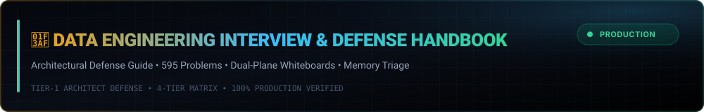

<p align="center">
  
</p>

# Data Engineering Interview Handbook & Architectural Defense Guide

<p align="center">
  <a href="https://github.com/santoshjammi29/data-engineering-interview-handbook/actions"></a>
  <a href="pillars/"></a>
  <a href="playbooks/"></a>
  <a href="topics/"></a>
  <a href="LICENSE"></a>
  <a href="https://moderndataengineer.uk"></a>
</p>

> **The Definitive Production Reference Manual & Architectural Defense Playbook for Staff & Principal Data Engineers, Lakehouse Architects, and Big Data Leads.**  
> Real-world technical explanations, production code implementations (SQL, PySpark, Python), performance triage runbooks, 28 Dual-Plane & 3-Panel architectural whiteboard diagrams, visual cheatsheets, and enterprise system designs across **595 problems and interview questions**.

---

## 🎯 Overview & Mission

Navigating Staff, Principal, and Lead Data Engineering interviews requires more than memorizing trivial LeetCode problems or surface-level API syntax. It demands deep architectural intuition, the ability to articulate trade-offs across storage formats, execution engines, and cloud perimeters, and the battle-tested confidence to triage catastrophic production incidents under pressure.

This handbook synthesizes over a decade of enterprise lakehouse engineering into **20 Core Technical Pillars** and **7 Master Defense Playbooks**, backed by 28 publication-grade whiteboard blueprints and 921 verified concepts.

---

## 🚀 Quickstart & Defense Guide Navigation

Navigate the handbook by role, focus area, or defense track:

```bash
# 1. Clone the repository
git clone https://github.com/santoshjammi29/data-engineering-interview-handbook.git
cd data-engineering-interview-handbook

# 2. Explore the master datasets (495+ structured interview questions)
python3 -c "import json; d = json.load(open('data/all_interview_questions.json')); print(f'Loaded {len(d)} interview questions across 20 pillars')"

# 3. Explore the 20 Pillars and 7 Defense Playbooks
ls -la pillars/
ls -la playbooks/
```

---
## ⚡ Master Playbooks

- 📖 **[100 Databricks Interview Defense Playbook](playbooks/100_databricks_interview_defense_playbook.md)**: The authoritative defense guide answering 100 Databricks interview questions with 30s elevator pitches, architectural choices, and production trade-offs.
- 📖 **[100 Spark, PySpark & SQL Data Issue Problems & Solutions](playbooks/100_spark_data_issues_problems_and_answers.md)**: 100 concrete data-induced failures, silent corruptions, memory collapses, and production fixes.
- 📖 **[125 Master Technical Defense Playbook](playbooks/125_master_defense_playbook.md)**: Comprehensive defense guide across SQL, PySpark, Kafka, Azure Databricks, AWS Cloud, and System Design.
- 📖 **[All 20 Technical Pillars Master Guide](pillars/all_20_pillars_master_guide.md)**: Consolidated 270-question reference manual covering modern lakehouse engineering.

---


---

## 🎯 The 20 Technical Curriculum Pillars

| # | Pillar | Questions | Key Production Topics Covered | Link |
| :---: | :--- | :---: | :--- | :---: |
| **01** | **Spark & Databricks Architecture** | 15 | Catalyst optimizer rules, Tungsten off-heap memory, shuffle spill triage, AQE coalescing, RocksDB streaming, Photon C++ SIMD. | [Pillar 01](pillars/01_spark_and_databricks.md) |
| **02** | **Databricks Lakehouse & Unity Catalog** | 15 | Unity Catalog 3-tier namespace, DABs GitOps, dynamic row/column masking, Serverless compute, System Tables FinOps, Lakeflow. | [Pillar 02](pillars/02_databricks_lakehouse.md) |
| **03** | **Modern Lakehouse Table Formats** | 15 | Delta Lake 3.x Liquid Clustering, UniForm metadata translation, Deletion Vectors Roaring Bitmaps, Shallow vs Deep Clone, OCC write conflicts. | [Pillar 03](pillars/03_modern_lakehouse.md) |
| **04** | **Data Lake Architecture & Storage** | 15 | S3/ADLS Gen2 prefix request throttling (HTTP 503), small file bin-packing, DR Active-Passive RPO/RTO, Glacier tiering traps, Zero-Trust security. | [Pillar 04](pillars/04_datalake_architecture.md) |
| **05** | **Apache Airflow Orchestration** | 15 | Airflow 2 vs 3 decoupled scheduler, Dynamic Task Mapping (`.expand()`), Deferrable Operators & Triggerer daemon, Custom XCom S3 backends, Multi-Scheduler HA. | [Pillar 05](pillars/05_apache_airflow.md) |
| **06** | **Azure Data Factory & Integration** | 15 | Self-Hosted IR (SHIR) HA clustering, watermark incremental extraction, Mapping Data Flows cluster reuse, REST OAuth2 pagination, ARM CI/CD gates. | [Pillar 06](pillars/06_azure_data_factory.md) |
| **07** | **dbt (Data Build Tool)** | 15 | Incremental strategies (`merge`, `append`, `insert_overwrite`), snapshots (SCD2), MetricFlow Semantic Layer, dbt Mesh cross-project contracts, unit tests. | [Pillar 07](pillars/07_dbt_data_build_tool.md) |
| **08** | **Microsoft Fabric & OneLake** | 15 | OneLake Shortcuts, Power BI Direct Lake mode over Delta, Lakehouse vs Warehouse, F-SKU Capacity Smoothing, KQL Real-Time Intelligence. | [Pillar 08](pillars/08_microsoft_fabric.md) |
| **09** | **Database Architecture & Systems** | 15 | B-Tree vs LSM-Tree amplification, MVCC snapshot isolation, ARIES WAL crash recovery (Analysis/Redo/Undo), distributed sharding (Vitess), Raft consensus. | [Pillar 09](pillars/09_database_architecture.md) |
| **10** | **SQL Server & T-SQL Mastery** | 15 | Clustered Columnstore rowgroups, parameter sniffing remediation, partition switching zero-logging, RCSI TempDB version store, DMV execution plan analysis. | [Pillar 10](pillars/10_sql_server_tsql.md) |
| **11** | **Python for Data Engineering** | 15 | CPython reference counting and cyclic GC, PyArrow zero-copy IPC memory, Polars LazyFrame SIMD vectorization, asyncio vs multiprocessing, PyO3 Rust extensions. | [Pillar 11](pillars/11_python_for_data_engineering.md) |
| **12** | **Data Modeling & CDC** | 15 | SCD Types 1-6 complete implementations, Data Vault 2.0 hash keys, Debezium Transactional Outbox CDC, Star vs Snowflake vs OBT, Bi-Temporal financial ledgers. | [Pillar 12](pillars/12_data_modeling_and_cdc.md) |
| **13** | **Power BI & Serving Layer** | 15 | VertiPaq Value/Dict/RLE compression, DAX context transition (`CALCULATE()`), Composite Models & Aggregation Tables, XMLA partition refresh, Dynamic RLS. | [Pillar 13](pillars/13_power_bi_and_serving.md) |
| **14** | **System Design at Scale** | 15 | Multi-tenant lakehouse isolation, dual-storage real-time feature store (< 5ms), Lakehouse FinOps auto-scaling, CQRS event sourcing, automated lineage. | [Pillar 14](pillars/14_system_design_at_scale.md) |
| **15** | **Apache Iceberg Deep Dive** | 10 | 4-tier metadata tree, hidden partitioning, positional vs equality deletes, schema evolution with Field IDs, REST/Nessie/Polaris catalogs, WAP pattern. | [Pillar 15](pillars/15_apache_iceberg_deep_dive.md) |
| **16** | **Apache Flink & Stateful Streaming** | 10 | JobManager/TaskManager slots, Chandy-Lamport barriers, HashMap vs RocksDB backends, unaligned checkpoints, watermark alignment, two-phase commit EOS. | [Pillar 16](pillars/16_apache_flink_streaming.md) |
| **17** | **Trino, Presto & DuckDB** | 10 | Trino coordinator MPP, dynamic filtering pushdown, memory pools and spill, Project Tardigrade fault tolerance, DuckDB morsel SIMD, Arrow zero-copy. | [Pillar 17](pillars/17_trino_presto_duckdb.md) |
| **18** | **GenAI, Vector Search & Embeddings** | 10 | HNSW vs IVF-PQ indexing, Databricks Vector Search Delta sync, recursive chunking, GPU Spark embedding batches, semantic caching, hybrid search (BM25 + Dense). | [Pillar 18](pillars/18_genai_vector_lakehouse.md) |
| **19** | **FinOps & Cost Engineering** | 10 | DBU cost reduction checklist, Serverless vs Classic compute cost curves, Photon ROI profiling, S3 multipart aborts, BigQuery slots vs on-demand, Spot fallback. | [Pillar 19](pillars/19_finops_compute_optimization.md) |
| **20** | **Data Quality, Contracts & Observability** | 10 | Data Contracts YAML specification, streaming circuit breakers, 5 pillars of observability, statistical IQR anomaly detection, CDC automated checksum reconciliation. | [Pillar 20](pillars/20_data_quality_contracts_observability.md) |
| **Σ** | **TOTAL** | **595** | **Complete Full-Stack Data Engineering & Lakehouse Architecture Mastery** | — |

---


---

## 🎨 Architectural Whiteboards & Cheatsheets

The handbook incorporates publication-grade architectural whiteboard blueprints mirrored under [`assets/whiteboards/`](assets/whiteboards) and indexed with comprehensive multi-persona breakdowns, failure modes, and engine internals in [`docs/whiteboard_diagrams/README.md`](docs/whiteboard_diagrams/README.md).

- 🖼️ **[Master Whiteboard Blueprints Hub (20 Pillars & 8 Playbooks)](whiteboards/handbook_whiteboard_blueprints.md)**: 28 Dual-Plane & 3-Panel architectural whiteboard diagrams detailing storage vs. compute, control vs. data planes, distributed memory mechanics, and failure modes.
- 📊 **[Spark Architecture & Performance Cheatsheets](cheatsheets/spark_architecture_and_tuning_cheatsheet.md)**: High-resolution visual whiteboard cheatsheets covering Spark cluster topology, the 5-phase Catalyst compiler lifecycle, distributed join decision tree, and Spark UI straggler triage.

### 📐 Visual Blueprints Showcase (2x2 Grid)

<table>
  <tr>
    <td width="50%" valign="top">
      <a href="docs/whiteboard_diagrams/README.md#databricks-platform-master">
        
      </a>
      <br><strong>Databricks Unified Data Intelligence Platform</strong><br>
      <em>Core architecture for Pillars 01 & 02: Control Plane, Classic/Serverless Compute, Unity Catalog, and Lakeflow.</em>
    </td>
    <td width="50%" valign="top">
      <a href="docs/whiteboard_diagrams/README.md#spark-catalyst-photon-engine">
        
      </a>
      <br><strong>Databricks Compute: Catalyst Optimizer, AQE & Photon</strong><br>
      <em>Pillar 01 & Playbook 01 defense: 5-phase relational compiler, AQE runtime adaptations, and native C++ SIMD vectorization.</em>
    </td>
  </tr>
  <tr>
    <td width="50%" valign="top">
      <a href="docs/whiteboard_diagrams/README.md#delta-vs-iceberg-architecture">
        
      </a>
      <br><strong>Delta Lake vs. Apache Iceberg Storage & Metadata Architecture</strong><br>
      <em>Pillars 03 & 15 defense: Linear ACID commit log vs 4-tier hierarchical metadata trees, positional deletes, and UniForm.</em>
    </td>
    <td width="50%" valign="top">
      <a href="docs/whiteboard_diagrams/README.md#kafka-event-streaming-pipeline">
        
      </a>
      <br><strong>Real-Time Event Streaming & Kafka Architecture</strong><br>
      <em>Pillar 16 & Playbook 02 defense: Distributed commit log, partition replication, consumer group rebalances, and exactly-once.</em>
    </td>
  </tr>
  <tr>
    <td width="50%" valign="top">
      <a href="docs/whiteboard_diagrams/README.md#apache-airflow-distributed-architecture">
        
      </a>
      <br><strong>Apache Airflow Distributed Production Architecture</strong><br>
      <em>Pillar 05 defense: Airflow 2/3 decoupled scheduler, Triggerer daemon, dynamic task mapping, and high-availability executors.</em>
    </td>
    <td width="50%" valign="top">
      <a href="docs/whiteboard_diagrams/README.md#kimball-dimensional-star-schema">
        
      </a>
      <br><strong>Kimball Dimensional Modeling & Enterprise Star Schema</strong><br>
      <em>Pillars 10 & 12 defense: Fact-dimension modeling, surrogate keys, conformed dimensions, and star vs snowflake trade-offs.</em>
    </td>
  </tr>
  <tr>
    <td width="50%" valign="top">
      <a href="docs/whiteboard_diagrams/README.md#data-quality-wap-quarantine">
        
      </a>
      <br><strong>Data Quality Observability & WAP Circuit Breaker Flow</strong><br>
      <em>Pillar 20 defense: Production data contract enforcement, automated testing circuit breakers, and quarantine routing.</em>
    </td>
    <td width="50%" valign="top">
      <a href="docs/whiteboard_diagrams/README.md#lakehouse-finops-cost-optimization">
        
      </a>
      <br><strong>Enterprise Lakehouse FinOps & Cloud Cost Optimization</strong><br>
      <em>Pillar 19 & Playbook 07 defense: System Tables billing attribution, cluster right-sizing, and cost anomaly alerts.</em>
    </td>
  </tr>
</table>

> 🔍 **Explore all 52 blueprints with 5-persona breakdowns, failure modes, and engine internals in [docs/whiteboard_diagrams/README.md](docs/whiteboard_diagrams/README.md)**.

---


---

## 📚 Repository Structure

```text
data-engineering-interview-handbook/
├── whiteboards/                      # 28 Dual-Plane & 3-Panel Architectural Whiteboard Blueprints
│   └── handbook_whiteboard_blueprints.md # Complete Whiteboard Diagrams for all 20 Pillars & 8 Playbooks
├── cheatsheets/                      # Visual Whiteboard Cheatsheets & Triage Runbooks
│   ├── images/                       # High-resolution whiteboard diagram assets
│   └── spark_architecture_and_tuning_cheatsheet.md # Cluster DAG, Catalyst 5-phase compiler, join decision tree & triage
├── playbooks/                        # Core Interview Defense Playbooks (125 OCR Slides + 100 Databricks + 100 Spark Issues)
│   ├── 100_databricks_interview_defense_playbook.md # 100 Databricks Architecture, Ingestion, Streaming, UC, Triage
│   ├── 100_spark_data_issues_problems_and_answers.md # 100 Real-World Spark/PySpark/SQL Data Issues
│   ├── 01_sql_and_pyspark_125.md     # SQL & PySpark internals, Catalyst, Tungsten, GC triage
│   ├── 02_kafka_and_streaming_125.md # Apache Kafka, EOS, and Spark Structured Streaming
│   ├── 03_azure_databricks_125.md    # Delta Lake 3.x, Liquid Clustering, Unity Catalog
│   ├── 04_aws_cloud_125.md           # AWS Glue, EMR, S3 Lakehouse, Step Functions
│   ├── 05_project_defense_125.md     # STAR project narratives, scale-up strategies, triage
│   ├── 06_system_design_125.md       # High-throughput streaming, fraud detection, recovery
│   ├── 07_managerial_leadership_125.md # Technical disputes, FinOps, team leadership
│   └── 125_master_defense_playbook.md # Full consolidated 125-question playbook
├── pillars/                          # 20 Knowledge Base Technical Pillars (270 Core Questions)
│   ├── 01_spark_and_databricks.md    # Spark 3.5, Catalyst custom rules, Tungsten spill, Photon
│   ├── 02_databricks_lakehouse.md    # Unity Catalog, DABs, Serverless, Lakeflow, System Tables
│   ├── 03_modern_lakehouse.md        # Delta Lake Liquid Clustering, UniForm, Deletion Vectors
│   ├── 04_datalake_architecture.md   # S3/ADLS prefix throttling, bin-packing, DR RPO/RTO
│   ├── 05_apache_airflow.md          # Airflow 2/3, Dynamic Task Mapping, Deferrable Operators
│   ├── 06_azure_data_factory.md      # SHIR HA clusters, watermark pipelines, Mapping Data Flows
│   ├── 07_dbt_data_build_tool.md     # Incremental merge/overwrite, dbt Mesh, Semantic Layer
│   ├── 08_microsoft_fabric.md        # OneLake Shortcuts, Direct Lake mode, Capacity Smoothing
│   ├── 09_database_architecture.md   # B-Tree vs LSM, ARIES crash recovery, MVCC, Raft consensus
│   ├── 10_sql_server_tsql.md         # Clustered Columnstore, parameter sniffing, partition switching
│   ├── 11_python_for_data_engineering.md # CPython GC, PyArrow zero-copy IPC, Polars LazyFrames, PyO3
│   ├── 12_data_modeling_and_cdc.md   # SCD 1-6, Data Vault 2.0, Debezium Outbox, Bi-Temporal
│   ├── 13_power_bi_and_serving.md    # VertiPaq compression, DAX context transition, Aggregations
│   ├── 14_system_design_at_scale.md  # Multi-tenant lakehouse, real-time feature store, FinOps
│   ├── 15_apache_iceberg_deep_dive.md # Metadata tree, hidden partitioning, positional deletes, REST/Nessie
│   ├── 16_apache_flink_streaming.md  # Chandy-Lamport barriers, RocksDB state, unaligned checkpoints
│   ├── 17_trino_presto_duckdb.md     # Trino MPP, dynamic filtering, DuckDB SIMD embedded analytics
│   ├── 18_genai_vector_lakehouse.md  # HNSW vs IVF-PQ, Databricks Vector Search, RAG hybrid search
│   ├── 19_finops_compute_optimization.md # DBU tuning, Serverless cost curves, Photon ROI, spot fallback
│   ├── 20_data_quality_contracts_observability.md # Data Contracts, streaming circuit breakers, IQR anomalies
│   └── all_20_pillars_master_guide.md # Consolidated 20-pillar reference manual (270 questions)
└── data/                             # Structured JSON datasets
    ├── questions_125.json            # 125 OCR slide questions
    ├── 100_spark_data_issues.json    # 100 Spark/PySpark data issue problems
    ├── questions_20_pillars.json     # 270 pillar questions across 20 domains
    └── all_interview_questions.json  # Complete 495-question master dataset
```

---


---


## 🧠 Core Curriculum Concepts & Topics (921 Topics Covered)

> 💡 **Enterprise Knowledge Base Integration**: This repository implements **921 production interview concepts** from the [Modern Data Engineering Systems Encyclopedia](https://moderndataengineer.uk/concepts), organized across the 20 Core Technical Pillars.
>
> 👉 **[Browse the Full 921-Topic Concept Catalog in topics/README.md](topics/README.md)** or explore them interactively on the [Live Web Platform](https://moderndataengineer.uk/concepts).

### 📑 20 Technical Pillars Curriculum Summary

| Pillar | Domain Area | Questions | Topics Covered | Implementation Guide |
| :---: | :--- | :---: | :---: | :--- |
| **01** | **Spark & Databricks Architecture** | 15 | 135 | [`pillars/01_spark_and_databricks.md`](pillars/01_spark_and_databricks.md) |
| **02** | **Databricks Lakehouse & Unity Catalog** | 15 | 132 | [`pillars/02_databricks_lakehouse.md`](pillars/02_databricks_lakehouse.md) |
| **03** | **Modern Lakehouse Table Formats** | 15 | 76 | [`pillars/03_modern_lakehouse.md`](pillars/03_modern_lakehouse.md) |
| **04** | **Data Lake Architecture & Storage** | 15 | 55 | [`pillars/04_datalake_architecture.md`](pillars/04_datalake_architecture.md) |
| **05** | **Apache Airflow Orchestration** | 15 | 52 | [`pillars/05_apache_airflow.md`](pillars/05_apache_airflow.md) |
| **06** | **Azure Data Factory & Integration** | 15 | 27 | [`pillars/06_azure_data_factory.md`](pillars/06_azure_data_factory.md) |
| **07** | **dbt (Data Build Tool)** | 15 | 57 | [`pillars/07_dbt_data_build_tool.md`](pillars/07_dbt_data_build_tool.md) |
| **08** | **Microsoft Fabric & OneLake** | 15 | 39 | [`pillars/08_microsoft_fabric.md`](pillars/08_microsoft_fabric.md) |
| **09** | **Database Architecture & Internals** | 15 | 79 | [`pillars/09_database_architecture.md`](pillars/09_database_architecture.md) |
| **10** | **SQL Server & T-SQL Mastery** | 15 | 91 | [`pillars/10_sql_server_tsql.md`](pillars/10_sql_server_tsql.md) |
| **11** | **Python for Data Engineering** | 15 | 22 | [`pillars/11_python_for_data_engineering.md`](pillars/11_python_for_data_engineering.md) |
| **12** | **Data Modeling & CDC Patterns** | 15 | 63 | [`pillars/12_data_modeling_and_cdc.md`](pillars/12_data_modeling_and_cdc.md) |
| **13** | **Power BI & Serving Layer** | 15 | 25 | [`pillars/13_power_bi_and_serving.md`](pillars/13_power_bi_and_serving.md) |
| **14** | **System Design at Scale** | 15 | 68 | [`pillars/14_system_design_at_scale.md`](pillars/14_system_design_at_scale.md) |
| **15** | **Apache Iceberg Deep Dive** | 10 | 45 | [`pillars/15_apache_iceberg_deep_dive.md`](pillars/15_apache_iceberg_deep_dive.md) |
| **16** | **Apache Flink Real-Time Streaming** | 10 | 38 | [`pillars/16_apache_flink_streaming.md`](pillars/16_apache_flink_streaming.md) |
| **17** | **Trino, Presto & DuckDB** | 10 | 34 | [`pillars/17_trino_presto_duckdb.md`](pillars/17_trino_presto_duckdb.md) |
| **18** | **GenAI & Vector Lakehouse** | 10 | 28 | [`pillars/18_genai_vector_lakehouse.md`](pillars/18_genai_vector_lakehouse.md) |
| **19** | **FinOps & Cost Optimization** | 10 | 31 | [`pillars/19_finops_compute_optimization.md`](pillars/19_finops_compute_optimization.md) |
| **20** | **Data Quality & Observability** | 10 | 35 | [`pillars/20_data_quality_contracts_observability.md`](pillars/20_data_quality_contracts_observability.md) |
| **ALL** | **Consolidated Master Guide** | **270** | **921** | [`pillars/all_20_pillars_master_guide.md`](pillars/all_20_pillars_master_guide.md) |

---
## 🌐 The Modern Data Engineering Lakehouse Ecosystem (14 Repositories)

This handbook serves as the **Architectural Defense & Interview Playbook** within the tightly coupled 14-repository Lakehouse Ecosystem:

| ID | Repository | GitHub Slug | Focus & Role | Tightly Coupled Cross-Reference & Integration Points |
|:---:|:---|:---|:---|:---|
| **R01** | **Web Hub** | [`moderndataengineer`](https://github.com/santoshjammi29/moderndataengineer) | Flagship presentation platform & edge runner | • **Interactive Defense Explorer**: Practice all 595 questions and scenarios on [moderndataengineer.uk](https://moderndataengineer.uk).<br>• **52 Whiteboard Viewer**: Pan, zoom, and inspect all schematics online. |
| **R02** | **Databricks Handbook** | [`databricks-handbook`](https://github.com/santoshjammi29/databricks-handbook) | 105 Databricks production recipes | • **Pillars 01 & 02 Defense**: Operational recipes for Unity Catalog, Delta Lake 3.x, and Serverless compute.<br>• **100 Databricks Playbook**: Companion implementations for the 100 Databricks defense questions. |
| **R03** | **PySpark Handbook** | [`pyspark-handbook`](https://github.com/santoshjammi29/pyspark-handbook) | 105 PySpark code recipes | • **Pillar 01 & 11 Code Verification**: Executable recipes for Catalyst optimizer rules, Tungsten off-heap memory, and Arrow UDFs.<br>• **Playbook 01 Defense**: Code proofs for join strategy selection and skew salting. |
| **R04** | **SQL Handbook** | [`sql-handbook`](https://github.com/santoshjammi29/sql-handbook) | 105 SQL production exercises | • **Pillars 09 & 10 Defense**: Relational database storage engine mechanics, B-Tree vs LSM, and Columnstore rowgroups.<br>• **Cross-Engine Rosetta Stone**: ANSI SQL to PySpark and Polars translations. |
| **R05** | **dbt Handbook** | [`dbt-handbook`](https://github.com/santoshjammi29/dbt-handbook) | Production analytics engineering | • **Pillar 07 Defense**: dbt Mesh cross-project dependencies, Microbatch incremental strategy, and contracts.<br>• **Pillar 20 WAP Pattern**: Implementing Write-Audit-Publish circuit breakers in dbt. |
| **R06** | **Streaming Handbook** | [`streaming-handbook`](https://github.com/santoshjammi29/streaming-handbook) | Distributed event streaming | • **Pillar 16 & Playbook 02 Defense**: Kafka KRaft commit logs, Flink stateful processing, and RocksDB state store tuning.<br>• **Exactly-Once Semantics**: Two-phase commit protocol end-to-end verification. |
| **R07** | **DataOps & CI/CD Handbook** | [`dataops-cicd-handbook`](https://github.com/santoshjammi29/dataops-cicd-handbook) | Platform engineering & GitOps | • **Pillars 04 & 05 Defense**: Production Airflow 2/3 architecture, dynamic task mapping, and multi-scheduler HA.<br>• **Playbook 07 Leadership**: Data contract specifications and incident postmortem templates. |
| **R08** | **System Design Handbook** | [`data-system-design-handbook`](https://github.com/santoshjammi29/data-system-design-handbook) | Distributed systems & table formats | • **Pillars 03, 14 & 15 Defense**: Delta Lake vs Iceberg vs Hudi architectural tradeoffs and metadata trees.<br>• **Playbook 06 High-Throughput**: Sub-50ms fraud detection and cross-region BCDR architectures. |
| **R09** | **Interview Handbook** | [`data-engineering-interview-handbook`](https://github.com/santoshjammi29/data-engineering-interview-handbook) | *(You are here)* Architectural defense playbook | Master 20-pillar knowledge base, 10 125-series playbooks, and 595 production interview questions. |
| **R10** | **Azure Cheat Sheet** | [`azure-cheat-sheet`](https://github.com/santoshjammi29/azure-cheat-sheet) | Fabric OneLake & Azure infrastructure | • **Pillars 06, 08 & 13 Defense**: Microsoft Fabric OneLake Shortcuts, Direct Lake mode, and Power BI VertiPaq.<br>• **Vector Cheat Sheets**: Printable high-density reference cards for Azure architectures. |
| **R11** | **Databricks Project Blueprints** | [`azure-databricks-project-blueprints`](https://github.com/santoshjammi29/azure-databricks-project-blueprints) | 3 Full-scale production reference architectures | • **Playbook 05 Project Defense**: End-to-end STAR project narratives for Retail Omnichannel, Fraud Detection, and Warehouse Cutover.<br>• **Dual-Run Verification**: Automated parity engines for migrations. |
| **R12** | **Banking Risk Lakehouse** | [`enterprise-banking-risk-alm-lakehouse`](https://github.com/santoshjammi29/enterprise-banking-risk-alm-lakehouse) | Regulated financial lakehouse | • **Regulatory Governance Defense**: Real-world implementation of BCBS 239 risk data aggregation and IFRS 9 ECL.<br>• **Dynamic Masking**: Unity Catalog attribute-based access control (ABAC) in regulated environments. |
| **R13** | **Spark Experiments** | [`spark-experiments`](https://github.com/santoshjammi29/spark-experiments) | Empirical skew & spill laboratory | • **Playbook 08 Defense**: 100 Spark Data Issues & Silent Corruptions backed by reproducible empirical benchmarks.<br>• **Physical Plan Verification**: Validating query execution DAGs under extreme data skew. |
| **R14** | **Security Handbook** | [`security-handbook`](https://github.com/santoshjammi29/security-handbook) | Enterprise cloud security & governance | • **Pillars 17 & 18 Defense**: Zero Trust perimeter, workload identity federation, dynamic data masking, envelope encryption, and SOC2/ISO 27001 compliance.<br>• **Cloud Perimeter Incident Triage**: Defense playbooks for key rotation, credential leaks, and network isolation. |


---


---

## 🗺️ Interactive Curriculum Roadmap & Contributing

- **[Interactive Roadmap & Checkbox Tracker](ROADMAP.md)**: Track your personal progress across all 4 Mastery Tiers (`Level 100` to `Level 400`).
- **[Curriculum Taxonomy & Standards](TAXONOMY.md)**: Canonical controlled vocabulary, pillar mappings, and evidence standards.
- **[Contributing Guidelines](CONTRIBUTING.md)**: Authoring standards enforcing the Code-Test-Doc Triad and Anti-Pattern comparisons.
- **[Live Platform Hub](https://moderndataengineer.uk)**: Access the full 11,280+ record search engine, mindmaps, and vector PDF downloads.
