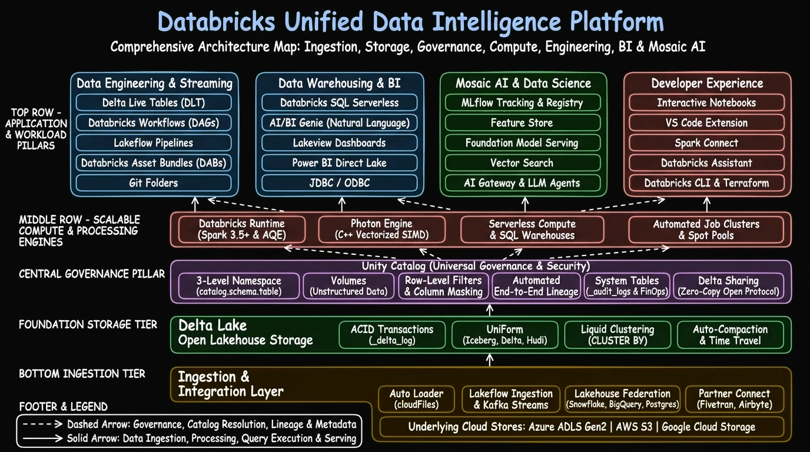
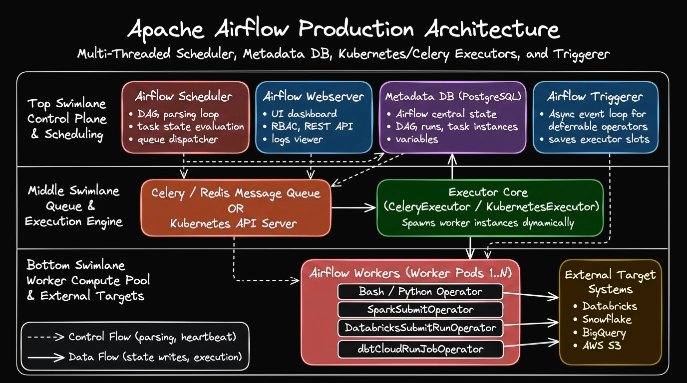
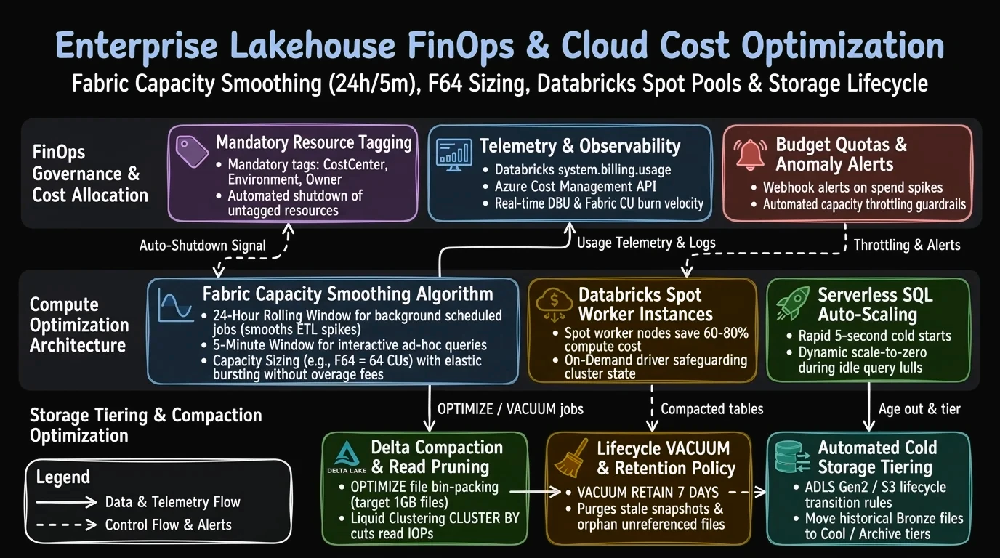

# Data Engineering Interview Handbook & Architectural Defense Guide

A comprehensive, production-tested reference manual and interview defense playbook for Data Engineers, Lakehouse Architects, and Big Data Leads. 

This repository provides original technical explanations, production code implementations (SQL, PySpark, Python), performance triage runbooks, 28 Dual-Plane & 3-Panel architectural whiteboard diagrams, visual cheatsheets, and enterprise system designs across **595 problems and interview questions**.

---

## 📚 Repository Structure

```text
data-engineering-interview-handbook/
├── whiteboards/                      # 28 Dual-Plane & 3-Panel Architectural Whiteboard Blueprints
│   └── handbook_whiteboard_blueprints.md # Complete Whiteboard Diagrams for all 20 Pillars & 8 Playbooks
├── cheatsheets/                      # Visual Whiteboard Cheatsheets & Triage Runbooks
│   ├── images/                       # High-resolution whiteboard diagram assets
│   └── spark_architecture_and_tuning_cheatsheet.md # Cluster DAG, Catalyst 5-phase compiler, join decision tree & triage
├── playbooks/                        # Core Interview Defense Playbooks (125 OCR Slides + 100 Databricks + 100 Spark Issues)
│   ├── 100_databricks_interview_defense_playbook.md # 100 Databricks Architecture, Ingestion, Streaming, UC, Triage
│   ├── 100_spark_data_issues_problems_and_answers.md # 100 Real-World Spark/PySpark/SQL Data Issues
│   ├── 01_sql_and_pyspark_125.md     # SQL & PySpark internals, Catalyst, Tungsten, GC triage
│   ├── 02_kafka_and_streaming_125.md # Apache Kafka, EOS, and Spark Structured Streaming
│   ├── 03_azure_databricks_125.md    # Delta Lake 3.x, Liquid Clustering, Unity Catalog
│   ├── 04_aws_cloud_125.md           # AWS Glue, EMR, S3 Lakehouse, Step Functions
│   ├── 05_project_defense_125.md     # STAR project narratives, scale-up strategies, triage
│   ├── 06_system_design_125.md       # High-throughput streaming, fraud detection, recovery
│   ├── 07_managerial_leadership_125.md # Technical disputes, FinOps, team leadership
│   └── 125_master_defense_playbook.md # Full consolidated 125-question playbook
├── pillars/                          # 20 Knowledge Base Technical Pillars (270 Core Questions)
│   ├── 01_spark_and_databricks.md    # Spark 3.5, Catalyst custom rules, Tungsten spill, Photon
│   ├── 02_databricks_lakehouse.md    # Unity Catalog, DABs, Serverless, Lakeflow, System Tables
│   ├── 03_modern_lakehouse.md        # Delta Lake Liquid Clustering, UniForm, Deletion Vectors
│   ├── 04_datalake_architecture.md   # S3/ADLS prefix throttling, bin-packing, DR RPO/RTO
│   ├── 05_apache_airflow.md          # Airflow 2/3, Dynamic Task Mapping, Deferrable Operators
│   ├── 06_azure_data_factory.md      # SHIR HA clusters, watermark pipelines, Mapping Data Flows
│   ├── 07_dbt_data_build_tool.md     # Incremental merge/overwrite, dbt Mesh, Semantic Layer
│   ├── 08_microsoft_fabric.md        # OneLake Shortcuts, Direct Lake mode, Capacity Smoothing
│   ├── 09_database_architecture.md   # B-Tree vs LSM, ARIES crash recovery, MVCC, Raft consensus
│   ├── 10_sql_server_tsql.md         # Clustered Columnstore, parameter sniffing, partition switching
│   ├── 11_python_for_data_engineering.md # CPython GC, PyArrow zero-copy IPC, Polars LazyFrames, PyO3
│   ├── 12_data_modeling_and_cdc.md   # SCD 1-6, Data Vault 2.0, Debezium Outbox, Bi-Temporal
│   ├── 13_power_bi_and_serving.md    # VertiPaq compression, DAX context transition, Aggregations
│   ├── 14_system_design_at_scale.md  # Multi-tenant lakehouse, real-time feature store, FinOps
│   ├── 15_apache_iceberg_deep_dive.md # Metadata tree, hidden partitioning, positional deletes, REST/Nessie
│   ├── 16_apache_flink_streaming.md  # Chandy-Lamport barriers, RocksDB state, unaligned checkpoints
│   ├── 17_trino_presto_duckdb.md     # Trino MPP, dynamic filtering, DuckDB SIMD embedded analytics
│   ├── 18_genai_vector_lakehouse.md  # HNSW vs IVF-PQ, Databricks Vector Search, RAG hybrid search
│   ├── 19_finops_compute_optimization.md # DBU tuning, Serverless cost curves, Photon ROI, spot fallback
│   ├── 20_data_quality_contracts_observability.md # Data Contracts, streaming circuit breakers, IQR anomalies
│   └── all_20_pillars_master_guide.md # Consolidated 20-pillar reference manual (270 questions)
└── data/                             # Structured JSON datasets
    ├── questions_125.json            # 125 OCR slide questions
    ├── 100_spark_data_issues.json    # 100 Spark/PySpark data issue problems
    ├── questions_20_pillars.json     # 270 pillar questions across 20 domains
    └── all_interview_questions.json  # Complete 495-question master dataset
```

---

## 🎨 Architectural Whiteboards & Cheatsheets

The handbook incorporates publication-grade architectural whiteboard blueprints mirrored under [`assets/whiteboards/`](assets/whiteboards) and indexed with comprehensive multi-persona breakdowns, failure modes, and engine internals in [`docs/whiteboard_diagrams/README.md`](docs/whiteboard_diagrams/README.md).

- 🖼️ **[Master Whiteboard Blueprints Hub (20 Pillars & 8 Playbooks)](whiteboards/handbook_whiteboard_blueprints.md)**: 28 Dual-Plane & 3-Panel architectural whiteboard diagrams detailing storage vs. compute, control vs. data planes, distributed memory mechanics, and failure modes.
- 📊 **[Spark Architecture & Performance Cheatsheets](cheatsheets/spark_architecture_and_tuning_cheatsheet.md)**: High-resolution visual whiteboard cheatsheets covering Spark cluster topology, the 5-phase Catalyst compiler lifecycle, distributed join decision tree, and Spark UI straggler triage.

### 📐 Visual Blueprints Showcase (2x2 Grid)

<table>
  <tr>
    <td width="50%" valign="top">
      <a href="docs/whiteboard_diagrams/README.md#databricks-platform-master">
        
      </a>
      <br><strong>Databricks Unified Data Intelligence Platform</strong><br>
      <em>Core architecture for Pillars 01 & 02: Control Plane, Classic/Serverless Compute, Unity Catalog, and Lakeflow.</em>
    </td>
    <td width="50%" valign="top">
      <a href="docs/whiteboard_diagrams/README.md#spark-catalyst-photon-engine">
        
      </a>
      <br><strong>Databricks Compute: Catalyst Optimizer, AQE & Photon</strong><br>
      <em>Pillar 01 & Playbook 01 defense: 5-phase relational compiler, AQE runtime adaptations, and native C++ SIMD vectorization.</em>
    </td>
  </tr>
  <tr>
    <td width="50%" valign="top">
      <a href="docs/whiteboard_diagrams/README.md#delta-vs-iceberg-architecture">
        
      </a>
      <br><strong>Delta Lake vs. Apache Iceberg Storage & Metadata Architecture</strong><br>
      <em>Pillars 03 & 15 defense: Linear ACID commit log vs 4-tier hierarchical metadata trees, positional deletes, and UniForm.</em>
    </td>
    <td width="50%" valign="top">
      <a href="docs/whiteboard_diagrams/README.md#kafka-event-streaming-pipeline">
        
      </a>
      <br><strong>Real-Time Event Streaming & Kafka Architecture</strong><br>
      <em>Pillar 16 & Playbook 02 defense: Distributed commit log, partition replication, consumer group rebalances, and exactly-once.</em>
    </td>
  </tr>
  <tr>
    <td width="50%" valign="top">
      <a href="docs/whiteboard_diagrams/README.md#apache-airflow-distributed-architecture">
        
      </a>
      <br><strong>Apache Airflow Distributed Production Architecture</strong><br>
      <em>Pillar 05 defense: Airflow 2/3 decoupled scheduler, Triggerer daemon, dynamic task mapping, and high-availability executors.</em>
    </td>
    <td width="50%" valign="top">
      <a href="docs/whiteboard_diagrams/README.md#kimball-dimensional-star-schema">
        
      </a>
      <br><strong>Kimball Dimensional Modeling & Enterprise Star Schema</strong><br>
      <em>Pillars 10 & 12 defense: Fact-dimension modeling, surrogate keys, conformed dimensions, and star vs snowflake trade-offs.</em>
    </td>
  </tr>
  <tr>
    <td width="50%" valign="top">
      <a href="docs/whiteboard_diagrams/README.md#data-quality-wap-quarantine">
        
      </a>
      <br><strong>Data Quality Observability & WAP Circuit Breaker Flow</strong><br>
      <em>Pillar 20 defense: Production data contract enforcement, automated testing circuit breakers, and quarantine routing.</em>
    </td>
    <td width="50%" valign="top">
      <a href="docs/whiteboard_diagrams/README.md#lakehouse-finops-cost-optimization">
        
      </a>
      <br><strong>Enterprise Lakehouse FinOps & Cloud Cost Optimization</strong><br>
      <em>Pillar 19 & Playbook 07 defense: System Tables billing attribution, cluster right-sizing, and cost anomaly alerts.</em>
    </td>
  </tr>
</table>

> 🔍 **Explore all 52 blueprints with 5-persona breakdowns, failure modes, and engine internals in [docs/whiteboard_diagrams/README.md](docs/whiteboard_diagrams/README.md)**.

---

## ⚡ Master Playbooks

- 📖 **[100 Databricks Interview Defense Playbook](playbooks/100_databricks_interview_defense_playbook.md)**: The authoritative defense guide answering 100 Databricks interview questions with 30s elevator pitches, architectural choices, and production trade-offs.
- 📖 **[100 Spark, PySpark & SQL Data Issue Problems & Solutions](playbooks/100_spark_data_issues_problems_and_answers.md)**: 100 concrete data-induced failures, silent corruptions, memory collapses, and production fixes.
- 📖 **[125 Master Technical Defense Playbook](playbooks/125_master_defense_playbook.md)**: Comprehensive defense guide across SQL, PySpark, Kafka, Azure Databricks, AWS Cloud, and System Design.
- 📖 **[All 20 Technical Pillars Master Guide](pillars/all_20_pillars_master_guide.md)**: Consolidated 270-question reference manual covering modern lakehouse engineering.

---

## 🎯 The 20 Technical Curriculum Pillars

| # | Pillar | Questions | Key Production Topics Covered | Link |
| :---: | :--- | :---: | :--- | :---: |
| **01** | **Spark & Databricks Architecture** | 15 | Catalyst optimizer rules, Tungsten off-heap memory, shuffle spill triage, AQE coalescing, RocksDB streaming, Photon C++ SIMD. | [Pillar 01](pillars/01_spark_and_databricks.md) |
| **02** | **Databricks Lakehouse & Unity Catalog** | 15 | Unity Catalog 3-tier namespace, DABs GitOps, dynamic row/column masking, Serverless compute, System Tables FinOps, Lakeflow. | [Pillar 02](pillars/02_databricks_lakehouse.md) |
| **03** | **Modern Lakehouse Table Formats** | 15 | Delta Lake 3.x Liquid Clustering, UniForm metadata translation, Deletion Vectors Roaring Bitmaps, Shallow vs Deep Clone, OCC write conflicts. | [Pillar 03](pillars/03_modern_lakehouse.md) |
| **04** | **Data Lake Architecture & Storage** | 15 | S3/ADLS Gen2 prefix request throttling (HTTP 503), small file bin-packing, DR Active-Passive RPO/RTO, Glacier tiering traps, Zero-Trust security. | [Pillar 04](pillars/04_datalake_architecture.md) |
| **05** | **Apache Airflow Orchestration** | 15 | Airflow 2 vs 3 decoupled scheduler, Dynamic Task Mapping (`.expand()`), Deferrable Operators & Triggerer daemon, Custom XCom S3 backends, Multi-Scheduler HA. | [Pillar 05](pillars/05_apache_airflow.md) |
| **06** | **Azure Data Factory & Integration** | 15 | Self-Hosted IR (SHIR) HA clustering, watermark incremental extraction, Mapping Data Flows cluster reuse, REST OAuth2 pagination, ARM CI/CD gates. | [Pillar 06](pillars/06_azure_data_factory.md) |
| **07** | **dbt (Data Build Tool)** | 15 | Incremental strategies (`merge`, `append`, `insert_overwrite`), snapshots (SCD2), MetricFlow Semantic Layer, dbt Mesh cross-project contracts, unit tests. | [Pillar 07](pillars/07_dbt_data_build_tool.md) |
| **08** | **Microsoft Fabric & OneLake** | 15 | OneLake Shortcuts, Power BI Direct Lake mode over Delta, Lakehouse vs Warehouse, F-SKU Capacity Smoothing, KQL Real-Time Intelligence. | [Pillar 08](pillars/08_microsoft_fabric.md) |
| **09** | **Database Architecture & Systems** | 15 | B-Tree vs LSM-Tree amplification, MVCC snapshot isolation, ARIES WAL crash recovery (Analysis/Redo/Undo), distributed sharding (Vitess), Raft consensus. | [Pillar 09](pillars/09_database_architecture.md) |
| **10** | **SQL Server & T-SQL Mastery** | 15 | Clustered Columnstore rowgroups, parameter sniffing remediation, partition switching zero-logging, RCSI TempDB version store, DMV execution plan analysis. | [Pillar 10](pillars/10_sql_server_tsql.md) |
| **11** | **Python for Data Engineering** | 15 | CPython reference counting and cyclic GC, PyArrow zero-copy IPC memory, Polars LazyFrame SIMD vectorization, asyncio vs multiprocessing, PyO3 Rust extensions. | [Pillar 11](pillars/11_python_for_data_engineering.md) |
| **12** | **Data Modeling & CDC** | 15 | SCD Types 1-6 complete implementations, Data Vault 2.0 hash keys, Debezium Transactional Outbox CDC, Star vs Snowflake vs OBT, Bi-Temporal financial ledgers. | [Pillar 12](pillars/12_data_modeling_and_cdc.md) |
| **13** | **Power BI & Serving Layer** | 15 | VertiPaq Value/Dict/RLE compression, DAX context transition (`CALCULATE()`), Composite Models & Aggregation Tables, XMLA partition refresh, Dynamic RLS. | [Pillar 13](pillars/13_power_bi_and_serving.md) |
| **14** | **System Design at Scale** | 15 | Multi-tenant lakehouse isolation, dual-storage real-time feature store (< 5ms), Lakehouse FinOps auto-scaling, CQRS event sourcing, automated lineage. | [Pillar 14](pillars/14_system_design_at_scale.md) |
| **15** | **Apache Iceberg Deep Dive** | 10 | 4-tier metadata tree, hidden partitioning, positional vs equality deletes, schema evolution with Field IDs, REST/Nessie/Polaris catalogs, WAP pattern. | [Pillar 15](pillars/15_apache_iceberg_deep_dive.md) |
| **16** | **Apache Flink & Stateful Streaming** | 10 | JobManager/TaskManager slots, Chandy-Lamport barriers, HashMap vs RocksDB backends, unaligned checkpoints, watermark alignment, two-phase commit EOS. | [Pillar 16](pillars/16_apache_flink_streaming.md) |
| **17** | **Trino, Presto & DuckDB** | 10 | Trino coordinator MPP, dynamic filtering pushdown, memory pools and spill, Project Tardigrade fault tolerance, DuckDB morsel SIMD, Arrow zero-copy. | [Pillar 17](pillars/17_trino_presto_duckdb.md) |
| **18** | **GenAI, Vector Search & Embeddings** | 10 | HNSW vs IVF-PQ indexing, Databricks Vector Search Delta sync, recursive chunking, GPU Spark embedding batches, semantic caching, hybrid search (BM25 + Dense). | [Pillar 18](pillars/18_genai_vector_lakehouse.md) |
| **19** | **FinOps & Cost Engineering** | 10 | DBU cost reduction checklist, Serverless vs Classic compute cost curves, Photon ROI profiling, S3 multipart aborts, BigQuery slots vs on-demand, Spot fallback. | [Pillar 19](pillars/19_finops_compute_optimization.md) |
| **20** | **Data Quality, Contracts & Observability** | 10 | Data Contracts YAML specification, streaming circuit breakers, 5 pillars of observability, statistical IQR anomaly detection, CDC automated checksum reconciliation. | [Pillar 20](pillars/20_data_quality_contracts_observability.md) |
| **Σ** | **TOTAL** | **595** | **Complete Full-Stack Data Engineering & Lakehouse Architecture Mastery** | — |

---

## 🧠 Core Curriculum Concepts & Topics (921 Interview Defense Topics Covered)

> 💡 **Enterprise Knowledge Base Integration**: This handbook provides production-grade architectural defense, internal mechanics, and code implementations across **all 921 verified concepts** from the [Modern Data Engineering Systems Encyclopedia (921 Topics)](https://moderndataengineer.uk/concepts), arranged in increasing order of difficulty. Browse the full curriculum in [`topics/README.md`](topics/README.md).

### 📑 Technical Curriculum Topics Directory at a Glance

| Knowledge Pillar Domain | Topic Count | Sample Core Primitives Covered | Status |
|:---|:---:|:---|:---:|
| ⚡ **Apache Spark & Distributed Compute Engine** | **135** | SparkSession, Resilient Distributed Dataset (RDD), DataFrame, Lazy Evaluation, and 131 more | ✅ Fully Documented |
| ⚡ **Databricks Platform, Unity Catalog & Delta Lake 3.x** | **132** | Databricks Workspace, All-Purpose Cluster, Job Cluster, Databricks Notebook, and 128 more | ✅ Fully Documented |
| 🌊 **Real-Time Streaming Lakehouse, CDC & Table Formats** | **76** | Fabric Capacity Smoothing & Bursting 24-Hour Windows, CAP & PACELC Theorem in Modern Data Stores, Parquet Vectorized Decoding & Predicate Pushdown, Apache Iceberg Hidden Partitioning & Manifest List Architecture, and 72 more | ✅ Fully Documented |
| 🌊 **Modern Data Lake Architecture, Storage Layouts & Formats** | **55** | HDFS, Parquet, Partitioning, Delta Lake, and 51 more | ✅ Fully Documented |
| 🌪️ **Apache Airflow & Pipeline Orchestration** | **52** | DAG (Directed Acyclic Graph), Task, Operator, Scheduler, and 48 more | ✅ Fully Documented |
| 🔄 **Azure Data Factory (ADF) & Resilient Orchestration** | **27** | Linked Service, Trigger, Pipeline, Self-hosted Integration Runtime (SHIR), and 23 more | ✅ Fully Documented |
| 🛠️ **dbt Core, Analytics Engineering & Semantic Modeling** | **57** | dbt Model, dbt Source, ref() Function, dbt Seed, and 53 more | ✅ Fully Documented |
| ⚡ **Microsoft Fabric & OneLake Architecture** | **39** | OneLake, Shortcuts, Lakehouse, Direct Lake Mode, and 35 more | ✅ Fully Documented |
| 🏛️ **Database Architecture, Distributed Sharding & Cloud MPP** | **79** | Vitess Architecture & VSchema Declarative Sharding, Database Sharding Topologies & Live Dynamic Re-sharding, Database Backpressure & Concurrency Admission Control, Database Traffic Control: Read-After-Write Consistency & GTID Pinning, and 75 more | ✅ Fully Documented |
| ⚡ **Relational SQL, Query Optimization & Transaction Engine** | **91** | Clustered Index, Common Table Expression (CTE), FOREIGN KEY, Non-Clustered Index, and 87 more | ✅ Fully Documented |
| 🐍 **Python & Vectorized Data Engineering Primitives** | **22** | Python Generators & Memory Efficiency, Python Type Hints & Static Typing, Python Context Managers & with Statement, Python List & Dictionary Comprehensions, and 18 more | ✅ Fully Documented |
| 🚀 **General Data Engineering, Dimensional Modeling & Governance** | **63** | ETL vs ELT, Dimension Table, Fact Table, Slowly Changing Dimensions Type 2 (SCD Type 2), and 59 more | ✅ Fully Documented |
| 📊 **Power BI & VertiPaq Analytics Engine** | **25** | Import Mode, Row Context, Star Schema, Filter Context, and 21 more | ✅ Fully Documented |
| 🏛️ **Distributed Systems Design & Fault Tolerance** | **68** | CAP Theorem, ACID Properties, Consistent Hashing, Cache-Aside Pattern, and 64 more | ✅ Fully Documented |

<details>
<summary><b>⚡ Apache Spark & Distributed Compute Engine (135 Topics)</b> — <i>Click to expand topic index (sorted by difficulty)</i></summary>

| # | Topic / Concept | Level | Architectural Definition & Core Principle |
|:---:|---|:---:|---|
| 1 | **Common Table Expression (CTE) in Spark SQL** | 🟢<br>Easy | A named temporary result set defined within a WITH clause in Spark SQL that can be referenced multiple times in the same query, improving readability and enabling recursive queries. |
| 2 | **DataFrame** | 🟢<br>Easy | A distributed collection of data organized into named columns, equivalent to a table in a relational database. |
| 3 | **Managed vs External Tables** | 🟢<br>Easy | Catalog table definitions specifying whether Spark manages both the metadata and the physical storage data. |
| 4 | **Narrow Transformation** | 🟢<br>Easy | A Spark transformation where each output partition depends on exactly one input partition, requiring no data movement across the network. |
| 5 | **PySpark Try-Cast Graceful Degradation** | 🟢<br>Easy | A fault-tolerant casting function returning NULL instead of terminating the Spark job when parsing corrupted data strings. |
| 6 | **Resilient Distributed Dataset (RDD)** | 🟢<br>Easy | Spark's core abstraction representing a read-only, partitioned, fault-tolerant collection of elements. |
| 7 | **SparkSession** | 🟢<br>Easy | The unified entry point for programming Apache Spark applications using DataFrames and SQL. |
| 8 | **Temp Views & Global Temp Views** | 🟢<br>Easy | Session-scoped and cluster-scoped virtual tables that provide temporary SQL query interfaces over DataFrames without persisting physical data files to storage. |
| 9 | **Wide Transformation** | 🟢<br>Easy | A Spark transformation where each output partition may depend on multiple input partitions from different executors, requiring a full shuffle of data across the network. |
| 10 | **Accumulator** | 🟡<br>Intermediate | A Spark shared variable that allows tasks running on executors to additively update a counter or collection, which the driver can then read — used for diagnostics and monitoring. |
| 11 | **Adaptive Query Execution (AQE)** | 🟡<br>Intermediate | An optimization framework that dynamically adjusts Spark physical execution plans during runtime based on intermediate stage statistics. |
| 12 | **Apache Avro Format in Spark** | 🟡<br>Intermediate | A row-oriented binary serialisation format used in Kafka/streaming pipelines and schema-registry-integrated workflows, supported in Spark via the spark-avro library. |
| 13 | **Broadcast Join Auto-Threshold Tuning** | 🟡<br>Intermediate | Configuring `spark.sql.autoBroadcastJoinThreshold` to safely broadcast lookup tables without driver OutOfMemoryError. |
| 14 | **Broadcast Variable** | 🟡<br>Intermediate | A Spark mechanism to efficiently distribute a read-only value (e.g., a lookup table or configuration map) to every executor once, stored in executor memory for reuse across all tasks. |
| 15 | **Cache vs Persist Operations** | 🟡<br>Intermediate | DataFrame operations used to store intermediate execution results in memory or disk to avoid recalculations. |
| 16 | **Catalyst Optimizer** | 🟡<br>Intermediate | The core query optimization engine powering Spark SQL and the DataFrame API. |
| 17 | **coalesce() vs repartition()** | 🟡<br>Intermediate | Two Spark functions for changing partition count: coalesce() reduces partitions without a full shuffle by merging local partitions, while repartition() performs a full shuffle to evenly redistribute data across any number of partitions. |
| 18 | **Complex Types: ARRAY, STRUCT, MAP** | 🟡<br>Intermediate | Composite Spark SQL data types (ARRAY, STRUCT, MAP) representing hierarchical and nested data schemas, queried using dot-notation, array indexing, and higher-order functions. |
| 19 | **CTEs, PIVOT & Subqueries** | 🟡<br>Intermediate | Advanced SQL query composition patterns—including Common Table Expressions, PIVOT aggregations, and subqueries—used to structure readable, modular, and optimized multi-step analytical transformations. |
| 20 | **DAG & RDD Lineage** | 🟡<br>Intermediate | The logical execution graph tracking all transformations applied to a dataset to enable fault-tolerance. |
| 21 | **DAG Scheduler** | 🟡<br>Intermediate | The high-level scheduling layer in Apache Spark that converts a logical DAG of RDD transformations into a physical execution plan of stages. |
| 22 | **Databricks Cluster Policies** | 🟡<br>Intermediate | Databricks governance constructs that define JSON-based rules restricting or fixing cluster configuration parameters, enforced when users create new clusters in a workspace. |
| 23 | **Databricks Instance Pools** | 🟡<br>Intermediate | A Databricks feature that maintains a pool of pre-provisioned, idle VM instances that clusters can attach to immediately, dramatically reducing cluster start time from minutes to seconds. |
| 24 | **Databricks Secrets** | 🟡<br>Intermediate | A Databricks-managed key-value secret store that securely injects sensitive values (API keys, connection strings, passwords) into notebooks and job runs without exposing them as plaintext. |
| 25 | **Databricks Serverless Compute** | 🟡<br>Intermediate | A Databricks compute model where Databricks manages the cluster lifecycle entirely — provisioning, scaling, and terminating compute resources instantly — with per-second DBU billing and zero cluster configuration. |
| 26 | **Delta Lake Schema Enforcement** | 🟡<br>Intermediate | Delta Lake's default behaviour that rejects writes where the incoming DataFrame schema does not match the table's registered schema, preventing silent data corruption from schema drift. |
| 27 | **Delta Lake Schema Evolution** | 🟡<br>Intermediate | Delta Lake's ability to automatically update a table's schema when new columns are added to an incoming DataFrame, without requiring manual schema changes or failing the write. |
| 28 | **Delta Lake Shallow Clone vs Deep Clone** | 🟡<br>Intermediate | Two Delta Lake cloning strategies: shallow clone creates a new table pointing to the original's data files without copying them, while deep clone physically copies all data and log files to a new location. |
| 29 | **Delta Lake Time Travel** | 🟡<br>Intermediate | Delta Lake's ability to query or restore a table to any previous version or timestamp by replaying the transaction log to reconstruct the historical table state. |
| 30 | **Dynamic Partition Overwrite** | 🟡<br>Intermediate | A Spark write mode that overwrites only the partitions present in the incoming DataFrame, leaving partitions not touched by the current write intact. |
| 31 | **EXPLAIN Plan (Spark Query Plan)** | 🟡<br>Intermediate | A Spark debugging tool that displays the logical and physical execution plan for a DataFrame or SQL query, enabling engineers to verify optimisations, diagnose performance issues, and understand data flow. |
| 32 | **foreachBatch Pattern** | 🟡<br>Intermediate | A Structured Streaming sink API method that processes each micro-batch as a static DataFrame, enabling custom multi-table writes, MERGE upserts, and external API integrations. |
| 33 | **Higher-Order Functions** | 🟡<br>Intermediate | Built-in Spark SQL functions (`transform`, `filter`, `exists`, `aggregate`) that manipulate nested arrays inline using anonymous lambda expressions without requiring expensive `explode()` operations. |
| 34 | **Join Strategies** | 🟡<br>Intermediate | The physical execution algorithms selected by the Catalyst optimizer for distributed table joins, including Broadcast Hash Join (BHJ), Sort-Merge Join (SMJ), and Shuffle Hash Join (SHJ). |
| 35 | **Lazy Evaluation** | 🟡<br>Intermediate | An execution strategy where Spark delays query executions until an action is explicitly requested. |
| 36 | **Output Modes** | 🟡<br>Intermediate | The streaming sink write configurations defining whether only newly processed rows are written (Append), the entire updated aggregation table is rewritten (Complete), or modified rows are updated in-place (Update). |
| 37 | **Parquet Columnar Storage** | 🟡<br>Intermediate | An Apache Parquet file format that stores data column-by-column rather than row-by-row, enabling highly efficient compression and selective column reads for analytical workloads. |
| 38 | **Partition Pruning** | 🟡<br>Intermediate | A Spark read optimisation that skips entire partition directories in storage when a query's WHERE clause exactly matches or narrows the partitioning key, avoiding unnecessary I/O. |
| 39 | **Photon Engine (General)** | 🟡<br>Intermediate | A native, vectorized query engine written in C++ that accelerates execution speeds of Spark SQL and DataFrame workloads. |
| 40 | **Predicate Pushdown** | 🟡<br>Intermediate | Optimization technique that applies filter conditions early in query execution to reduce data movement and storage I/O before processing begins. |
| 41 | **PySpark Pandas API on Spark (formerly Koalas)** | 🟡<br>Intermediate | A PySpark API that implements the pandas DataFrame interface on top of distributed Spark DataFrames, allowing pandas code to scale across a cluster with minimal code changes. |
| 42 | **PySpark Vectorized Pandas UDF Architecture** | 🟡<br>Intermediate | Using Apache Arrow record batches to pass columnar data between the JVM and Python worker processes with high efficiency. |
| 43 | **RDD Lineage Graph** | 🟡<br>Intermediate | The directed acyclic graph of transformations recorded for an RDD that allows Spark to reconstruct lost partitions by replaying only the transformations needed, rather than storing full data copies. |
| 44 | **Reading the Spark UI** | 🟡<br>Intermediate | The web-based performance monitoring and telemetry dashboard used to inspect execution plans, identify straggler tasks, detect memory spill, and profile shuffle I/O across Spark Jobs, Stages, and SQL DAGs. |
| 45 | **Semi Join & Anti Join** | 🟡<br>Intermediate | Spark join types that filter the left table based on existence (semi) or non-existence (anti) of matching rows in the right table, without including right-side columns in the output. |
| 46 | **Shuffle Hash Join vs. Sort Merge Join** | 🟡<br>Intermediate | The architectural trade-offs between sorting keys on disk (SMJ) versus building in-memory hash tables across partitions (SHJ). |
| 47 | **Shuffle Operations** | 🟡<br>Intermediate | The distributed physical data redistribution process across cluster executor nodes triggered by wide transformations such as `groupBy()`, `join()`, `distinct()`, and `repartition()`. |
| 48 | **Spark AQE Dynamic Shuffle Partition Coalescing** | 🟡<br>Intermediate | A runtime optimization in Apache Spark 3.0+ that inspects post-shuffle partition sizes and automatically combines undersized partitions into target-sized task bundles. |
| 49 | **Spark Broadcast Hash Join (BHJ)** | 🟡<br>Intermediate | A distributed join strategy in Apache Spark that distributes an entire small DataFrame to all executor nodes to eliminate costly shuffle operations. |
| 50 | **Spark Connect (General)** | 🟡<br>Intermediate | A client-server gRPC architecture that decouples the Spark driver from local client applications and developer IDEs. |
| 51 | **Spark Window Function** | 🟡<br>Intermediate | A Spark SQL operation that performs calculations across a set of rows logically related to the current row (a 'window'), without collapsing the result into a single aggregate row. |
| 52 | **Stage Boundary** | 🟡<br>Intermediate | A stage boundary in Spark marks the point where a wide transformation (shuffle) separates two stages, requiring all tasks in the upstream stage to complete before the downstream stage begins. |
| 53 | **Storage Level: MEMORY_AND_DISK** | 🟡<br>Intermediate | A Spark cache storage level that stores partitions in JVM heap memory and spills remaining partitions to local executor disk if memory is insufficient. |
| 54 | **Stream-Static Joins** | 🟡<br>Intermediate | A stateful stream enrichment pattern that joins real-time streaming DataFrames with static reference or dimensional tables without requiring unbounded streaming state retention. |
| 55 | **StructType & Explicit Schema** | 🟡<br>Intermediate | The programmatic way to define the schema of a Spark DataFrame using StructType and StructField objects, avoiding the cost and risks of automatic schema inference from data. |
| 56 | **Structured Streaming Fundamentals** | 🟡<br>Intermediate | The scalable, fault-tolerant stream processing engine in Apache Spark that models streaming data as append-only unbounded tables, leveraging Delta Lake sources and sinks with exactly-once guarantees. |
| 57 | **Table Constraints & Generated Columns** | 🟡<br>Intermediate | Declarative relational integrity rules—including CHECK constraints, NOT NULL requirements, and computed generated columns—enforced by Delta Lake at write time to guarantee table quality. |
| 58 | **Task Scheduler** | 🟡<br>Intermediate | The low-level component in Apache Spark responsible for assigning individual tasks to executor cores and handling task retries and speculative execution. |
| 59 | **UDFs vs. Native Functions** | 🟡<br>Intermediate | The architectural trade-offs between native Catalyst expressions and custom Python UDFs, highlighting serialization overhead, memory penalties, and whole-stage code generation boundaries. |
| 60 | **VARIANT Type** | 🟡<br>Intermediate | A native binary data type in Databricks and Spark designed to efficiently store semi-structured JSON data with sub-column shredding, indexing, and high-performance query execution. |
| 61 | **Windowed Aggregations** | 🟡<br>Intermediate | Time-based streaming aggregations computed over fixed non-overlapping intervals (tumbling windows) or overlapping periodic intervals (sliding windows) bounded by event-time watermarks. |
| 62 | **AQE Dynamic Join Strategy Switching** | 🔴<br>Advanced | A runtime optimization in Adaptive Query Execution that converts planned SortMergeJoins into BroadcastHashJoins based on post-shuffle partition size statistics. |
| 63 | **AQE Dynamic Skew Join Splitting** | 🔴<br>Advanced | An AQE optimization that automatically identifies skewed shuffle partitions at runtime and splits them into smaller sub-partitions to balance executor workload. |
| 64 | **AQE Shuffle Partition Coalescing** | 🔴<br>Advanced | An Adaptive Query Execution feature that merges small post-shuffle partitions at runtime into larger ones, eliminating the small-file and task-overhead problem from over-partitioning. |
| 65 | **BroadcastNestedLoopJoin Anti-Pattern** | 🔴<br>Advanced | The most dangerous physical join operator in Apache Spark, executing an $O(M 	imes N)$ Cartesian product comparison when equi-join conditions are missing. |
| 66 | **Bucket Join** | 🔴<br>Advanced | A Spark join optimisation that eliminates shuffle entirely by pre-bucketing both tables on the join key with the same number of buckets, co-locating matching keys on the same partitions. |
| 67 | **Catalyst Optimizer — Analysis Phase** | 🔴<br>Advanced | The first phase of Spark's Catalyst Optimizer where unresolved logical plans are validated against the catalog to produce a resolved logical plan. |
| 68 | **Catalyst Optimizer — Physical Planning** | 🔴<br>Advanced | The phase of Spark's Catalyst Optimizer that selects the most efficient physical execution strategy from multiple candidate plans using a cost model. |
| 69 | **Data Skew & Salt Keys** | 🔴<br>Advanced | A performance bottleneck where a few data partitions hold disproportionately more records, resolved by adding random salt keys. |
| 70 | **Data Skew: Detection & Mitigation** | 🔴<br>Advanced | The process of diagnosing uneven record distributions across executor partitions using Spark UI percentiles, resolved via Adaptive Query Execution (AQE) skew join splitting or two-phase key salting. |
| 71 | **Databricks Auto Loader** | 🔴<br>Advanced | A Databricks-native structured streaming source that incrementally ingests new files from cloud storage (S3/ADLS/GCS) as they arrive, using directory listing or file notification events to detect new files efficiently at scale. |
| 72 | **Delta Lake Change Data Feed (CDF)** | 🔴<br>Advanced | A Delta Lake feature that records row-level change events (INSERT, UPDATE_PREIMAGE, UPDATE_POSTIMAGE, DELETE) in a special column, enabling downstream systems to consume only changed rows. |
| 73 | **Delta Lake Data Skipping** | 🔴<br>Advanced | A Delta Lake read optimisation that uses per-file min/max column statistics stored in the transaction log to skip Parquet files entirely when their value ranges cannot contain query filter values. |
| 74 | **Delta Lake MERGE INTO (Upsert)** | 🔴<br>Advanced | A Delta Lake SQL command that performs an atomic upsert — updating matched rows and inserting unmatched rows — in a single scan of both the target and source tables. |
| 75 | **Delta Lake OPTIMIZE with Z-Ordering** | 🔴<br>Advanced | A Delta Lake maintenance operation that compacts small Parquet files (bin-packing) and optionally co-locates related data using Z-order multi-dimensional clustering to accelerate query data skipping. |
| 76 | **Delta Lake VACUUM** | 🔴<br>Advanced | A Delta Lake maintenance command that physically deletes Parquet data files that are no longer referenced by any table version within the retention window. |
| 77 | **Delta Live Tables (DLT) (General)** | 🔴<br>Advanced | A declarative SQL and Python framework for building, testing, and monitoring reliable batch and streaming data pipelines. |
| 78 | **Delta Log (_delta_log) Structure** | 🔴<br>Advanced | The transaction log directory of a Delta table that records every change as JSON commit files, with periodic Parquet checkpoint files for efficient log replay. |
| 79 | **Dynamic Resource Allocation** | 🔴<br>Advanced | A Spark feature that automatically scales executor count up and down based on workload demand, adding executors during high parallelism needs and releasing idle executors to the cluster manager. |
| 80 | **Executor Heartbeat Timeout** | 🔴<br>Advanced | A Spark executor failure condition where the driver stops receiving heartbeat signals from an executor within the configured timeout window, causing the driver to declare the executor dead and reschedule its tasks. |
| 81 | **Executor Memory Overhead** | 🔴<br>Advanced | The amount of non-heap off-JVM memory reserved per executor for native processes, Python workers, and JVM internal overhead, separate from spark.executor.memory. |
| 82 | **External Shuffle Service** | 🔴<br>Advanced | A long-running service on each worker node that serves shuffle blocks independently of executor JVM processes, allowing executors to be removed during dynamic scaling without losing shuffle data. |
| 83 | **G1GC Garbage Collector in Spark** | 🔴<br>Advanced | The Garbage-First (G1) GC is the recommended JVM garbage collector for Spark executors, offering predictable pause times and better heap region management than the older ParallelGC. |
| 84 | **G1GC Garbage Collector Tuning in Spark** | 🔴<br>Advanced | Configuring the Garbage-First Garbage Collector (`-XX:+UseG1GC`) for low-pause heap reclamation in large Spark executors. |
| 85 | **Memory Management & Spill** | 🔴<br>Advanced | The Spark Unified Memory architecture that dynamically shares RAM between Execution (shuffles/joins) and Storage (caching), spilling in-memory buffers to disk when executor memory limits are exceeded. |
| 86 | **Memory Spill to Disk** | 🔴<br>Advanced | A performance degradation state where Spark runs out of executor RAM and writes execution buffers to disk. |
| 87 | **MERGE INTO & Upsert Patterns** | 🔴<br>Advanced | The atomic `MERGE INTO` SQL operation used to coordinate simultaneous INSERT, UPDATE, and DELETE actions between source and target Delta tables in a single ACID transaction. |
| 88 | **Off-Heap Memory** | 🔴<br>Advanced | Memory allocated outside the JVM heap using native OS memory, bypassing garbage collection entirely and managed explicitly by Project Tungsten's memory manager. |
| 89 | **Pandas UDF — GROUPED_MAP Type** | 🔴<br>Advanced | A PySpark UDF pattern that receives an entire partition group (keyed by groupBy columns) as a Pandas DataFrame, applies arbitrary Python/Pandas logic, and returns a Pandas DataFrame — enabling per-group custom transformations. |
| 90 | **Pandas UDF — SCALAR Type** | 🔴<br>Advanced | A vectorised PySpark UDF that receives a batch of column values as a Pandas Series, applies a Python function, and returns a Pandas Series — using Apache Arrow for efficient zero-copy data transfer. |
| 91 | **Photon Execution Engine** | 🔴<br>Advanced | Databricks' native vectorised query execution engine written in C++, replacing Spark's JVM-based Whole-Stage CodeGen for SQL and DataFrame workloads to deliver significantly higher throughput. |
| 92 | **Py4J Gateway** | 🔴<br>Advanced | The bridge technology used by PySpark to enable Python processes to communicate with the JVM-based Spark driver, translating Python API calls into JVM method invocations over a local socket. |
| 93 | **PySpark Actions vs Transformations: Lazy Evaluation and Driver OOM** | 🔴<br>Advanced | The foundational execution boundary in Apache Spark separating lazily evaluated DAG construction (Transformations) from physical execution triggers (Actions), along with memory safety guardrails. |
| 94 | **Shuffle Hash Join (SHJ)** | 🔴<br>Advanced | A Spark join strategy that shuffles both tables by join key and builds an in-memory hash table from the smaller side of each partition to probe with the larger side. |
| 95 | **Small File Problem** | 🔴<br>Advanced | A performance anti-pattern where a Delta/Parquet table accumulates thousands of tiny files, causing excessive file listing overhead, driver memory pressure during metadata operations, and poor read throughput. |
| 96 | **Sort Merge Join (SMJ)** | 🔴<br>Advanced | Spark's default join strategy for large-to-large table joins, where both datasets are shuffled by join key, sorted, and merged partition-by-partition on executor cores. |
| 97 | **Spark Data Skew & Salting Technique** | 🔴<br>Advanced | A distributed data engineering pattern that redistributes skewed join or aggregation keys across multiple executor tasks by appending random numerical salt prefixes. |
| 98 | **Spark Executor Memory Overhead Sizing** | 🔴<br>Advanced | Allocating native off-heap memory via `spark.executor.memoryOverhead` for PyArrow, C++ libraries, and OS buffers. |
| 99 | **Spark Join Skew Remediation via Key Salting** | 🔴<br>Advanced | Key Salting is a distributed optimization technique where a pseudo-random integer suffix is appended to skewed join keys to distribute data uniformly across shuffle partitions. |
| 100 | **Spark Partitioning vs. Bucketing Architecture** | 🔴<br>Advanced | The two primary storage organization techniques in Apache Spark that govern physical directory layouts, file pruning, and shuffle elimination. |
| 101 | **Spark Tungsten Off-Heap Memory Model** | 🔴<br>Advanced | Project Tungsten's memory management system that allocates binary row representations directly in C-style off-heap memory using sun.misc.Unsafe. |
| 102 | **Speculative Execution** | 🔴<br>Advanced | A Spark fault-tolerance feature that launches a duplicate copy of a slow (straggler) task on another executor, using whichever copy finishes first and killing the other. |
| 103 | **Spill to Disk** | 🔴<br>Advanced | The mechanism by which Spark writes in-progress shuffle or sort buffers to executor local disk when execution memory is insufficient to hold all intermediate records. |
| 104 | **Stream-Stream Joins** | 🔴<br>Advanced | A bidirectional stateful join between two continuous real-time data streams requiring event-time watermarking and time-interval constraints on both sides to bound in-memory state buffer growth. |
| 105 | **Structured Streaming Checkpoint** | 🔴<br>Advanced | A directory on durable storage where Spark Structured Streaming records the state of a streaming query — including offsets consumed and micro-batch progress — enabling recovery after failures without reprocessing. |
| 106 | **Structured Streaming Watermark** | 🔴<br>Advanced | A Spark Structured Streaming mechanism that defines how late an event can arrive and still be included in a windowed aggregation, enabling Spark to clean up state for windows that are no longer expected to receive late data. |
| 107 | **Task Duration Skew Detection** | 🔴<br>Advanced | Using Spark Web UI task duration percentiles (75th vs Max) to diagnose unbalanced partition distributions. |
| 108 | **Tungsten Binary Row Format (UnsafeRow)** | 🔴<br>Advanced | Apache Spark's off-heap binary row format that stores data as raw bytes using sun.misc.Unsafe, bypassing JVM object overhead and enabling cache-efficient processing. |
| 109 | **Tungsten Engine** | 🔴<br>Advanced | Spark's physical execution optimizer that manages memory directly using raw off-heap byte arrays. |
| 110 | **Unity Catalog (General)** | 🔴<br>Advanced | A unified governance and catalog system for files, tables, dashboards, and notebooks across Databricks workspaces. |
| 111 | **Watermarks & Late Data** | 🔴<br>Advanced | A streaming state management mechanism (`withWatermark()`) that specifies the maximum allowable delay for incoming events, permitting Spark to evict expired state from memory. |
| 112 | **Whole-Stage Code Generation** | 🔴<br>Advanced | A Project Tungsten optimisation that compiles an entire pipeline of Spark operators into a single Java function, eliminating virtual function dispatch overhead and enabling JIT optimisation. |
| 113 | **Whole-Stage Code Generation (Tungsten)** | 🔴<br>Advanced | Collapsing an entire physical query execution stage of multiple operators into a single optimized Java bytecode loop. |
| 114 | **Adaptive Query Execution (AQE) Runtime Optimization** | 🟣<br>Architect | Dynamic query re-optimization framework in Apache Spark inspecting physical shuffle statistics at stage boundaries to re-plan execution plans on the fly. |
| 115 | **AQE Query Stage Re-Optimization Boundaries** | 🟣<br>Architect | The runtime execution boundaries in Apache Spark where completed shuffle stages materialize partition statistics, enabling the catalyst optimizer to dynamically alter downstream physical plans. |
| 116 | **Databricks Photon Native C++ Engine** | 🟣<br>Architect | A ground-up rewrite of Apache Spark's execution engine in native C++, utilizing SIMD vectorized instruction sets to accelerate SQL and DataFrame operations. |
| 117 | **Databricks Photon Vectorized Execution Engine** | 🟣<br>Architect | A native, high-performance vectorized query engine written in C++ designed to accelerate modern lakehouse SQL and DataFrame workloads. |
| 118 | **Delta Lake Liquid Clustering** | 🟣<br>Architect | A next-generation Delta Lake table layout feature that replaces partitioning and Z-Ordering with dynamic, incremental clustering that continuously optimises data layout without full rewrites. |
| 119 | **Driver OutOfMemory (OOM)** | 🟣<br>Architect | A fatal Spark application failure where the driver JVM process exhausts its heap memory, typically caused by collecting large results, broadcasting oversized DataFrames, or accumulating large metadata. |
| 120 | **Executor OutOfMemory (OOM)** | 🟣<br>Architect | A Spark task failure where an executor JVM process runs out of heap memory during task execution, typically caused by data skew, oversized joins, or insufficient shuffle partition count. |
| 121 | **Post-Shuffle Partition Coalescing** | 🟣<br>Architect | An automated runtime optimization in Spark AQE that aggregates small contiguous shuffle partitions into larger logical partitions to minimize driver scheduling overhead. |
| 122 | **RocksDB State Store in Structured Streaming** | 🟣<br>Architect | An embedded, disk-backed LSM-tree state store provider engineered to manage multi-gigabyte or multi-billion-key stateful streaming pipelines. |
| 123 | **Salted Join (Skew Mitigation)** | 🟣<br>Architect | A technique to handle data skew in Spark joins by appending a random integer ('salt') to skewed keys, exploding the smaller table to match, thereby distributing hot partitions across multiple executors. |
| 124 | **Shuffle Fetch Failed** | 🟣<br>Architect | A Spark task failure that occurs when a downstream task cannot retrieve shuffle data from an upstream executor, typically caused by executor loss, OOM, or network partition. |
| 125 | **Skewed Shuffle Partition Splitting** | 🟣<br>Architect | A dynamic AQE mechanism that identifies disproportionately large shuffle partitions and divides them into parallel sub-tasks while duplicating opposing join data. |
| 126 | **Spark Connect Architecture & Decoupled Python Drivers** | 🟣<br>Architect | A decoupled client-server architecture in Apache Spark 3.4+ that transmits unresolved logical query plans via gRPC protocol buffers from a lightweight Python client to a remote Spark server. |
| 127 | **Spark Data Skew Remediation: Salting & Isolated Broadcast Patterns** | 🟣<br>Architect | Algorithmic architectural strategies to balance severely uneven data distributions across Spark cluster worker cores during shuffle-intensive joins. |
| 128 | **Spark DataFrame API: Catalyst Optimizer and Project Tungsten** | 🟣<br>Architect | The high-level declarative query interface in Apache Spark that achieves superior throughput and memory efficiency over RDDs through automated Catalyst query planning and Tungsten byte-code generation. |
| 129 | **Spark Memory Management: Off-Heap, Storage vs Execution Dynamics** | 🟣<br>Architect | The internal physical memory layout of a Spark JVM executor governed by UnifiedMemoryManager and Project Tungsten. |
| 130 | **Spark SQL Broadcast Joins & Key Salting for Data Skew** | 🟣<br>Architect | Distributed query execution techniques in Apache Spark to eliminate shuffle bottlenecks during asymmetric joins and mitigate executor memory exhaustion caused by skewed join keys. |
| 131 | **Spark Unified Memory Manager** | 🟣<br>Architect | The memory management subsystem introduced in Apache Spark that unifies execution and storage memory into a single shared pool with dynamic borrowing. |
| 132 | **Structured Streaming Checkpointing & Exactly-Once Semantics** | 🟣<br>Architect | End-to-end fault tolerance mechanism guaranteeing each incoming stream event is processed and written to sink storage exactly once, even through cluster crashes. |
| 133 | **The 5 S's of Apache Spark Performance** | 🟣<br>Architect | The 5 S's of Spark is a diagnostic framework categorizing all distributed big data bottlenecks into Storage, Skew, Spill, Shuffle, and Serialization. |
| 134 | **Volcano Iterator vs. Vectorized Execution** | 🟣<br>Architect | The Volcano Iterator model processes queries tuple-at-a-time via a pull-based next() interface, whereas Vectorized Execution processes batches of column vectors directly in CPU cache. |
| 135 | **Zombie Worker** | 🟣<br>Architect | A Databricks/Spark executor node that has been declared dead by the driver (due to heartbeat timeout or network partition) but continues running tasks in isolation, causing double-execution and potential data corruption. |

</details>

<details>
<summary><b>⚡ Databricks Platform, Unity Catalog & Delta Lake 3.x (132 Topics)</b> — <i>Click to expand topic index (sorted by difficulty)</i></summary>

| # | Topic / Concept | Level | Architectural Definition & Core Principle |
|:---:|---|:---:|---|
| 1 | **ACID Transactions** | 🟢<br>Easy | The set of transactional guarantees (Atomicity, Consistency, Isolation, Durability) enforced by Delta Lake on top of cloud object storage using an append-only transaction log and optimistic concurrency control. |
| 2 | **All-Purpose Cluster** | 🟢<br>Easy | An All-Purpose Cluster is a shared interactive compute cluster designed for collaborative exploratory data analysis, interactive notebook development, and ad-hoc querying. |
| 3 | **Choosing Compute for Jobs** | 🟢<br>Easy | The architectural decision framework for matching workloads to compute tiers: Serverless (zero startup delay, auto-managed), Classic Automated Jobs clusters (custom libraries), or All-Purpose clusters. |
| 4 | **Cluster Policy** | 🟢<br>Easy | A Cluster Policy is an administrative governance rule set that restricts the configuration options available to users when provisioning compute clusters. |
| 5 | **Data Explorer** | 🟢<br>Easy | Data Explorer is the visual UI tool in the Databricks Workspace used to discover, manage, inspect, and grant permissions on Unity Catalog data assets. |
| 6 | **Databricks Job** | 🟢<br>Easy | A Databricks Job is a scheduled or triggered execution unit that runs non-interactive code (notebooks, JARs, Python scripts, dbt models) on automated compute clusters. |
| 7 | **Databricks Notebook** | 🟢<br>Easy | A Databricks Notebook is a web-based interactive development document combining live executable code cells, interactive visualizations, and narrative markdown documentation. |
| 8 | **Databricks Repos** | 🟢<br>Easy | Databricks Repos (now known as Git Folders) provides visual and programmatic Git version control integration directly inside the Databricks Workspace. |
| 9 | **Databricks Workflow** | 🟢<br>Easy | Databricks Workflows is the fully managed, native orchestration service within Databricks that designs, schedules, and monitors multi-task Directed Acyclic Graphs (DAGs). |
| 10 | **Databricks Workspace** | 🟢<br>Easy | A Databricks Workspace is a software-as-a-service (SaaS) environment that provides a unified collaborative interface for data engineers, data scientists, and analysts to access compute, notebooks, and storage. |
| 11 | **DBFS (Databricks File System)** | 🟢<br>Easy | DBFS (Databricks File System) is a distributed file system abstraction layer mounted over cloud object storage (S3 bucket, Azure container, GCS bucket) accessible across the workspace. |
| 12 | **dbutils** | 🟢<br>Easy | Databricks Utilities (dbutils) is a built-in Python and Scala library that provides programmatic helper methods for file system operations, secret management, notebook workflows, and UI widgets. |
| 13 | **Delta Lake (Databricks)** | 🟢<br>Easy | Delta Lake is an open-source storage framework that brings ACID transactions, scalable metadata handling, and unified streaming and batch data processing to Apache Spark and data lakes. |
| 14 | **Delta Lake Liquid Clustering vs Hive Partitioning** | 🟢<br>Easy | A physical data layout protocol that dynamically groups data along multiple columns without the rigidity, small-file explosion, or partition skew of traditional Hive directory trees. |
| 15 | **Job Cluster** | 🟢<br>Easy | A Job Cluster is an ephemeral, dedicated compute cluster automatically provisioned by Databricks to execute a specific automated workload and terminated immediately upon completion. |
| 16 | **Magic Commands** | 🟢<br>Easy | Magic Commands are special prefix directives (%python, %sql, %scala, %r, %sh, %fs) entered at the beginning of a notebook cell to alter the execution runtime or execute system utilities. |
| 17 | **Metastore** | 🟢<br>Easy | A Metastore is the central metadata repository that catalogs schema definitions, table partition locations, data types, and access privileges for data stored in the lakehouse. |
| 18 | **Notebook Development Patterns** | 🟢<br>Easy | Software engineering methodologies for Databricks notebooks, contrasting modular Python packages, Git Folders, and Databricks Connect against legacy `%run` script chaining. |
| 19 | **Parameterization: Widgets, Job Parameters, Task Values** | 🟢<br>Easy | The runtime parameterization suite in Databricks—including notebook widgets, job-level parameters, and inter-task dynamic task values—used to construct dynamic and reusable workflows. |
| 20 | **Secrets Management** | 🟢<br>Easy | The secure credential management framework in Databricks (Secret Scopes backed by Azure Key Vault or encrypted storage) used to securely inject tokens, API keys, and connection strings at runtime. |
| 21 | **Serverless Compute Economics** | 🟢<br>Easy | The FinOps cost and operational efficiency model of Databricks Serverless Compute, which eliminates idle capacity costs and cold-start latency through instant provisioning and per-workload DBU billing. |
| 22 | **Shallow vs. Deep Clones** | 🟢<br>Easy | Delta Lake table cloning capabilities that either create zero-copy metadata pointers to source data files (SHALLOW CLONE) or create fully independent physical table copies (DEEP CLONE). |
| 23 | **Three-Level Namespace** | 🟢<br>Easy | The standard 3-tier logical namespace (`catalog.schema.table_or_view`) introduced by Unity Catalog to structure enterprise data assets, manage permissions, and enforce data mesh boundaries. |
| 24 | **Transaction Log (`_delta_log`)** | 🟢<br>Easy | The ordered, append-only directory of JSON commit files and Parquet checkpoints (`_delta_log`) that serves as the single source of truth for all metadata, schema versions, and physical file operations in a Delta table. |
| 25 | **Unity Catalog** | 🟢<br>Easy | Unity Catalog is Databricks' centralized, multi-cloud governance solution providing unified access control, data auditing, lineage tracking, and discovery across all workspace assets. |
| 26 | **Volumes** | 🟢<br>Easy | Governed Unity Catalog storage abstractions that provide secure access, governance, and audit lineage for non-tabular files including raw CSVs, unstructured text, images, and machine learning models. |
| 27 | **AI Functions for Data Engineers** | 🟡<br>Intermediate | Built-in SQL functions (`ai_query()`, `ai_classify()`, `ai_extract()`) in Databricks SQL that invoke foundation LLMs directly within batch and streaming queries for automated data enrichment. |
| 28 | **Auto Loader** | 🟡<br>Intermediate | Auto Loader is an optimized ingestion engine in Databricks that incrementally and efficiently ingests raw data files from cloud storage as they arrive without state tracking overhead. |
| 29 | **Change Data Feed (CDF)** | 🟡<br>Intermediate | Change Data Feed (CDF) is a Delta Lake feature that captures and exposes row-level change events (inserts, updates, deletes) committed to a Delta table. |
| 30 | **Cluster Sizing & Autoscaling** | 🟡<br>Intermediate | The operational strategy of balancing cluster node memory-to-core ratios and autoscaling worker limits to optimize workload parallelism while controlling cloud infrastructure spending. |
| 31 | **Column Statistics & File Pruning** | 🟡<br>Intermediate | Per-file min/max statistics collected for the first 32 columns by default (managed tables with Predictive Optimization choose columns intelligently). |
| 32 | **Compute Policies & Cluster Governance** | 🟡<br>Intermediate | Administrative governance guardrails that enforce compute provisioning boundaries—including allowed VM types, max worker limits, spot instance allocations, and idle auto-termination. |
| 33 | **Data Lineage** | 🟡<br>Intermediate | The automated, real-time metadata tracking engine in Unity Catalog that captures column-level and table-level data flow lineage across queries, notebooks, workflows, and dashboards. |
| 34 | **Databricks Feature Store** | 🟡<br>Intermediate | The Databricks Feature Store is a centralized catalog that enables data scientists to discover, share, and reuse ML features with guaranteed online/offline consistency. |
| 35 | **Databricks Secret Scopes (Azure Key Vault)** | 🟡<br>Intermediate | Secure credential storage backed by cloud key vaults, accessed in notebooks via `dbutils.secrets.get()`. |
| 36 | **Databricks SQL Warehouse** | 🟡<br>Intermediate | A Databricks SQL Warehouse is a specialized compute resource optimized for SQL workloads, business intelligence queries, and high-concurrency analytical dashboards. |
| 37 | **Databricks Workspace File Sync (Repos)** | 🟡<br>Intermediate | Bi-directional Git integration synchronizing branch code directly into Databricks workspace directories. |
| 38 | **DBU Cost Model & Billing** | 🟡<br>Intermediate | The consumption-based billing framework where platform workloads consume Databricks Units (DBUs) based on compute SKU tiers (All-Purpose, Automated Jobs, SQL Serverless, and Lakeflow). |
| 39 | **Delta Live Tables (DLT)** | 🟡<br>Intermediate | Delta Live Tables (DLT) is a declarative ETL framework in Databricks that simplifies data pipeline development by managing dependencies, infrastructure scaling, and data quality enforcement. |
| 40 | **Delta Time Travel** | 🟡<br>Intermediate | Delta Time Travel is the ability to query point-in-time historical snapshots of a Delta table using historical commit versions or timestamps. |
| 41 | **Delta UniForm & Multi-Engine Interoperability** | 🟡<br>Intermediate | Delta Lake Universal Format (UniForm), which automatically translates and maintains Apache Iceberg and Apache Hudi metadata alongside Delta logs, enabling multi-engine query access without data duplication. |
| 42 | **Dynamic Views for Security** | 🟡<br>Intermediate | Security-hardened SQL views that evaluate user context functions (`CURRENT_USER()`, `IS_MEMBER()`) at runtime to provide row-level filtering and column-level masking without duplicating data. |
| 43 | **Expectations (Quality Rules)** | 🟡<br>Intermediate | Declarative data quality rules in Lakeflow pipelines (`EXPECT`, `EXPECT OR DROP`, `EXPECT OR FAIL`) that audit record integrity and maintain automated telemetry on data quality metrics. |
| 44 | **External Locations & Storage Credentials** | 🟡<br>Intermediate | Unity Catalog securable objects that encapsulate cloud identity credentials (IAM roles, Managed Identities) and associate them with specific object storage URLs for governed external table access. |
| 45 | **Incremental Processing Patterns** | 🟡<br>Intermediate | Data pipeline design architectures that ingest and transform only new or modified data since the prior execution checkpoint, leveraging Auto Loader, Change Data Feed, and streaming watermarks. |
| 46 | **Information Schema & Metadata Queries** | 🟡<br>Intermediate | Querying `system.information_schema.tables`, `.columns`, `.table_privileges` to discover and audit catalog contents. |
| 47 | **Managed vs. External Tables: Architecture Tradeoffs** | 🟡<br>Intermediate | The strategic trade-offs between Unity Catalog managed tables (lifecycle managed by Databricks, Predictive Optimization enabled) and external tables (custom storage locations, multi-engine access). |
| 48 | **Medallion Architecture on Databricks** | 🟡<br>Intermediate | The Medallion Architecture is a lakehouse data design pattern that logically organizes data into Bronze (raw ingestion), Silver (cleaned/conformed), and Gold (curated business marts) quality layers. |
| 49 | **MLflow Model Registry** | 🟡<br>Intermediate | The MLflow Model Registry provides a centralized model store, set of APIs, and UI to collaboratively manage the full lifecycle of MLflow models from development to production deployment. |
| 50 | **MLflow Tracking** | 🟡<br>Intermediate | MLflow Tracking is an enterprise logging API and UI for recording machine learning experiment runs, hyperparameters, evaluation metrics, code versions, and serialized model artifacts. |
| 51 | **Monitoring, Alerting & SQL Alerts** | 🟡<br>Intermediate | Automated operational monitoring and alert mechanisms in Databricks SQL that periodically evaluate query thresholds and dispatch notifications via Slack, PagerDuty, or Webhooks. |
| 52 | **OPTIMIZE & File Compaction** | 🟡<br>Intermediate | A Delta Lake table maintenance command that bin-packs small files (1MB–10MB) into optimal larger files (~1GB) to reduce cloud object storage API overhead and significantly accelerate analytical query scanning performance. |
| 53 | **OPTIMIZE Command** | 🟡<br>Intermediate | The OPTIMIZE command compacts fragmented small Parquet files in a Delta table into larger, query-efficient files (typically ~1GB in size). |
| 54 | **Permission Model & Inheritance** | 🟡<br>Intermediate | The hierarchical access control model in Unity Catalog where security privileges granted on parent securable objects (Catalogs) automatically cascade down to Schemas, Tables, and Views. |
| 55 | **Photon Engine** | 🟡<br>Intermediate | Databricks' native, high-performance vectorized query execution engine written in C++ that leverages hardware SIMD acceleration and CPU cache locality to dramatically accelerate SQL and DataFrame workloads. |
| 56 | **Query Profile & Execution Plans** | 🟡<br>Intermediate | Reading the DBSQL Query Profile (visual plan, statistics, bottleneck identification). |
| 57 | **Serverless vs Provisioned Auto-scaling Compute Economics** | 🟡<br>Intermediate | The unit cost and utilization modeling comparing pay-per-second serverless execution runtimes against fixed, provisioned auto-scaling VM cluster pools. |
| 58 | **Service Principals & Managed Identity** | 🟡<br>Intermediate | Using service principals for automated jobs instead of personal credentials. |
| 59 | **Shallow Clone vs Deep Clone** | 🟡<br>Intermediate | Delta Cloning creates copies of a table: Shallow Clone copies only metadata references with zero data duplication, whereas Deep Clone creates a fully independent physical copy of data and metadata. |
| 60 | **Streaming Tables vs. Materialized Views** | 🟡<br>Intermediate | The architectural distinction in Lakeflow between append-only Streaming Tables for continuous incremental ingestion and stateful Materialized Views for precomputed analytical query acceleration. |
| 61 | **System Tables for Operations** | 🟡<br>Intermediate | Centrally governed, audit-grade operational telemetry tables in Unity Catalog (`system.billing`, `system.compute`, `system.access`) used for cost tracking, cluster audit logs, and FinOps analytics. |
| 62 | **Task Dependencies, Retries & Conditional Logic** | 🟡<br>Intermediate | Workflow orchestration primitives in Lakeflow Jobs that define multi-task DAG dependencies, conditional branch routing, retry policies, and SLA timeout limits. |
| 63 | **Unity Catalog Lineage Tracking** | 🟡<br>Intermediate | Automated capture of column-level and table-level data flow across queries, jobs, and dashboards. |
| 64 | **Unity Catalog Volumes (Managed vs. External)** | 🟡<br>Intermediate | A Unity Catalog securable object that extends centralized catalog governance, audit trails, and SQL permissions to unstructured and semi-structured files. |
| 65 | **VACUUM & Storage Lifecycle** | 🟡<br>Intermediate | A Delta Lake table maintenance command that permanently purges unreferenced physical data files older than a configured retention safety threshold (default 7 days) to reclaim object storage capacity. |
| 66 | **VACUUM Command** | 🟡<br>Intermediate | The VACUUM command permanently deletes historical data files from cloud storage that are no longer referenced by the active Delta table log and exceed a retention threshold. |
| 67 | **Vector Search** | 🟡<br>Intermediate | Databricks Vector Search is a serverless vector database integrated into Unity Catalog that stores and indexes vector embeddings for real-time similarity search and RAG applications. |
| 68 | **Write Optimization** | 🟡<br>Intermediate | Delta Lake write-time optimizations—such as `optimizeWrite` and auto-compaction—that dynamically coalesce and size Parquet data files during ingestion to avoid small-file fragmentation. |
| 69 | **Z-Ordering** | 🟡<br>Intermediate | Z-Ordering is a multidimensional clustering technique that colocates related information in the same set of Parquet files to maximize file skipping during SQL queries. |
| 70 | **Audit Logging** | 🔴<br>Advanced | Audit Logging captures, records, and exports detailed security audit trails of all user and system activities occurring across Databricks workspaces and Unity Catalog. |
| 71 | **CDC Processing: AUTO CDC INTO** | 🔴<br>Advanced | Declarative CDC processing primitives in Lakeflow pipelines that automatically reconcile out-of-order change logs and maintain SCD Type 1 or SCD Type 2 dimension tables. |
| 72 | **Databricks Asset Bundles (DABs)** | 🔴<br>Advanced | Databricks Asset Bundles (DABs) is an Infrastructure-as-Code (IaC) framework that allows developers to define, test, and deploy entire Databricks projects using version-controlled YAML configurations. |
| 73 | **Databricks Asset Bundles Multi-Environment Promotion** | 🔴<br>Advanced | A declarative Infrastructure-as-Code (IaC) packaging framework that defines jobs, pipelines, notebooks, and permissions as versioned YAML for automated CI/CD promotion. |
| 74 | **Databricks Auto Loader (cloudFiles)** | 🔴<br>Advanced | An optimized streaming source format in Databricks (`cloudFiles`) that incrementally and efficiently processes billions of new data files arriving in cloud storage without state file explosion. |
| 75 | **Databricks Connect v2** | 🔴<br>Advanced | Databricks Connect v2 is a client library built on Spark Connect that allows developers to run PySpark code from local IDEs directly against remote Databricks compute clusters. |
| 76 | **Databricks DBU Allocation via system.billing.usage** | 🔴<br>Advanced | The system catalog telemetry table in Unity Catalog that records minute-by-minute Databricks Unit (DBU) consumption across all workspaces, jobs, and users. |
| 77 | **Databricks Delta Live Tables (DLT) Expectations** | 🔴<br>Advanced | Declarative data quality rules (`@dlt.expect`, `@dlt.expect_or_drop`, `@dlt.expect_or_fail`) embedded into streaming pipelines. |
| 78 | **Databricks Genie Spaces (Lakehouse AI)** | 🔴<br>Advanced | An AI-powered conversational interface in Databricks that allows non-technical business stakeholders to query Lakehouse Delta tables using natural language. |
| 79 | **Databricks Serverless SQL Warehouse** | 🔴<br>Advanced | A fully managed, instant-starting compute tier in Databricks optimized for high-concurrency SQL and BI queries running inside Databricks-managed compute planes. |
| 80 | **Databricks Structured Streaming** | 🔴<br>Advanced | Databricks Structured Streaming is a scalable stream processing engine built on Spark SQL that processes continuous data streams with micro-batch or continuous processing semantics. |
| 81 | **Delta Lake Schema Enforcement vs. Evolution** | 🔴<br>Advanced | Schema Enforcement prevents data corruption by blocking appends that deviate from table schema, while Schema Evolution allows controlled addition of new columns during write operations. |
| 82 | **Delta Sharing** | 🔴<br>Advanced | Delta Sharing is an open, cross-platform protocol for securely sharing live data tables, schemas, and AI models across organizations and clouds without data duplication. |
| 83 | **Delta Table Properties & Configuration** | 🔴<br>Advanced | Configurable table-level metadata properties in Delta Lake that govern engine behavior, including Change Data Feed enablement, Deletion Vector activation, column mapping mode, and checkpoint frequency. |
| 84 | **DLT Expectations** | 🔴<br>Advanced | DLT Expectations are declarative data quality assertions applied to Delta Live Tables that validate incoming records and govern pipeline behavior upon data quality violations. |
| 85 | **Error Handling & Dead Letter Patterns** | 🔴<br>Advanced | A resilient pipeline design pattern that routes malformed or schema-violating records into quarantined Dead-Letter Queue (DLQ) tables for offline inspection without aborting the pipeline. |
| 86 | **Join Performance Diagnosis** | 🔴<br>Advanced | When a join is the bottleneck: reading shuffle sizes, spill metrics, and task skew in Spark UI for join stages. |
| 87 | **Lakehouse Federation** | 🔴<br>Advanced | Lakehouse Federation allows Unity Catalog to query external operational and analytical databases (Snowflake, BigQuery, PostgreSQL, MySQL, SQL Server) in place without moving data. |
| 88 | **Liquid Clustering** | 🔴<br>Advanced | Delta Lake 3.x's next-generation data layout engine (`CLUSTER BY`) that organizes data along space-filling curves to optimize multi-dimensional query pruning without hive partitioning or write amplification. |
| 89 | **MERGE Write Amplification** | 🔴<br>Advanced | The storage I/O performance penalty in copy-on-write architectures where updating a single row forces the engine to rewrite the entire underlying Parquet file. |
| 90 | **Multi-Workspace Architecture** | 🔴<br>Advanced | Enterprise platform deployment topology evaluating single-workspace versus multi-workspace designs for team isolation, regulatory compliance boundaries, and multi-region governance. |
| 91 | **Performance Troubleshooting Methodology** | 🔴<br>Advanced | A structured diagnostic workflow for identifying lakehouse performance bottlenecks by analyzing Spark UI stages, query execution plans, shuffle spill, data skew, and cluster resource utilization. |
| 92 | **Predictive Optimization** | 🔴<br>Advanced | Predictive Optimization is an automated AI-driven service in Databricks that intelligently schedules OPTIMIZE and VACUUM maintenance operations on Unity Catalog managed tables. |
| 93 | **Row Filters & Column Masks** | 🔴<br>Advanced | Applying row-level and column-level security directly to tables via SQL UDFs. |
| 94 | **SCD Type 1 & Type 2 Patterns** | 🔴<br>Advanced | Dimensional modeling techniques in Delta Lake that either overwrite current dimension attribute values (SCD Type 1) or preserve historical state transitions using effective date ranges and active flags (SCD Type 2). |
| 95 | **SCIM Provisioning** | 🔴<br>Advanced | SCIM (System for Cross-domain Identity Management) Provisioning automatically synchronizes users, service principals, and security groups from enterprise identity providers to Databricks. |
| 96 | **Serverless Compute (Databricks)** | 🔴<br>Advanced | Serverless Compute is an on-demand, fully managed compute architecture in Databricks that boots clusters in seconds and scales resources instantaneously within Databricks-managed cloud accounts. |
| 97 | **Serverless DLT** | 🔴<br>Advanced | Serverless DLT executes Delta Live Tables pipelines on instant, fully managed serverless compute clusters operated within the Databricks cloud control plane. |
| 98 | **Spark Connect** | 🔴<br>Advanced | Spark Connect is a decoupled client-server architecture for Apache Spark that enables thin clients and IDEs to execute Spark DataFrame queries via a lightweight gRPC protocol. |
| 99 | **Unity Catalog Fine-Grained Access Control** | 🔴<br>Advanced | Fine-Grained Access Control in Unity Catalog enforces cell-level security via Row Filters and Column Masks defined with standard SQL functions. |
| 100 | **Unity Catalog System Tables** | 🔴<br>Advanced | Unity Catalog System Tables are analytical Delta tables hosted in the system catalog that expose operational metadata, cost telemetry, query history, and data lineage. |
| 101 | **CI/CD for Databricks with DABs** | 🟣<br>Architect | The continuous integration and continuous deployment (CI/CD) architecture for Databricks using Databricks Asset Bundles (DABs) and Git automation pipelines. |
| 102 | **Data Mesh on Databricks** | 🟣<br>Architect | An architectural implementation of the Data Mesh paradigm on Databricks, treating data as a product owned by decentralized domain teams governed by Unity Catalog. |
| 103 | **Databricks + dbt Integration** | 🟣<br>Architect | The production architecture pairing dbt with Databricks SQL Serverless and Unity Catalog, leveraging the dbt-databricks adapter for high-performance lakehouse transformations. |
| 104 | **Databricks Asset Bundles (DABs) Infrastructure-as-Code** | 🟣<br>Architect | A declarative Infrastructure-as-Code (IaC) standard for authoring, testing, deploying, and version-controlling Databricks data and AI projects. |
| 105 | **Databricks Asset Bundles (DABs) Multi-Target CI/CD** | 🟣<br>Architect | The official Infrastructure-as-Code (IaC) standard for authoring, version-controlling, testing, and deploying Databricks Lakehouse workflows and pipelines across environments. |
| 106 | **Databricks Clean Rooms** | 🟣<br>Architect | A secure multi-party collaboration environment allowing organizations to query shared datasets without exposing raw data. |
| 107 | **Databricks for Data Products** | 🟣<br>Architect | The methodology and platform architecture for engineering, publishing, documenting, and monetizing curated data products on Databricks. |
| 108 | **Databricks Genie Compound AI** | 🟣<br>Architect | A natural language conversational interface translating business questions into certified SQL over Unity Catalog metric views. |
| 109 | **Databricks Lakeflow Connectors** | 🟣<br>Architect | Native managed SaaS and database ingestion connectors for Salesforce, Workday, ServiceNow, and SQL databases into Unity Catalog. |
| 110 | **Databricks Lakehouse vs Snowflake** | 🟣<br>Architect | The enterprise architectural evaluation comparing Databricks' open, compute-flexible lakehouse platform against Snowflake's proprietary, SQL-centric cloud data warehouse platform. |
| 111 | **Databricks MLOps Platform** | 🟣<br>Architect | An end-to-end Machine Learning Operations (MLOps) architecture on Databricks encompassing automated feature engineering, experiment tracking, model registry, and serverless model serving. |
| 112 | **Databricks Serverless Compute Architecture** | 🟣<br>Architect | A cloud compute model where Databricks manages an instant warm pool of virtual machines in the Databricks compute plane, eliminating cluster startup latency. |
| 113 | **Databricks Serverless Compute Plane** | 🟣<br>Architect | A fully managed, instant-start compute tier running inside Databricks-managed cloud subscriptions with pre-warmed container fleets and sub-second elasticity. |
| 114 | **Databricks Split-Plane Cloud Architecture** | 🟣<br>Architect | A dual-plane cloud security model that segregates management/control infrastructure from distributed compute execution and persistent customer storage. |
| 115 | **Databricks Unity Catalog Architecture** | 🟣<br>Architect | The centralized governance, metadata, and fine-grained access control layer for all data and AI assets across multiple Databricks workspaces in a cloud tenant. |
| 116 | **Databricks Workflows vs Airflow** | 🟣<br>Architect | The architectural decision framework comparing native Databricks Workflows with external general-purpose orchestrators like Apache Airflow. |
| 117 | **DBU Cost Governance** | 🟣<br>Architect | The architectural framework and operational policies used to monitor, allocate, forecast, and optimize Databricks Unit (DBU) consumption and cloud infrastructure costs. |
| 118 | **Delta Lake Deletion Vectors** | 🟣<br>Architect | A storage optimization technique in Delta Lake that marks deleted or updated rows using lightweight bitmap index files instead of rewriting entire Parquet data files. |
| 119 | **Delta Lake Liquid Clustering Architecture** | 🟣<br>Architect | A modern, dynamic data layout architecture that organizes Delta Lake Parquet files along a space-filling Hilbert curve without rigid Hive directory hierarchies. |
| 120 | **Disaster Recovery for Databricks** | 🟣<br>Architect | The disaster recovery (DR) architecture for Databricks ensuring business continuity, minimal RPO, and near-zero RTO during regional cloud infrastructure outages. |
| 121 | **Governance with Unity Catalog + Purview** | 🟣<br>Architect | The enterprise governance integration between Databricks Unity Catalog and Microsoft Purview, unifying lakehouse metadata with company-wide data governance. |
| 122 | **Lakeflow Spark Declarative Pipelines (DLT)** | 🟣<br>Architect | A declarative framework for building, testing, and operating reliable lakehouse ETL pipelines with managed orchestration, state, and data quality expectations. |
| 123 | **Mosaic AI Vector Search Continuous Delta Sync** | 🟣<br>Architect | A serverless vector database integrated with Unity Catalog that automatically synchronizes vector embeddings with underlying Delta tables in real time. |
| 124 | **Multi-Cloud Databricks Deployment** | 🟣<br>Architect | An enterprise deployment pattern operating Databricks across multiple cloud providers (AWS, Azure, GCP) while maintaining unified governance and consistent CI/CD pipelines. |
| 125 | **Petabyte-Scale ELT on Databricks** | 🟣<br>Architect | The architectural principles and tuning strategies required to ingest, transform, and merge petabyte-scale data volumes on Databricks with predictable SLAs. |
| 126 | **Real-Time Lakehouse Architecture** | 🟣<br>Architect | A unified lakehouse architecture that processes high-frequency real-time event streams (Kafka, Event Hubs) with sub-second to minute-level latency directly into Delta Lake. |
| 127 | **Stream-to-Table Commit Boundary** | 🟣<br>Architect | The consistency boundary between a streaming engine's checkpoint progress and the durable commit visible in its table sink. |
| 128 | **Unity Catalog Dynamic Column Masking & Row Filters** | 🟣<br>Architect | Declarative SQL-based fine-grained access control policies enforced transparently at the Unity Catalog metadata layer. |
| 129 | **Unity Catalog Dynamic Row Filters & Column Masks** | 🟣<br>Architect | Fine-grained SQL access control mechanisms in Unity Catalog that dynamically redact columns or filter table rows based on the querying user's group membership. |
| 130 | **Unity Catalog Enterprise Governance** | 🟣<br>Architect | The enterprise governance operating model for Unity Catalog encompassing account-level identity management, catalog segregation, classification tagging, and regulatory audit compliance. |
| 131 | **Unity Catalog Multi-Workspace Topology** | 🟣<br>Architect | An enterprise architecture design that connects multiple environment- or business-unit-specific workspaces to a single regional Unity Catalog metastore. |
| 132 | **Unity Catalog System Tables for Lakehouse FinOps** | 🟣<br>Architect | Centrally governed, read-only analytical schemas providing real-time telemetry on compute usage, billing, audit access, and lineage across an entire account. |

</details>

<details>
<summary><b>🌊 Real-Time Streaming Lakehouse, CDC & Table Formats (76 Topics)</b> — <i>Click to expand topic index (sorted by difficulty)</i></summary>

| # | Topic / Concept | Level | Architectural Definition & Core Principle |
|:---:|---|:---:|---|
| 1 | **Apache Iceberg Hidden Partitioning & Manifest List Architecture** | 🟢<br>Easy | Decouples table partitioning from physical directory structures, avoiding Hive-style column path rewrites. |
| 2 | **In-Process Analytics Revolution: DuckDB and Polars via Apache Arrow Zero-Copy** | 🟢<br>Easy | Serverless local analytical engines sharing columnar memory without serialization or network hops. |
| 3 | **Parquet Vectorized Decoding & Predicate Pushdown** | 🟢<br>Easy | SIMD-accelerated column decoding combined with metadata-driven row group skipping via min/max statistics. |
| 4 | **Apache Airflow 3.0 Asset-Driven Scheduling & Deferrable Operators** | 🟡<br>Intermediate | Event-driven DAG execution triggered by dataset updates combined with async triggerer workers. |
| 5 | **Apache Hudi Copy-On-Write (COW)** | 🟡<br>Intermediate | A table type that rewrites entire Parquet data files upon receiving row updates, maximizing subsequent read scan speeds. |
| 6 | **Cross-Engine Data Manipulation (Rosetta Stone)** | 🟡<br>Intermediate | The Cross-Engine Rosetta Stone is an architectural translation matrix mapping common data engineering operations across SQL, PySpark, Pandas, and Polars. |
| 7 | **Delta Lake Column Mapping** | 🟡<br>Intermediate | A Delta Lake metadata feature that decouples logical column names exposed to users from physical column identifiers stored inside Parquet files. |
| 8 | **Delta Lake Deletion Vectors (DV) vs Copy-on-Write (CoW)** | 🟡<br>Intermediate | Soft-delete bitmap index avoiding full Parquet file rewrites on UPDATE and DELETE operations. |
| 9 | **Delta Standalone Reader & Writer** | 🟡<br>Intermediate | A lightweight JVM library that allows reading and writing Delta Lake tables directly without requiring an active Apache Spark cluster or runtime. |
| 10 | **Hybrid Search Retrieval over Lakehouse Tables** | 🟡<br>Intermediate | An enterprise retrieval architecture that merges sparse keyword search (BM25) with dense vector embeddings to provide accurate, hallucination-resistant context for RAG agents. |
| 11 | **OpenLineage & Spark UI DAG Task Skew Diagnostics** | 🟡<br>Intermediate | Open-source standard for runtime lineage collection paired with Spark UI partition duration metrics. |
| 12 | **Parquet ZSTD Level 7 Recompression** | 🟡<br>Intermediate | A high-ratio columnar compression algorithm developed by Facebook, offering 35-40% smaller disk footprint than Snappy with virtually identical decompression speed. |
| 13 | **QUALIFY Clause Window Filtering** | 🟡<br>Intermediate | The QUALIFY clause filters the results of window functions directly within a single SELECT statement without requiring nested subqueries or Common Table Expressions. |
| 14 | **Spark 4.0 AQE Dynamic Shuffle Coalescing & Skew Join Mitigation** | 🟡<br>Intermediate | Runtime query plan adjustments based on actual shuffle statistics collected during stage execution. |
| 15 | **AI Data Workload Unit Economics** | 🔴<br>Advanced | The cost model for delivering one useful AI-enabled data task, including retrieval, query compute, model inference, storage, and human review. |
| 16 | **Apache Hudi Merge-On-Read (MOR)** | 🔴<br>Advanced | A table type storing real-time updates in compact columnar log files, merging with base Parquet files during query execution. |
| 17 | **Apache Iceberg Partition Evolution** | 🔴<br>Advanced | A table format capability that updates partitioning schemas (e.g. from month to day) without rewriting historical data or invalidating existing queries. |
| 18 | **Apache Paimon Streaming Lakehouse** | 🔴<br>Advanced | A streaming lakehouse storage format developed for high-throughput changelog ingestion, sub-second real-time streaming updates, and primary-key upserts with Apache Flink. |
| 19 | **CAP & PACELC Theorem in Modern Data Stores** | 🔴<br>Advanced | In a network partition (P), trade off Availability (A) vs Consistency (C). PACELC extends this: Else (E), trade off Latency (L) vs Consistency (C). |
| 20 | **Copy-on-Write vs Merge-on-Read Table Format Trade-offs** | 🔴<br>Advanced | The fundamental write-latency versus read-amplification trade-off between rewriting entire data files on mutation versus appending delta deletion files. |
| 21 | **Cosmos DB Request Units (RU/s) & Analytical Store (HTAP)** | 🔴<br>Advanced | Hybrid Transactional/Analytical Processing isolating row-store OLTP from columnar analytical sync. |
| 22 | **Cross-Cloud Egress-Aware Data Placement** | 🔴<br>Advanced | A placement decision that weighs compute location, data gravity, egress charges, latency, residency, and operational ownership across cloud boundaries. |
| 23 | **Databricks Asset Bundles (DABs) & Declarative DataOps Pipelines** | 🔴<br>Advanced | Infrastructure-as-Code for lakehouses defining jobs, pipelines, and permissions in version-controlled YAML. |
| 24 | **Delta Lake Soft Deletion Vectors** | 🔴<br>Advanced | Binary vector files recording deleted row positions, decoupling mutations from 500MB Parquet rewrites. |
| 25 | **Iceberg Equality Deletes vs. Position Deletes** | 🔴<br>Advanced | The two deletion vector mechanisms supported by Apache Iceberg v2 to handle row-level deletions and updates without full data file rewrites. |
| 26 | **Iceberg Snapshot Expiration** | 🔴<br>Advanced | Purging historical Iceberg table metadata and unreferenced Parquet data files to reclaim cloud storage and bound manifest list scan latency. |
| 27 | **Lakehouse Deletion Vectors for Right-to-be-Forgotten Compliance** | 🔴<br>Advanced | The application of lightweight position deletion files to remove individual customer PII records from immutable Parquet tables in compliance with privacy regulations without rewriting historical files. |
| 28 | **Star Schema Many-to-Many Bridge Tables** | 🔴<br>Advanced | A Bridge Table (junction table) is an intermediate modeling construct in a Kimball Star Schema that resolves many-to-many relationships between facts and dimensions without Cartesian fan-out. |
| 29 | **Structured Streaming Watermarking & Allowed Lateness** | 🔴<br>Advanced | Threshold specifying how far event-time can lag behind maximum observed event-time before data is dropped. |
| 30 | **Unity Catalog 3-Level Namespace & Attribute-Based Access Control (ABAC)** | 🔴<br>Advanced | Unified lakehouse governance with catalog.schema.table namespace and tag-based dynamic masking policies. |
| 31 | **Vector Indexing Architecture: HNSW vs IVF in Enterprise RAG** | 🔴<br>Advanced | Trade-offs between graph-based Hierarchical Navigable Small World and inverted file cluster indexing. |
| 32 | **Apache Iceberg REST Catalog Open Specification** | 🟣<br>Architect | A vendor-neutral OpenAPI protocol that standardizes how query engines discover namespaces, load table metadata pointers, and perform atomic multi-table commit transactions. |
| 33 | **Apache Iceberg REST Catalog Specification** | 🟣<br>Architect | An open, vendor-neutral HTTP OpenAPI standard for metadata discovery, atomic commit coordination, and table credential vending across multi-engine lakehouses. |
| 34 | **Apache Polaris Catalog Federation** | 🟣<br>Architect | An open-source centralized metadata catalog built on the Apache Iceberg REST specification, providing unified cross-cloud governance and multi-engine interoperability. |
| 35 | **Architectural Decision Records (ADRs) for Data Platforms** | 🟣<br>Architect | A lightweight, immutable document capturing significant technical architecture decisions, the historical context, explored alternatives, and accepted long-term trade-offs. |
| 36 | **Blameless Data Incident Postmortems & Cost of Downtime** | 🟣<br>Architect | A structured, blameless retrospective methodology for analyzing production data outages, identifying systemic root causes, quantifying financial impact, and implementing permanent safeguards. |
| 37 | **Canary Data Pipeline Deployment & Abort Circuit** | 🟣<br>Architect | A release strategy where new pipeline code or transformation logic processes a small fraction of live data or runs in parallel shadow mode before full production cutover. |
| 38 | **Clustered Columnstore Rowgroup Health** | 🟣<br>Architect | Columnstore rowgroup health measures the size, compaction state, and row count of columnar rowgroups, where the optimal target is exactly 1,048,576 rows per compressed rowgroup. |
| 39 | **Column-Level Encryption & Tokenization (FPE)** | 🟣<br>Architect | Cryptographic data protection mechanisms that encrypt or tokenize sensitive PII attributes while preserving original data formats and enabling analytical queries. |
| 40 | **Data Asset Sunsetting & Graveyard Archiving** | 🟣<br>Architect | A formal decommission and archival lifecycle process that safely retires obsolete data assets, reclaims storage costs, and satisfies legal record retention compliance. |
| 41 | **Data Contract Specification & Drift Prevention** | 🟣<br>Architect | An explicit, version-controlled agreement between data producers and consumers specifying schema definitions, business semantics, SLA guarantees, and change management protocols. |
| 42 | **Data FinOps Unit Economics & Workload Right-Sizing** | 🟣<br>Architect | The practice of measuring and optimizing cloud data platform expenditures by attributing costs to granular business units, product features, and computational workloads. |
| 43 | **Data Incident Severity Matrix & Escalation Routing** | 🟣<br>Architect | A standardized taxonomy defining incident severity levels (SEV-1 to SEV-4) based on consumer impact, with automated paging and response time service levels. |
| 44 | **Data Mesh Federated Governance & Data Product Contracts (ODCS)** | 🟣<br>Architect | Decentralized domain ownership with centralized automated compliance and declarative schema contracts. |
| 45 | **Data Product Intake & Problem Framing** | 🟣<br>Architect | A formal engineering discovery gate that captures business problem statements, baseline metrics, downstream decision cycles, and platform risk tiering before technical design commences. |
| 46 | **Data SLA, SLO & Error Budget Specification** | 🟣<br>Architect | A quantifiable framework translating business expectations into measurable pipeline metrics: Service Level Indicators (SLIs), Service Level Objectives (SLOs), and enforceable Service Level Agreements (SLAs). |
| 47 | **Databricks Serverless Compute & Photon Vectorized C++ Engine** | 🟣<br>Architect | Instant-on, fully managed C++ query engine separating cluster provisioning from SQL execution. |
| 48 | **DataOps Testing Pyramid & Quality Assertions** | 🟣<br>Architect | A structured testing hierarchy spanning unit tests, integration tests, contract verification, and production data quality assertions (Great Expectations, Soda). |
| 49 | **Dead-Letter Queue (DLQ) Quarantine Architecture** | 🟣<br>Architect | An isolation mechanism that routes malformed, corrupted, or non-conforming data records to a quarantined storage queue without halting primary pipeline execution. |
| 50 | **Debezium CDC & Analytical Stream Decoupling** | 🟣<br>Architect | Debezium CDC is a distributed transaction log mining engine that captures row-level database changes in real time, streaming events into Kafka to decouple OLTP from analytical lakehouses. |
| 51 | **Delta Lake Change Data Feed (CDC & table_changes TVF)** | 🟣<br>Architect | A native Delta table capability that exposes row-level change events (inserts, update pre-images, update post-images, deletes) between table versions. |
| 52 | **Delta Lake Conflict Detection Matrix** | 🟣<br>Architect | The formal concurrency matrix in Delta Lake defining which write operations (append, update, delete, compaction) can commit concurrently under WriteSerializable isolation. |
| 53 | **Delta Lake Deletion Vectors (Merge-on-Read)** | 🟣<br>Architect | A storage optimization that shifts Delta Lake write operations from Copy-on-Write (CoW) to Merge-on-Read (MoR) using compact RoaringBitmap row tombstones. |
| 54 | **Delta Lake Liquid Clustering & Space-Filling Curves** | 🟣<br>Architect | A dynamic layout optimization using Hilbert space-filling curves that replaces rigid Hive-style directory partitioning and manual Z-Ordering. |
| 55 | **Delta Lake UniForm (Universal Format)** | 🟣<br>Architect | An open lakehouse capability that writes Delta Parquet data files once while generating Iceberg and Hudi metadata asynchronously for multi-engine zero-copy read interoperability. |
| 56 | **Devcontainers & Ephemeral Data Sandboxes** | 🟣<br>Architect | Containerized, reproducible local and cloud-based development environments that allow data engineers to spin up identical toolchains and isolated test databases in seconds. |
| 57 | **Dual-Region Lakehouse Disaster Recovery & RPO/RTO** | 🟣<br>Architect | An enterprise business continuity architecture featuring automated metadata synchronization, cross-region object storage replication, and rehearsed failover procedures. |
| 58 | **Fabric Capacity Smoothing & Bursting 24-Hour Windows** | 🟣<br>Architect | Resource management model amortizing heavy compute bursts over rolling multi-hour evaluation periods. |
| 59 | **Federated Metadata Control Plane** | 🟣<br>Architect | A governance architecture that lets distributed catalogs and data products share discovery and policy context without requiring every dataset to move into one store. |
| 60 | **FinOps Cost Attribution Matrix for Shared Catalogs** | 🟣<br>Architect | The allocation framework that attributes compute, storage, and egress spend back to specific business units and data products across shared enterprise lakehouse infrastructure. |
| 61 | **FinOps DBU/Credit Allocation & Query Result Cache Reuse** | 🟣<br>Architect | System table telemetry tracking compute spend with multi-tier cache hits across SQL Warehouses. |
| 62 | **Idempotent Pipeline Patterns & Replay Safety** | 🟣<br>Architect | A pipeline architectural design ensuring that executing a data transformation multiple times with identical inputs produces the exact same output without duplicates or data corruption. |
| 63 | **Lakehouse Active-Passive Multi-Region Disaster Recovery** | 🟣<br>Architect | An enterprise disaster recovery pattern that replicates lakehouse table metadata and underlying object files to a secondary cloud region to meet strict RPO and RTO recovery mandates. |
| 64 | **Lakehouse UniForm Hudi Interoperability** | 🟣<br>Architect | Cross-engine interoperability standard converting Delta commit logs into Apache Hudi timeline commit files. |
| 65 | **Model Context Protocol (MCP) & Lakehouse RAG Vector Search** | 🟣<br>Architect | Standardized protocol connecting LLMs to lakehouse metadata and managed vector search indexes. |
| 66 | **Multi-Signal Data Observability & SLO Management** | 🟣<br>Architect | A comprehensive operational framework that continuously monitors the five pillars of data health (freshness, volume, schema, quality, and lineage) against defined Service Level Objectives (SLOs). |
| 67 | **Open Lakehouse Interoperability Contract** | 🟣<br>Architect | A tested agreement for how multiple engines discover, read, write, and govern shared table data and metadata. |
| 68 | **Policy-as-Code Guardrails for Data Infrastructure** | 🟣<br>Architect | The automated enforcement of organizational security, compliance, and FinOps policies through code-defined rules evaluated during CI/CD infrastructure deployments. |
| 69 | **Power BI Direct Lake Mode: In-Memory VertiPaq Paging** | 🟣<br>Architect | Zero-copy semantic model serving directly from OneLake Delta Parquet without Import or DirectQuery latency. |
| 70 | **Production Readiness Review (PRR) for Data Products** | 🟣<br>Architect | A structured architectural review checklist conducted before promoting a data product to production, verifying operational readiness across security, reliability, observability, and support. |
| 71 | **ScyllaDB C++ Seastar Asynchronous Engine vs JVM Cassandra** | 🟣<br>Architect | Share-nothing, thread-per-core asynchronous C++ database architecture eliminating JVM GC latency. |
| 72 | **Supply Chain Levels for Software Artifacts (SLSA) in Data** | 🟣<br>Architect | A security framework of standards and verifiable build attestations that protect data pipeline packages, container images, and ML models from tampering throughout the software supply chain. |
| 73 | **The 11 Modern Database Paradigms** | 🟣<br>Architect | The 11 Database Paradigms classify storage systems by data structure, access patterns, and consistency guarantees to prevent anti-patterns in polyglot persistence. |
| 74 | **Trunk-Based Development for Data Platforms** | 🟣<br>Architect | A source-control branching strategy where data engineers merge small, frequent commits into a single core branch (trunk/main), avoiding long-lived feature branches and merge hell. |
| 75 | **UniForm Iceberg Metadata Translator** | 🟣<br>Architect | The background asynchronous daemon in Delta Lake that converts Delta action commits into Apache Iceberg metadata manifest trees. |
| 76 | **Zero-Downtime Expand/Contract Data Migration** | 🟣<br>Architect | A phased database and schema refactoring pattern that guarantees 100% continuous uptime and compatibility across active producers and consumers during major table schema evolutions. |

</details>

<details>
<summary><b>🌊 Modern Data Lake Architecture, Storage Layouts & Formats (55 Topics)</b> — <i>Click to expand topic index (sorted by difficulty)</i></summary>

| # | Topic / Concept | Level | Architectural Definition & Core Principle |
|:---:|---|:---:|---|
| 1 | **Apache Avro Binary Row Format & Schema Evolution** | 🟢<br>Easy | A compact, row-based binary serialization format with a JSON-encoded schema stored in the file header, designed for streaming and RPC. |
| 2 | **Apache ORC Stripe Architecture & Built-in Indexes** | 🟢<br>Easy | An optimized columnar format dividing data into self-contained Stripes (typically 64MB-256MB) with built-in index streams and bloom filters. |
| 3 | **Apache Parquet Hybrid Columnar Anatomy** | 🟢<br>Easy | A self-describing, hybrid columnar storage format organized into Row Groups, Column Chunks, and Pages with a Thrift metadata footer. |
| 4 | **Cloud Object Storage Lifecycle Tiering and Transition Policies** | 🟢<br>Easy | Automated storage class transition rules that move aged raw data files from hot storage classes to cold or archive tiers to drastically lower long-term lakehouse storage costs. |
| 5 | **HDFS** | 🟢<br>Easy | Hadoop Distributed File System, a Java-based file system providing redundant block storage across commoditized hardware nodes. |
| 6 | **Medallion Architecture Layer Invariants** | 🟢<br>Easy | The strict data quality, mutation, and schema rules that establish explicit technical boundaries between Bronze (Raw), Silver (Curated), and Gold (Aggregated) lakehouse layers. |
| 7 | **Medallion Bronze Layer Immutability** | 🟢<br>Easy | The architectural rule requiring Bronze lakehouse tables to append raw source events in original fidelity without modification. |
| 8 | **Parquet** | 🟢<br>Easy | An open-source, columnar storage file format optimized for high-performance analytical queries. |
| 9 | **Partitioning** | 🟢<br>Easy | The practice of structuring a data lake directory layout based on specific low-cardinality data columns. |
| 10 | **Silver Layer Curation** | 🟢<br>Easy | The cleaned, validated, and semi-normalized layer in a medallion data architecture. |
| 11 | **Apache Iceberg** | 🟡<br>Intermediate | An open-source, high-performance table format designed for massive analytical datasets, supporting schema evolution and hidden partitioning. |
| 12 | **Apache Iceberg Hierarchical Metadata Tree** | 🟡<br>Intermediate | A 4-tier metadata hierarchy (Catalog -> Metadata JSON -> Manifest List -> Manifest Files) enabling partition evolution and snapshot isolation. |
| 13 | **Cloud Object Storage Strong Read-After-Write Consistency** | 🟡<br>Intermediate | The durability and ordering guarantee in modern object storage where write and delete operations immediately become visible to all subsequent read and list requests. |
| 14 | **Columnar Compression Codecs: Snappy vs ZSTD vs GZIP** | 🟡<br>Intermediate | Algorithm trade-offs between compression ratio, CPU encode/decode throughput, and splittability for lakehouse columnar files. |
| 15 | **Dead-Letter Queue (DLQ) Automated Replay Protocol** | 🟡<br>Intermediate | A resilient pipeline pattern that isolates corrupt, malformed, or unparseable records into a quarantine sink while allowing valid data to continue flowing, paired with automated replay tooling. |
| 16 | **Delta Lake** | 🟡<br>Intermediate | An open-source storage layer that brings ACID transactions and metadata management to Apache Spark data lakes. |
| 17 | **Delta Lake ACID Transaction Log & Checkpointing** | 🟡<br>Intermediate | An ordered, append-only JSON log (_delta_log/) coupled with Parquet checkpoints that guarantees ACID isolation over raw cloud storage. |
| 18 | **Delta Lake Standard for Lakehouse Tables** | 🟡<br>Intermediate | The open-source storage layer built on Apache Parquet that serves as the universal standard for lakehouse tables due to ACID transactions, schema evolution, and cross-engine interoperability. |
| 19 | **Dictionary Encoding & Run-Length Encoding (RLE)** | 🟡<br>Intermediate | Lightweight compression techniques that replace repeated string values with compact bit-packed integer keys prior to page compression. |
| 20 | **Lakehouse Schema Evolution & Read-Time Schema Merging** | 🟡<br>Intermediate | The non-blocking Delta Lake capability that accommodates structural schema changes across partitions without table locks, reconciling variations at query time with automatic NULL population. |
| 21 | **Medallion Gold Dimensional Marts** | 🟡<br>Intermediate | The analytical serving layer organizing business metrics into dimensional star schemas and aggregated reporting tables. |
| 22 | **Medallion Silver Conformed Cleansing** | 🟡<br>Intermediate | The transformation layer standardizing data types, deduplicating keys, and resolving foreign key references. |
| 23 | **Object Storage** | 🟡<br>Intermediate | Flat storage repositories (like ADLS Gen2, AWS S3, GCS) that manage data as objects rather than hierarchical filesystems. |
| 24 | **OpenLineage Operational Telemetry Standard** | 🟡<br>Intermediate | An open standard for automated collection of end-to-end dataset lineage, pipeline job execution metadata, and runtime assertions across data platforms. |
| 25 | **Reverse ETL Operational Analytics** | 🟡<br>Intermediate | Syncing curated Gold lakehouse data back into operational SaaS tools (Salesforce, HubSpot, Zendesk) for frontline workers. |
| 26 | **Schema Evolution** | 🟡<br>Intermediate | The ability of a data storage engine to dynamically accommodate schema changes without rewriting existing data. |
| 27 | **Schema-on-Write vs Schema-on-Read in Medallion Architecture** | 🟡<br>Intermediate | Architectural principles governing data validation timing: schema-on-read offers flexibility for raw ingestion, whereas schema-on-write enforces strict structural integrity for curated reporting. |
| 28 | **Soda Core Declarative Data Quality Checks** | 🟡<br>Intermediate | An open-source, CLI- and Python-driven declarative data testing framework that validates table metrics against YAML-defined SodaCL quality agreements. |
| 29 | **Storage Lifecycle Cold Tiering** | 🟡<br>Intermediate | Automating cloud storage policies to migrate historical Parquet files to cool, cold, and archive storage tiers. |
| 30 | **Streaming Schema Evolution Compatibility Modes** | 🟡<br>Intermediate | Rules enforced by schema registries (BACKWARD, FORWARD, FULL) governing whether producer or consumer applications must update first during schema alterations. |
| 31 | **Streaming Small-File Compaction Debt** | 🟡<br>Intermediate | The accumulating query and storage cost caused when frequent stream writes produce many undersized data files. |
| 32 | **The Small Files Problem** | 🟡<br>Intermediate | A storage bottleneck where thousands of tiny files in a data lake degrade query execution times. |
| 33 | **Apache Iceberg Format** | 🔴<br>Advanced | An open-source, high-performance table format for massive analytical datasets, designed for engines like Spark and Trino. |
| 34 | **CDC Context Synchronization** | 🔴<br>Advanced | The process of keeping analytical and AI-facing context aligned with changes captured from operational databases. |
| 35 | **CDC Transaction Log Mining vs Query Polling** | 🔴<br>Advanced | The architectural comparison between extracting database mutations directly from binary redo logs versus repeatedly querying tables via SQL. |
| 36 | **Data Lake Small File Problem: Two-Stage OPTIMIZE and VACUUM** | 🔴<br>Advanced | The metadata explosion and query performance degradation caused by millions of sub-optimal files in data lakes, resolved via a two-stage ingest-then-compact operational strategy. |
| 37 | **Delta Lake Deletion Vectors (Roaring Bitmaps)** | 🔴<br>Advanced | A soft-delete storage optimization that tracks deleted rows via Roaring Bitmap files, avoiding full Parquet file rewrites. |
| 38 | **Delta Lake MERGE INTO & Auto Schema Merge** | 🔴<br>Advanced | The declarative UPSERT mechanism in Delta Lake that coordinates atomic inserts, updates, and deletes in a single ACID transaction while automatically assimilating upstream schema drift. |
| 39 | **Delta Lake Time Travel & Transaction Log Compaction** | 🔴<br>Advanced | The mechanism where Delta Lake maintains ordered JSON commit logs (`_delta_log`) and checkpoint Parquet files to enable querying historical table snapshots and point-in-time recovery. |
| 40 | **Delta Lake VACUUM & Retention Governance** | 🔴<br>Advanced | The maintenance command in Delta Lake that removes uncommitted and historical Parquet data files that are older than the specified retention threshold. |
| 41 | **Delta Lake Z-Ordering: Space-Filling Curves and Data Skipping** | 🔴<br>Advanced | A multi-dimensional clustering algorithm that organizes data along a space-filling Z-curve across 2 to 4 frequently queried columns to maximize Delta Lake file-level data skipping. |
| 42 | **Delta Sharing (General)** | 🔴<br>Advanced | An open protocol for secure data sharing across organizations without moving or copying physical files. |
| 43 | **Liquid Clustering (General)** | 🔴<br>Advanced | A self-tuning data layout optimization in Delta Lake that replaces static partitioning and Z-Ordering with incremental clustering keys. |
| 44 | **Schema Enforcement** | 🔴<br>Advanced | A safety mechanism in Delta Lake that rejects data writes if the incoming schema does not match the target table. |
| 45 | **Time Travel** | 🔴<br>Advanced | The capability in Delta Lake to query past snapshots of a table using transaction log version keys or timestamps. |
| 46 | **Universal Format (UniForm)** | 🔴<br>Advanced | A Delta Lake technology that automatically generates Iceberg-compliant metadata, allowing Iceberg-centric engines to read Delta tables without copying. |
| 47 | **Z-Ordering (General)** | 🔴<br>Advanced | A multi-dimensional data clustering technique used to sort data columns inside Parquet files to optimize scan efficiency. |
| 48 | **Data Contracts (Producer-Side Guarantees)** | 🟣<br>Architect | A formal, version-controlled agreement between upstream data producers and downstream consumers governing schema structure, semantic meaning, SLA, and quality invariants. |
| 49 | **Data Lake Storage Tiering Lifecycle & Zero-Egress Economics** | 🟣<br>Architect | Cost-optimization architectural model moving petabyte-scale lakehouse data across Hot, Cool, Cold, and Archive storage tiers based on query access SLAs. |
| 50 | **Data Mesh Federated Governance** | 🟣<br>Architect | A decentralized data governance framework balancing domain autonomy with standardized enterprise interoperability policies. |
| 51 | **Delta Lake Liquid Clustering vs Z-Order Architecture** | 🟣<br>Architect | Next-generation flexible data layout algorithm in Delta Lake replacing static directory partitioning and manual Z-Order optimization. |
| 52 | **Delta Lake Optimistic Concurrency Control (OCC) & Conflict Resolution** | 🟣<br>Architect | ACID transaction coordination protocol managing concurrent multi-engine writes on distributed object storage without centralized locking servers. |
| 53 | **Lambda vs Kappa Architecture in Modern Cloud Platforms** | 🟣<br>Architect | The fundamental architectural paradigm choice between dual-stream/batch processing pipelines (Lambda) versus unified stream-first real-time platforms (Kappa). |
| 54 | **Slowly Changing Dimensions (SCD Type 1 & 2) in Delta Lake** | 🟣<br>Architect | The dimensional modeling implementation in Delta Lake that manages historical attribute changes using atomic `MERGE INTO` operations. |
| 55 | **Unified Lakehouse Catalog Federation & REST APIs** | 🟣<br>Architect | Decoupled catalog architecture enabling disparate query engines (Spark, Trino, Snowflake, Synapse) to share Iceberg/Delta tables via REST. |

</details>

<details>
<summary><b>🌪️ Apache Airflow & Pipeline Orchestration (52 Topics)</b> — <i>Click to expand topic index (sorted by difficulty)</i></summary>

| # | Topic / Concept | Level | Architectural Definition & Core Principle |
|:---:|---|:---:|---|
| 1 | **Airflow Connections** | 🟢<br>Easy | Airflow Connections are centralized configuration objects that store credentials, hostnames, ports, and authentication parameters required to interface with external systems. |
| 2 | **Airflow Task SLA Alerting** | 🟢<br>Easy | Defining service level agreement thresholds on tasks and triggering automated notifications when tasks exceed duration limits. |
| 3 | **Airflow Variables** | 🟢<br>Easy | Airflow Variables are global key-value store entries maintained in the metadata database used to store non-sensitive runtime configurations and application constants. |
| 4 | **DAG (Directed Acyclic Graph)** | 🟢<br>Easy | A Directed Acyclic Graph (DAG) is a collection of all tasks you want to run, organized in a way that reflects their relationships and dependencies without any circular loops. |
| 5 | **DagRun** | 🟢<br>Easy | A DagRun is an instantiation of an entire DAG representing a single execution instance for a specific logical date and trigger type. |
| 6 | **Operator** | 🟢<br>Easy | An Operator is a template or blueprint class in Airflow that defines a single task's behavior, execution logic, and parameters. |
| 7 | **Scheduler** | 🟢<br>Easy | The Scheduler is the heartbeat service of Airflow that monitors DAG files, resolves dependencies, and queues task instances for executor dispatch. |
| 8 | **SLA (Service Level Agreement)** | 🟢<br>Easy | An SLA (Service Level Agreement) is a time duration threshold configured on tasks or DAGs that triggers automated alerts if execution exceeds expected operational windows. |
| 9 | **Task** | 🟢<br>Easy | A Task is the basic unit of execution in Airflow, representing an instantiated node in a DAG that performs a specific piece of work. |
| 10 | **TaskInstance** | 🟢<br>Easy | A TaskInstance represents a specific run of a Task for a particular DagRun point in time, holding runtime state, attempt counts, and execution metrics. |
| 11 | **Trigger Rules** | 🟢<br>Easy | Trigger Rules dictate the exact upstream conditions required for a task to transition from queued to running. |
| 12 | **Worker Node** | 🟢<br>Easy | A Worker Node is a dedicated compute instance or container responsible for pulling queued task instances and executing their payload logic. |
| 13 | **XCom (Cross-Communication)** | 🟢<br>Easy | XCom (Cross-Communication) is Airflow's built-in mechanism that allows tasks within the same DAG run to exchange small metadata payloads, parameters, or state identifiers. |
| 14 | **Airflow Connection Secrets Backend** | 🟡<br>Intermediate | Storing Airflow database and API connections in cloud secret managers (HashiCorp Vault, AWS Secrets Manager). |
| 15 | **Airflow Data-Aware Dataset Scheduling** | 🟡<br>Intermediate | A declarative orchestration model in Apache Airflow 2.4+ where DAGs execute based on dataset updates produced by upstream tasks rather than fixed cron clocks. |
| 16 | **Airflow Data-Aware Scheduling (Datasets)** | 🟡<br>Intermediate | An event-driven orchestration feature in Airflow 2.4+ where downstream DAGs trigger automatically when upstream tasks produce specific data assets. |
| 17 | **Backfill** | 🟡<br>Intermediate | Backfill is the process of executing a DAG across a past historical date range to populate historical data or reprocess data after logic modifications. |
| 18 | **CeleryExecutor** | 🟡<br>Intermediate | CeleryExecutor is a distributed executor that distributes task execution across an independent, horizontally scalable fleet of worker nodes via a message broker. |
| 19 | **Custom Operators** | 🟡<br>Intermediate | Custom Operators are user-defined Python classes extending BaseOperator that implement specialized enterprise task execution logic. |
| 20 | **Dataset-Driven Scheduling** | 🟡<br>Intermediate | Dataset-Driven Scheduling (Airflow 2.4+) is an event-based scheduling mechanism where DAGs trigger automatically when upstream producer tasks update defined data assets. |
| 21 | **Dynamic Task Mapping** | 🟡<br>Intermediate | Dynamic Task Mapping (Airflow 2.3+) is an orchestration pattern that generates a dynamic number of parallel task instances at runtime based on upstream data outputs. |
| 22 | **Hooks** | 🟡<br>Intermediate | Hooks are reusable client interfaces that encapsulate connection logic, authentication, and API communication with external databases, platforms, and services. |
| 23 | **KubernetesExecutor** | 🟡<br>Intermediate | KubernetesExecutor is a cloud-native executor that launches a dedicated, ephemeral Kubernetes pod for each individual task instance. |
| 24 | **LocalExecutor** | 🟡<br>Intermediate | LocalExecutor is a single-node Airflow executor that runs tasks concurrently as separate OS subprocesses on the scheduler host using a process pool. |
| 25 | **Pools (Airflow Pools)** | 🟡<br>Intermediate | Airflow Pools are concurrency control mechanisms used to restrict the number of simultaneous task instances accessing a specific shared resource or database. |
| 26 | **Priority Weights** | 🟡<br>Intermediate | Priority Weights determine the execution priority of queued task instances when multiple tasks compete for limited worker or pool slots. |
| 27 | **Sensors (BaseSensorOperator)** | 🟡<br>Intermediate | Sensors are specialized operators derived from BaseSensorOperator that poll an external system at regular intervals until a specific condition or criteria is met. |
| 28 | **TaskGroup** | 🟡<br>Intermediate | A TaskGroup is a visual and organizational UI construct in Airflow that hierarchically groups related tasks together without the overhead of SubDAGs. |
| 29 | **Airflow Dynamic Task Mapping (`expand()`)** | 🔴<br>Advanced | Dynamically generating parallel task instances at runtime based on the output of an upstream task. |
| 30 | **Airflow KubernetesPodOperator Isolation** | 🔴<br>Advanced | Executing individual Airflow tasks inside dedicated, ephemeral Kubernetes pods with isolated dependencies and CPU/RAM limits. |
| 31 | **Airflow REST API** | 🔴<br>Advanced | The Airflow REST API is an OpenAPI-compliant web interface providing programmatic access to trigger runs, manage variables, inspect logs, and audit cluster state. |
| 32 | **Astronomer Cosmos (dbt Airflow Orchestration)** | 🔴<br>Advanced | An open-source library that parses a dbt project directory and renders each individual dbt model as a native, observable task in an Apache Airflow DAG. |
| 33 | **Celery Worker Autoscaling** | 🔴<br>Advanced | Celery Worker Autoscaling dynamically scales the number of Celery worker processes or nodes based on active task queue depth and resource utilization. |
| 34 | **Custom Timetables** | 🔴<br>Advanced | Custom Timetables (Airflow 2.2+) allow developers to author arbitrary, non-cron scheduling logic that accounts for business calendars, holidays, and fiscal intervals. |
| 35 | **DAG Serialization** | 🔴<br>Advanced | DAG Serialization is an architectural subsystem that parses Python DAG files, serializes them into JSON blobs, and stores them in the metadata database for fast webserver retrieval. |
| 36 | **DAGs on Remote Storage** | 🔴<br>Advanced | An enterprise deployment pattern where Airflow DAG definitions are synchronized from object storage (S3/GCS) or Git repositories rather than baked into container images. |
| 37 | **Grid View & Task Dependencies** | 🔴<br>Advanced | Grid View is Airflow's primary operational UI dashboard combining hierarchical task dependency trees with historical run statuses, duration charts, and log access. |
| 38 | **High Availability Scheduler** | 🔴<br>Advanced | The High Availability (HA) Scheduler architecture allows multiple Airflow scheduler instances to run concurrently in an active-active model without race conditions. |
| 39 | **KubernetesPodOperator (KPO)** | 🔴<br>Advanced | KubernetesPodOperator (KPO) executes an arbitrary Docker container as an isolated Kubernetes pod, providing language-agnostic compute and complete dependency isolation. |
| 40 | **Metadata Database Tuning** | 🔴<br>Advanced | Metadata Database Tuning involves optimizing PostgreSQL/MySQL parameters, connection pooling, and table indexes to sustain high Airflow scheduling throughput. |
| 41 | **SLA Miss Callbacks** | 🔴<br>Advanced | SLA Miss Callbacks are custom Python functions invoked by the Airflow scheduler when tasks breach their configured Service Level Agreement duration thresholds. |
| 42 | **Statsd Metrics Integration** | 🔴<br>Advanced | Statsd Metrics Integration exports low-level Airflow operational telemetry to monitoring backends like Prometheus, Datadog, or Grafana. |
| 43 | **Airflow + dbt Integration** | 🟣<br>Architect | The architectural integration between Airflow and dbt, leveraging orchestration frameworks like Cosmos to translate dbt models into native Airflow task dependency graphs. |
| 44 | **Airflow + Spark Integration** | 🟣<br>Architect | The architectural pattern for orchestrating large-scale Apache Spark batch and streaming jobs from Airflow across distributed compute clusters. |
| 45 | **Airflow 2.x Architecture (DagProcessor)** | 🟣<br>Architect | The standalone DagProcessor architecture isolates the Python DAG parsing loop into dedicated, decoupled processes outside the Airflow scheduler daemon. |
| 46 | **Airflow 3.0 Preview** | 🟣<br>Architect | The architectural vision of Apache Airflow 3.0, introducing decoupled execution engines, multi-language task authoring, and native event-driven streaming primitives. |
| 47 | **Astronomer Astro vs OSS** | 🟣<br>Architect | The architectural evaluation between operating self-hosted open-source Apache Airflow versus managed enterprise platforms like Astronomer Astro. |
| 48 | **Cross-DAG Dependencies with Datasets** | 🟣<br>Architect | Cross-DAG Dependencies with Datasets models enterprise data pipelines as a decentralized, event-driven mesh of producer and consumer DAGs synchronized via data assets. |
| 49 | **Custom Secret Backends** | 🟣<br>Architect | Custom Secret Backends enable Airflow to retrieve Connections and Variables directly from enterprise secret management systems at runtime without storing secrets in the metadata database. |
| 50 | **Event-Driven Orchestration** | 🟣<br>Architect | An architectural paradigm where Airflow pipelines trigger immediately in response to external real-time events (webhooks, Kafka messages, file arrivals) rather than static schedules. |
| 51 | **Multi-Tenant Airflow** | 🟣<br>Architect | Multi-Tenant Airflow is an enterprise architectural model where multiple disparate teams or business units share Airflow infrastructure while maintaining strict workload isolation. |
| 52 | **RBAC in Airflow** | 🟣<br>Architect | Role-Based Access Control (RBAC) in Airflow restricts user permissions to specific DAGs, connections, variables, and operational actions based on defined organizational roles. |

</details>

<details>
<summary><b>🔄 Azure Data Factory (ADF) & Resilient Orchestration (27 Topics)</b> — <i>Click to expand topic index (sorted by difficulty)</i></summary>

| # | Topic / Concept | Level | Architectural Definition & Core Principle |
|:---:|---|:---:|---|
| 1 | **Linked Service** | 🟢<br>Easy | The connection definition that defines connection strings and credentials to external resources in ADF. |
| 2 | **Pipeline** | 🟢<br>Easy | A logical grouping of activities that coordinates and executes data workflows. |
| 3 | **SHIR Auto-Update** | 🟢<br>Easy | The automated mechanism that downloads and applies updates to Self-Hosted Integration Runtime nodes. |
| 4 | **Trigger** | 🟢<br>Easy | The mechanism that defines when a data pipeline execution should be started. |
| 5 | **Variables vs Parameters** | 🟢<br>Easy | Orchestration primitives defining constant configuration inputs (Parameters) vs dynamic execution values (Variables). |
| 6 | **ADF Bounded ForEach Concurrency** | 🟡<br>Intermediate | Configuring the `batchCount` parameter on ForEach activities to limit parallel pipeline invocations. |
| 7 | **ADF REST API Pagination Handling** | 🟡<br>Intermediate | Configuring pagination rules (AbsoluteUrl, QueryParameters, NextSibling) to incrementally extract paginated JSON feeds. |
| 8 | **Data Factory Managed Airflow** | 🟡<br>Intermediate | A managed service in ADF that hosts Apache Airflow environments, enabling Python-based DAG orchestration. |
| 9 | **Managed Private Endpoints** | 🟡<br>Intermediate | Private IP addresses provisioned inside the ADF Managed Virtual Network to secure connections to Azure resources. |
| 10 | **Managed Virtual Network (Managed VNet)** | 🟡<br>Intermediate | A secure networking feature that runs ADF Integration Runtimes inside a dedicated private network boundary, connecting to services via Private Endpoints. |
| 11 | **Mapping Data Flows** | 🟡<br>Intermediate | A visual, code-free data transformation tool in ADF that executes on an underlying Spark cluster. |
| 12 | **Schema Drift** | 🟡<br>Intermediate | The capability of a data pipeline to gracefully handle changes in source schemas (added or renamed columns) without crashing. |
| 13 | **Self-hosted Integration Runtime (SHIR)** | 🟡<br>Intermediate | The compute infrastructure used to run copy activities and scan metadata on private networks. |
| 14 | **Tumbling Window Trigger** | 🟡<br>Intermediate | A specialized time-slice trigger that supports state tracking, dependencies, and backfilling. |
| 15 | **ADF CI/CD and Global Parameters** | 🔴<br>Advanced | The deployment pipeline process that promotes ADF configurations across environments using ARM Templates. |
| 16 | **ADF Mapping Data Flows vs. Azure Databricks** | 🔴<br>Advanced | The architectural decision framework comparing ADF's visual, code-free Spark execution engine (Mapping Data Flows) against code-first Azure Databricks compute for enterprise ETL/ELT. |
| 17 | **ADF Self-Hosted Integration Runtime (SHIR)** | 🔴<br>Advanced | An agent installed on an on-premises machine or private cloud virtual network that enables Azure Data Factory to securely access and copy data from protected internal network sources. |
| 18 | **ADF Tumbling Window Self-Dependency** | 🔴<br>Advanced | Configuring tumbling window triggers to depend on the successful completion of the preceding time window slice. |
| 19 | **Azure Synapse Link** | 🔴<br>Advanced | A cloud-native, zero-ETL synchronization service that continuously replicates operational data into analytical stores. |
| 20 | **Dynamic Parameterization** | 🔴<br>Advanced | The practice of using runtime parameters to configure connection strings, dataset schemas, and targets. |
| 21 | **Metadata-driven Pipelines** | 🔴<br>Advanced | A pipeline design pattern where the orchestration parameters are read from an external SQL control table. |
| 22 | **ADF Managed Private Endpoint Provisioning & Timeout Bypass** | 🟣<br>Architect | Enterprise network security architecture managing lifecycle, approval protocols, and timeout bypass for private endpoints inside ADF Managed Virtual Networks. |
| 23 | **ADF Metadata-Driven Ingestion Framework** | 🟣<br>Architect | An enterprise pipeline architecture where a single parameterized Azure Data Factory pipeline orchestrates extraction for thousands of tables guided by a SQL control database. |
| 24 | **ADF Pipeline Idempotency & Concurrency Governance** | 🟣<br>Architect | Fault-tolerant orchestration patterns ensuring pipeline retries produce identical results without data duplication, race conditions, or connection pool exhaustion. |
| 25 | **Metadata-Driven Dynamic ETL Framework Architecture** | 🟣<br>Architect | Universal pipeline architecture orchestrating thousands of heterogeneous table ingestions dynamically using database control tables and parameterized activities. |
| 26 | **Metadata-Driven Pipeline Orchestration: GetMetadata and ForEach** | 🟣<br>Architect | A scalable Data Factory pipeline design pattern that dynamically controls data ingestion workflows by querying centralized metadata tables using Lookup, ForEach, and GetMetadata activities. |
| 27 | **Self-Hosted Integration Runtime (SHIR) High-Availability Clustering** | 🟣<br>Architect | Scalable multi-node agent topology linking cloud data factories to on-premises enterprise networks with automated failover and dynamic load balancing. |

</details>

<details>
<summary><b>🛠️ dbt Core, Analytics Engineering & Semantic Modeling (57 Topics)</b> — <i>Click to expand topic index (sorted by difficulty)</i></summary>

| # | Topic / Concept | Level | Architectural Definition & Core Principle |
|:---:|---|:---:|---|
| 1 | **dbt Model** | 🟢<br>Easy | A dbt model is a single SQL SELECT statement defined in a .sql file that compiles and materializes a table, view, or incremental dataset in the data warehouse. |
| 2 | **dbt run command** | 🟢<br>Easy | The dbt run command is the core CLI command that compiles and executes SQL models in the target warehouse according to the project's dependency DAG. |
| 3 | **dbt Seed** | 🟢<br>Easy | A dbt seed is a static CSV file placed in the seeds/ directory that dbt loads directly into the data warehouse as a version-controlled lookup table. |
| 4 | **dbt Source** | 🟢<br>Easy | A dbt source represents an external raw table loaded by an ingestion tool (e.g. Fivetran, Airbyte) that is registered in dbt using YAML configuration files. |
| 5 | **Ephemeral Materialization** | 🟢<br>Easy | Ephemeral materialization creates a reusable SQL code block that is not written to the database at all, but rather interpolated as a Common Table Expression (CTE) into downstream models. |
| 6 | **Generic Tests** | 🟢<br>Easy | Generic tests are parameterized, reusable schema validation tests defined in YAML that assert data quality constraints against columns or models. |
| 7 | **Incremental Materialization** | 🟢<br>Easy | Incremental materialization allows dbt to transform and insert only newly arrived or modified records since the previous pipeline run, rather than rebuilding the entire table. |
| 8 | **profiles.yml** | 🟢<br>Easy | The profiles.yml file stores warehouse connection configurations, authentication credentials, and environment target settings outside of the project code repository. |
| 9 | **ref() Function** | 🟢<br>Easy | The ref() function is dbt's core interpolation macro used to reference other models within a project, automatically building the Directed Acyclic Graph (DAG) of dependencies. |
| 10 | **schema.yml** | 🟢<br>Easy | A schema.yml file is a configuration file where models, columns, descriptions, tests, and documentation metadata are declaratively registered in dbt. |
| 11 | **Table Materialization** | 🟢<br>Easy | Table materialization rebuilds the target model as a physical relational table in the data warehouse on every dbt run using CREATE TABLE AS SELECT (CTAS) logic. |
| 12 | **View Materialization** | 🟢<br>Easy | View materialization defines the model as a virtual database view using CREATE VIEW AS SELECT, storing only the SQL query definition without persisting physical data. |
| 13 | **Analyses** | 🟡<br>Intermediate | Analyses are one-off SQL queries stored in the analyses/ directory that utilize dbt Jinja and ref() functions but are compiled without being materialized in the database. |
| 14 | **Custom Schema Override** | 🟡<br>Intermediate | Custom Schema Override is the pattern of overriding dbt's default `generate_schema_name` macro to control how schema names are generated across dev and prod environments. |
| 15 | **Data Trust Service-Level Objective** | 🟡<br>Intermediate | A measurable commitment that a data product meets agreed freshness, quality, lineage, and ownership expectations for its consumers. |
| 16 | **dbt build Command** | 🟡<br>Intermediate | The dbt build command executes models, runs tests, creates snapshots, and loads seeds in a unified DAG sequence, halting downstream nodes if an upstream model or test fails. |
| 17 | **dbt Macros** | 🟡<br>Intermediate | dbt Macros are reusable, parameterizable Jinja code blocks defined in the macros/ directory that compile into dynamic SQL during project execution. |
| 18 | **dbt Semantic Layer** | 🟡<br>Intermediate | The dbt Semantic Layer (powered by MetricFlow) allows organizations to centrally define metrics and dimensions on top of dbt models, providing consistent metric calculation across all BI tools. |
| 19 | **dbt Slim CI & State:Modified Execution** | 🟡<br>Intermediate | A CI/CD optimization technique that compares the current Git branch against production manifest artifacts, running and testing only models modified in the pull request. |
| 20 | **dbt Snapshot (SCD Type 2)** | 🟡<br>Intermediate | A dbt snapshot captures and records changes to mutable source data over time, automatically maintaining a Slowly Changing Dimension (SCD Type 2) history table. |
| 21 | **dbt Snapshot Timestamp vs. Check Strategy** | 🟡<br>Intermediate | Slowly Changing Dimension Type 2 implementation strategies comparing updated timestamps versus hashing column values. |
| 22 | **dbt-utils Package** | 🟡<br>Intermediate | dbt-utils is the foundational open-source macro package maintained by dbt Labs that provides essential utility macros, cross-database SQL helpers, and advanced schema tests. |
| 23 | **Exposures** | 🟡<br>Intermediate | Exposures are YAML declarations in dbt that document downstream consumers of dbt models, such as dashboards, ML models, and operational APIs. |
| 24 | **Incremental Models (unique_key)** | 🟡<br>Intermediate | The unique_key configuration in incremental models specifies the primary key column(s) used by dbt to update existing records and insert new records during MERGE operations. |
| 25 | **Jinja Templating in dbt** | 🟡<br>Intermediate | Jinja is the Python-based templating engine embedded within dbt that compiles dynamic SQL, enables control flow loops and conditionals, and evaluates environment parameters. |
| 26 | **Pre/Post Hooks** | 🟡<br>Intermediate | Pre-hooks and post-hooks are SQL statements or macros executed immediately before or after a dbt model is materialized in the database. |
| 27 | **Singular Tests** | 🟡<br>Intermediate | A singular test is a standalone SQL query stored in the tests/ directory that defines a custom business assertion that fails if the query returns any rows. |
| 28 | **--defer Flag** | 🔴<br>Advanced | The --defer flag allows dbt to resolve unbuilt upstream dependencies in a developer sandbox by pointing to production models recorded in a production manifest.json artifact. |
| 29 | **Adapter-Specific Macros** | 🔴<br>Advanced | Adapter-Specific Macros use dbt's multiple-dispatch mechanism to execute different SQL implementations depending on the target database engine (Snowflake, BigQuery, Databricks). |
| 30 | **Cross-Database Macros** | 🔴<br>Advanced | Cross-Database Macros provide standardized SQL syntax for functions that vary across database dialects, allowing dbt projects to run on any cloud warehouse platform. |
| 31 | **Custom Materializations** | 🔴<br>Advanced | Custom Materializations are user-defined dbt materialization macros that control the exact DDL, staging steps, and transaction mechanics used to persist models in the warehouse. |
| 32 | **Data Product Contract and Service Objectives** | 🔴<br>Advanced | A consumer-facing agreement that describes a data product's schema, semantics, quality checks, freshness, availability, ownership, and change policy. |
| 33 | **dbt Compile vs Run vs Build** | 🔴<br>Advanced | The core architectural distinction between dbt compile (generating warehouse SQL), dbt run (executing model DDL/DML), and dbt build (unified execution of seeds, models, tests, and snapshots). |
| 34 | **dbt Incremental Microbatch Strategy** | 🔴<br>Advanced | A partition-aware incremental loading strategy dividing large table updates into discrete time-based batches. |
| 35 | **dbt Model Contracts** | 🔴<br>Advanced | Explicit schema constraints enforced by dbt at build time, guaranteeing column names, data types, and nullability. |
| 36 | **dbt Slim CI with Deferred State Modification** | 🔴<br>Advanced | A CI/CD optimization pattern in dbt that runs and tests only newly modified or upstream/downstream impacted models by comparing git branch artifacts against production manifests. |
| 37 | **dbt-audit-helper** | 🔴<br>Advanced | dbt-audit-helper is a dbt package that provides macros to compare row-by-row data parity between two relations, verifying refactored models against legacy tables. |
| 38 | **Graph Selection Syntax** | 🔴<br>Advanced | Graph Selection Syntax is dbt's powerful query language used in CLI arguments (--select, --exclude) to selectively execute targeted subgraphs of models, tests, and sources. |
| 39 | **Manifest.json Internals** | 🔴<br>Advanced | The manifest.json file is a comprehensive JSON artifact generated during compilation that contains the full semantic model, dependency graph, and metadata of the entire dbt project. |
| 40 | **Partial Parsing** | 🔴<br>Advanced | Partial Parsing is a performance optimization engine in dbt Core that caches previously parsed project files in manifest.json, reparsing only modified files on subsequent runs. |
| 41 | **Semantic Metric Verification for AI-Generated SQL** | 🔴<br>Advanced | An automated validation layer that intercepts AI-generated analytical SQL and verifies its table joins, filter predicates, and metric grains against governed semantic contracts before execution. |
| 42 | **Source Freshness Checks** | 🔴<br>Advanced | Source Freshness Checks are automated SLA validations executed via dbt source freshness that assert whether raw source tables have received recent data updates. |
| 43 | **State-Based CI** | 🔴<br>Advanced | State-Based CI (Slim CI) is a continuous integration testing strategy that compares pull request code against a production manifest to test strictly modified models and their first-order dependents. |
| 44 | **Cost Governance with dbt** | 🟣<br>Architect | Cost Governance in dbt involves implementing architectural practices, query tagging, incremental models, and compute warehouse sizing to optimize cloud data warehouse expenditures. |
| 45 | **dbt + Airflow Orchestration** | 🟣<br>Architect | The enterprise integration pattern combining Apache Airflow as the global workflow orchestrator with dbt as the specialized in-warehouse transformation engine. |
| 46 | **dbt + Databricks Integration** | 🟣<br>Architect | The architectural design pairing dbt with Databricks, utilizing dbt-databricks adapters against Databricks SQL Serverless Warehouses and Unity Catalog. |
| 47 | **dbt Core vs dbt Cloud** | 🟣<br>Architect | The strategic architectural evaluation between hosting open-source dbt-core via custom orchestrators versus adopting the managed enterprise SaaS platform, dbt Cloud. |
| 48 | **dbt Mesh & Cross-Project Dependencies** | 🟣<br>Architect | An enterprise multi-project architecture in dbt that enables decentralized teams to maintain independent dbt repositories while referencing public models across project boundaries. |
| 49 | **dbt Mesh (Cross-Project Refs)** | 🟣<br>Architect | dbt Mesh is an enterprise data architecture that decomposes monolithic dbt repositories into multiple autonomous, domain-owned projects connected via cross-project ref() calls. |
| 50 | **dbt Production Deployment** | 🟣<br>Architect | The production deployment architecture for dbt encompassing containerization, blue/green environment promotion, automated rollback strategies, and observability integration. |
| 51 | **dbt Semantic Layer & MetricFlow** | 🟣<br>Architect | A unified semantic specification defining business metrics (e.g. Net Revenue, Customer Churn) centrally in dbt. |
| 52 | **dbt Semantic Layer at Scale** | 🟣<br>Architect | The enterprise deployment architecture for the dbt Semantic Layer, serving unified metric definitions to thousands of concurrent BI, dashboard, and AI consumption consumers. |
| 53 | **dbt Testing Pyramid** | 🟣<br>Architect | The dbt Testing Pyramid is a quality architecture framework that structures data testing across unit tests, generic schema assertions, singular business assertions, and data observability. |
| 54 | **Monorepo vs Multi-Project dbt** | 🟣<br>Architect | The architectural trade-off between consolidating all corporate data transformations in a single Git monorepo versus establishing decentralized, domain-specific multi-project dbt repositories. |
| 55 | **Open Data Contract Specification (ODCS)** | 🟣<br>Architect | A standardized, vendor-neutral schema and metadata contract format that explicitly defines schema, semantics, SLA targets, and access permissions between data producers and consumers. |
| 56 | **Semantic Context Contract for Data Agents** | 🟣<br>Architect | A versioned definition of business terms, metrics, entities, and permitted joins that an AI system can use when answering data questions. |
| 57 | **Slim CI for dbt** | 🟣<br>Architect | Slim CI is an automated pull request verification pattern that uses state comparison artifacts to test exclusively modified models and their downstream dependencies in temporary sandboxes. |

</details>

<details>
<summary><b>⚡ Microsoft Fabric & OneLake Architecture (39 Topics)</b> — <i>Click to expand topic index (sorted by difficulty)</i></summary>

| # | Topic / Concept | Level | Architectural Definition & Core Principle |
|:---:|---|:---:|---|
| 1 | **Copilot in Microsoft Fabric** | 🟢<br>Easy | An AI-powered assistant integrated into Fabric to generate code, summarize datasets, and build reporting visuals. |
| 2 | **Lakehouse** | 🟢<br>Easy | An architecture that combines the flexible, cost-effective file storage of a data lake with the ACID transactions of a data warehouse. |
| 3 | **OneLake** | 🟢<br>Easy | A single, unified, logical data lake for the entire organization, built on ADLS Gen2 using open Delta Parquet format. |
| 4 | **Shortcuts** | 🟢<br>Easy | Virtual links in OneLake that point to other storage locations (internal or external) without copying the actual files. |
| 5 | **Dataflows Gen2** | 🟡<br>Intermediate | A visual, low-code data transformation tool built on Power Query that ingests and transforms data, outputting results directly into Fabric data destinations (Lakehouse, Warehouse, SQL Database). |
| 6 | **Direct Lake Mode** | 🟡<br>Intermediate | A Power BI storage mode that reads Delta Parquet files directly from OneLake without importing or running SQL queries. |
| 7 | **Fabric Capacities (F-SKUs)** | 🟡<br>Intermediate | The shared pool of compute resources (expressed in Capacity Units or CUs) that powers all workloads in Microsoft Fabric. |
| 8 | **Fabric Deployment Pipelines** | 🟡<br>Intermediate | Built-in CI/CD release management facilitating automated promotion of Fabric workspaces from dev to test to prod. |
| 9 | **Fabric Warehouse COPY INTO Command** | 🟡<br>Intermediate | A high-throughput, parallelized T-SQL bulk ingestion command in Microsoft Fabric Warehouse and Azure Synapse optimized for loading external Parquet, CSV, or ORC files from ADLS Gen2. |
| 10 | **Git Integration** | 🟡<br>Intermediate | A feature that connects Fabric workspaces directly to Azure DevOps or GitHub repositories for source control of item metadata. |
| 11 | **Medallion Architecture** | 🟡<br>Intermediate | A data curation pattern consisting of three distinct layers: Bronze (raw), Silver (cleansed), and Gold (curated). |
| 12 | **Mirroring** | 🟡<br>Intermediate | A zero-ETL, fully managed solution that replicates operational databases (Azure SQL, Cosmos DB, Snowflake) in near real-time directly into OneLake as Delta Lake tables. |
| 13 | **Real-Time Intelligence** | 🟡<br>Intermediate | A workload suite in Fabric designed to ingest, process, and analyze high-volume streaming data in real-time. |
| 14 | **Eventhouse OneLake Availability Synchronization** | 🔴<br>Advanced | The streaming synchronization bridge in Microsoft Fabric Real-Time Intelligence that mirrors KQL database tables into OneLake Delta Parquet format without retroactively duplicating historical data. |
| 15 | **Fabric Eventstream Architecture: Event Hub to Lakehouse** | 🔴<br>Advanced | Microsoft Fabric's no-code/low-code real-time ingestion service that streams high-throughput IoT telemetry from Azure Event Hubs through real-time processors into Lakehouse Delta tables. |
| 16 | **Fabric KQL Database (Eventhouse)** | 🔴<br>Advanced | A high-performance columnar time-series database optimized for real-time telemetry, logs, and free-text search. |
| 17 | **Fabric Real-Time Hub & Eventstreams** | 🔴<br>Advanced | A unified SaaS event streaming hub capturing, transforming, and routing streaming data to OneLake and KQL databases. |
| 18 | **KQL Database (Real-Time Intelligence)** | 🔴<br>Advanced | A high-performance database optimized for real-time telemetry, log analytics, and event streams, queried using Kusto Query Language (KQL) and integrated with OneLake. |
| 19 | **Power BI Service Cloud Refresh Schema Drift** | 🔴<br>Advanced | Power BI Service Cloud Refresh Schema Drift is a production outage scenario where cloud scheduled data refreshes fail following backend database column deletions or renames. |
| 20 | **Purview Data Quality Rules: Definition vs Execution** | 🔴<br>Advanced | The governance boundary establishing that data quality rules in Microsoft Purview are centralized definitions, whereas execution requires separate implementation across compute engines. |
| 21 | **Purview Metadata Enrichment & Non-Destructive Cataloging** | 🔴<br>Advanced | The architectural principle ensuring that metadata enrichment, classifications, and business definitions applied in Microsoft Purview do not modify source Fabric storage objects. |
| 22 | **Semantic Link** | 🔴<br>Advanced | A Python library ('sempy') that establishes a bidirectional bridge between Spark DataFrames and Power BI semantic models. |
| 23 | **V-Order Serialization** | 🔴<br>Advanced | A Microsoft-proprietary optimization algorithm applied to Delta Parquet files to accelerate read speeds. |
| 24 | **Workspace Managed Identities** | 🔴<br>Advanced | System-assigned identities created at the workspace level to secure access to Azure resources without storing credentials. |
| 25 | **XMLA Endpoint** | 🔴<br>Advanced | An industry-standard communication protocol that allows external client tools to connect directly to Fabric semantic models. |
| 26 | **Direct Lake Fallback & V-Order Columnar Optimization** | 🟣<br>Architect | The in-memory columnar caching architecture where Power BI VertiPaq reads Delta Parquet directly without translation, and the architectural gates that prevent DirectQuery fallback. |
| 27 | **Fabric & Purview Tenant Co-location & Native Architecture** | 🟣<br>Architect | The mandatory single-tenant governance architecture requiring Microsoft Purview and Microsoft Fabric to reside within the exact same Azure Active Directory (Microsoft Entra ID) tenant for native metadata, lineage, and policy integration. |
| 28 | **Fabric Automated Lineage & Decoupled Purview RBAC** | 🟣<br>Architect | The governance security model where Fabric automated lineage capture requires specific workspace settings, while Purview enforces role-based access control completely independent of Fabric permissions. |
| 29 | **Fabric Capacity Unit (CU) Smoothing & Throttling** | 🟣<br>Architect | The mathematical governor algorithm Microsoft Fabric uses to distribute interactive and background computational spikes over 24-hour moving averages. |
| 30 | **Fabric Declarative Git Integration & ALM Pipelines** | 🟣<br>Architect | The enterprise Application Lifecycle Management (ALM) framework integrating Fabric workspaces with Git repositories and multi-stage deployment pipelines. |
| 31 | **Fabric Storage Workload Decision Matrix: Warehouse vs Lakehouse vs KQL** | 🟣<br>Architect | The architectural decision framework evaluating Microsoft Fabric Warehouse, Lakehouse, KQL Database, and OneLake based on transactional consistency, query engines, and data paradigms. |
| 32 | **Fabric Workspace Roles: Viewer vs Member vs Admin vs Capacity Admin** | 🟣<br>Architect | The role-based access control (RBAC) hierarchy governing content authoring, access administration, and capacity resource allocation within Microsoft Fabric workspaces. |
| 33 | **Microsoft Fabric Capacity Unit (CU) Smoothing** | 🟣<br>Architect | The multi-hour algorithmic capacity governance in Microsoft Fabric that averages high-intensity compute spikes over 24-hour evaluation windows. |
| 34 | **Microsoft Fabric OneLake Shortcuts** | 🟣<br>Architect | Zero-copy virtualization pointers linking external ADLS Gen2, AWS S3, or Google Cloud Storage buckets into OneLake. |
| 35 | **Microsoft Purview in Fabric & GDPR Compliance** | 🟣<br>Architect | The unified data governance integration within Microsoft Fabric (via the Purview Hub) providing automated data discovery, PII classification, sensitivity labeling, and cross-workspace lineage essential for GDPR compliance. |
| 36 | **MPP 60-Distribution Storage Topology** | 🟣<br>Architect | The MPP 60-Distribution Topology is the distributed storage architecture in Azure Synapse Analytics that partitions table storage across exactly 60 underlying database distributions. |
| 37 | **OneLake Data Mesh & Domain Governance Boundaries** | 🟣<br>Architect | The multi-workspace decentralized domain architecture partitioning OneLake into autonomous product domains with automated governance gates. |
| 38 | **OneLake Tenant-Scoped Namespace & Shortcuts Architecture** | 🟣<br>Architect | The unified SaaS data lake architecture of Microsoft Fabric where a single hierarchical namespace serves the entire enterprise tenant, eliminating data silos via zero-copy shortcuts. |
| 39 | **PolyBase & MPP Parallel Data Loading** | 🟣<br>Architect | PolyBase is a data virtualization and high-speed ingestion technology in Azure Synapse and SQL Server that leverages MPP compute nodes to read external cloud storage blocks in parallel. |

</details>

<details>
<summary><b>🏛️ Database Architecture, Distributed Sharding & Cloud MPP (79 Topics)</b> — <i>Click to expand topic index (sorted by difficulty)</i></summary>

| # | Topic / Concept | Level | Architectural Definition & Core Principle |
|:---:|---|:---:|---|
| 1 | **Database Sharding Topologies & Live Dynamic Re-sharding** | 🟢<br>Easy | Techniques for horizontally partitioning database tables across independent physical nodes and dynamically splitting shards in production with zero application downtime. |
| 2 | **High Cardinality** | 🟢<br>Easy | Column with many distinct values (like CustomerID with millions of unique customers). |
| 3 | **Low Cardinality** | 🟢<br>Easy | Column with few distinct values (like ProductCategory with only 15 categories). |
| 4 | **OLAP (Online Analytical Processing)** | 🟢<br>Easy | Workload pattern focused on complex queries, aggregations, and read-heavy analytics. |
| 5 | **OLTP (Online Transaction Processing)** | 🟢<br>Easy | Workload pattern focused on transactional operations with frequent inserts, updates, and deletes. |
| 6 | **Rowstore Index** | 🟢<br>Easy | Traditional row-based storage optimized for OLTP workloads with frequent inserts, updates, and single-row lookups. |
| 7 | **ACID Properties & Physical Engine Enforcements** | 🟡<br>Intermediate | The four foundational guarantees—Atomicity, Consistency, Isolation, and Durability—enforced via low-level engine subsystems. |
| 8 | **Attribute-Based Dynamic Column Masking (ABAC)** | 🟡<br>Intermediate | A runtime security policy engine that evaluates user attributes (role, department, clearance) to conditionally mask, hash, or redact sensitive column values without duplicating tables. |
| 9 | **Columnstore Index** | 🟡<br>Intermediate | A storage structure that organizes data by columns rather than rows, optimized for analytical queries that scan large datasets. |
| 10 | **Connection Pools & Thread/Process Multiplexing** | 🟡<br>Intermediate | A persistent cache of open database connections that multiplexes high-volume client application requests over a fixed pool of server backends. |
| 11 | **Database Backpressure & Concurrency Admission Control** | 🟡<br>Intermediate | Flow-control and overload-shedding mechanisms that regulate query ingress, enforcing Little's Law to prevent database CPU thrashing, memory exhaustion, and cascading collapse. |
| 12 | **Database Branching & Copy-on-Write CoW Virtual Forks** | 🟡<br>Intermediate | A Git-like database lifecycle capability that instantly provisions isolated, fully functional database clones in seconds using Copy-on-Write pointer manipulation without duplicating physical data. |
| 13 | **Database Connection Pooling (PgBouncer)** | 🟡<br>Intermediate | Maintaining an in-memory pool of reusable database connections to eliminate per-request connection handshake latency. |
| 14 | **Database Transactions & Two-Phase Commit (2PC)** | 🟡<br>Intermediate | A consensus protocol ensuring atomic commit or rollback across multiple distributed database instances or heterogeneous resources. |
| 15 | **Dictionary Encoding** | 🟡<br>Intermediate | Compression technique that replaces repeating values with smaller numeric identifiers and stores a lookup dictionary. |
| 16 | **Inverted Indexes (GIN & Full-Text Search)** | 🟡<br>Intermediate | An indexing structure that maps discrete elements (such as tokens, tags, or JSON keys) to sorted posting lists of containing document/row IDs. |
| 17 | **ORM Query Degradation & N+1 Cascade Problem** | 🟡<br>Intermediate | The systemic performance degradation that occurs when object-relational mapping frameworks generate chatty, unindexed, or Cartesian queries. |
| 18 | **Query Plans & EXPLAIN ANALYZE Mechanics** | 🟡<br>Intermediate | The tree of relational operators generated by the cost-based optimizer detailing physical access paths, join algorithms, and actual execution metrics. |
| 19 | **Relational Normal Forms (1NF through 5NF & BCNF)** | 🟡<br>Intermediate | A mathematical progression of design rules based on functional dependencies designed to eliminate data redundancy and update anomalies. |
| 20 | **Run-Length Encoding (RLE)** | 🟡<br>Intermediate | Compression method that stores consecutive identical values as a single value with a count. |
| 21 | **Segment Elimination** | 🟡<br>Intermediate | Performance optimization where columnstore skips reading irrelevant data segments based on min/max statistics. |
| 22 | **Storage Engine Trade-offs: LSM-Trees vs B+Trees & Compaction Dynamics** | 🟡<br>Intermediate | The foundational architectural trade-offs between write-optimized Log-Structured Merge Trees (LSM) and read-optimized B+Tree storage engines in modern database design. |
| 23 | **The DUAL Table & Relational Projection Semantics** | 🟡<br>Intermediate | A special single-row dummy table used in SQL engines (historically Oracle and MySQL) to evaluate scalar expressions within relational SELECT syntax. |
| 24 | **Ambiguous Network Errors & Two-Generals Commit Dilemma** | 🔴<br>Advanced | The distributed systems dilemma where a network socket drops during a COMMIT operation, leaving the client in an indeterminate transactional state. |
| 25 | **Ascending Key Problem in B-Trees** | 🔴<br>Advanced | The severe concurrency and optimizer degradation that occurs when high-volume inserts target monotonically increasing primary keys. |
| 26 | **Batch Mode Processing** | 🔴<br>Advanced | Query execution method that processes multiple rows simultaneously, available with columnstore indexes. |
| 27 | **Bit-Packing** | 🔴<br>Advanced | Compression technique that uses minimum number of bits required to represent numerical values. |
| 28 | **Cost-Based Optimizers & Table Statistics Histograms** | 🔴<br>Advanced | Statistical metadata describing column value distributions, null fractions, and density vectors used by optimizers to estimate query plan costs. |
| 29 | **Database Sharding & Distributed Hash Routing** | 🔴<br>Advanced | A shared-nothing horizontal scaling architecture where a large relational dataset is partitioned across independent physical database instances via a shard key. |
| 30 | **Database Traffic Control: Read-After-Write Consistency & GTID Pinning** | 🔴<br>Advanced | Routing architectures that decouple reads and writes across replicas while tracking Global Transaction Identifiers (GTIDs) to eliminate replication lag anomalies. |
| 31 | **Deploy Requests & Zero-Downtime Online Schema Migrations with gh-ost** | 🔴<br>Advanced | An asynchronous schema migration methodology that modifies large tables without locking DDL, using shadow tables, continuous CDC binlog stream catchup, and atomic cutovers. |
| 32 | **MVCC Garbage Collection & Table Bloat (VACUUM / Undo Purge)** | 🔴<br>Advanced | The internal storage engine processes responsible for reclaiming physical disk space occupied by obsolete, dead row versions under MVCC. |
| 33 | **MySQL utf8 Truncation Bug vs utf8mb4** | 🔴<br>Advanced | The notorious legacy encoding issue in MySQL where the 'utf8' charset supported only 3 bytes, causing silent data truncation on modern 4-byte Unicode characters. |
| 34 | **PAGE Compression** | 🔴<br>Advanced | Row-level compression technique that removes repetitive data within database pages, used in rowstore scenarios. |
| 35 | **Phantom Reads & Next-Key Locking** | 🔴<br>Advanced | A concurrency anomaly where a transaction reads a set of rows satisfying a predicate, but a concurrent committed transaction inserts a new row matching that predicate. |
| 36 | **PostgreSQL BRIN (Block Range Index)** | 🔴<br>Advanced | An index storing minimum and maximum values for physical disk block ranges, delivering compact indexing on ordered tables. |
| 37 | **PostgreSQL MVCC Table Bloat & VACUUM** | 🔴<br>Advanced | Multi-Version Concurrency Control dead tuple accumulation and automated background vacuuming mechanics. |
| 38 | **Quorum Consensus & Redundancy: Multi-Raft, Paxos & Witness Nodes** | 🔴<br>Advanced | Distributed consensus algorithms that guarantee fault-tolerant state machine replication across independent nodes through majority voting quorums. |
| 39 | **Read-Replica Replication Lag Mitigation** | 🔴<br>Advanced | Architectural patterns preventing stale reads when distributing read traffic across asynchronous database replicas. |
| 40 | **Relational Denormalization Strategies** | 🔴<br>Advanced | The intentional reintroduction of redundant data into a relational schema to optimize read latency and eliminate expensive multi-table joins. |
| 41 | **Serializable Restarts & SQLSTATE 40001 Retry Loops** | 🔴<br>Advanced | The architectural requirement that applications executing under Serializable Snapshot Isolation must wrap all transactions in retry loops to handle serialization failures. |
| 42 | **Set-Returning Generator Functions & Cross Join Alignment** | 🔴<br>Advanced | The distinct behavior of set-returning functions (SRFs) in SQL engines, contrasting row-wise zipping with Cartesian expansion. |
| 43 | **Star Schema vs Normalized 3NF Relational Engines** | 🔴<br>Advanced | The architectural contrast between highly normalized 3NF schemas optimized for transactional write isolation and denormalized star schemas optimized for analytical OLAP scans. |
| 44 | **There Are No Non-Nullable Types in SQL** | 🔴<br>Advanced | The relational truth that column-level NOT NULL constraints do not guarantee non-nullability across expressions, outer joins, and aggregations. |
| 45 | **TIMESTAMPTZ Does Not Store a Time Zone** | 🔴<br>Advanced | The common misconception in PostgreSQL and relational standards regarding how timezone-aware timestamps are physically stored on disk. |
| 46 | **Transaction Contention, Latch Waits & Hotspots** | 🔴<br>Advanced | The serialization bottleneck caused by concurrent sessions competing for identical logical row locks or physical in-memory page latches. |
| 47 | **Transaction Isolation Levels & Concurrency Anomalies** | 🔴<br>Advanced | The formal ANSI/ISO standards defining transaction boundary guarantees and the specific concurrency anomalies each level permits or prohibits. |
| 48 | **Write Skew Anomaly in Snapshot Isolation** | 🔴<br>Advanced | A subtle concurrency anomaly occurring under Snapshot Isolation where two concurrent transactions read overlapping data but modify disjoint rows, violating an invariant. |
| 49 | **Zigzag Join (Multi-Index Merge Intersection)** | 🔴<br>Advanced | An advanced physical query optimization algorithm that finds matching rows across multiple B-Tree indexes by jumping back and forth across sorted leaf keys. |
| 50 | **'null'::jsonb IS NULL Evaluates to False** | 🟣<br>Architect | The semantic distinction in PostgreSQL between a JSON-encoded null primitive and a relational SQL NULL value. |
| 51 | **Azure Data Explorer (ADX) vs Azure Synapse Analytics Workload Selection** | 🟣<br>Architect | Architectural decision criteria for selecting between indexing-optimized real-time telemetry exploration (ADX/KQL) and massively parallel relational data warehousing (Synapse/Fabric Warehouse). |
| 52 | **Azure Synapse Resource Classes (Static vs. Dynamic)** | 🟣<br>Architect | Pre-determined resource limits and memory allocation governance profiles assigned to database roles in Azure Synapse to control query memory grants and concurrency. |
| 53 | **Azure Synapse Table Distributions (Hash, Round-Robin, Replicated)** | 🟣<br>Architect | The architectural data distribution strategies across 60 fixed storage buckets that govern data movement and query parallelization in Azure Synapse dedicated SQL pools. |
| 54 | **Causal Reverse Anomaly in Asynchronous Replication** | 🟣<br>Architect | A distributed consistency anomaly where an effect appears to precede its cause in replica read logs due to asynchronous replication delays or clock skew. |
| 55 | **Compute & Storage Decoupling: Log-is-the-Database Paradigm** | 🟣<br>Architect | A cloud-native database architecture where stateless SQL execution engines are separated from a distributed, purpose-built write-ahead log (WAL) storage tier. |
| 56 | **Cost Models vs Physical Hardware Reality** | 🟣<br>Architect | The systemic divergence between static relational query optimizer cost formulas and the physical realities of modern hardware (NVMe SSDs, tiered memory, and CPU caches). |
| 57 | **Database Cracking & Self-Organizing Adaptive Indexing** | 🟣<br>Architect | An autonomous physical indexing architecture where queries adaptively partition and sort columns on-the-fly as a side-effect of query execution. |
| 58 | **DEFERRABLE INITIALLY IMMEDIATE Constraints** | 🟣<br>Architect | A relational constraint configuration that allows integrity checks (such as foreign keys or unique constraints) to be postponed until transaction commit. |
| 59 | **Distributed Two-Phase Commit & Cross-Shard Transaction Latency** | 🟣<br>Architect | The distributed consensus protocol used to guarantee atomic transactions across multiple database shards, and the inherent latency and locking bottlenecks it introduces. |
| 60 | **Every SQL Operator as a Relational Join** | 🟣<br>Architect | The theoretical mathematical proof in relational algebra demonstrating that Selection, Projection, Union, and Intersection can be expressed as joins. |
| 61 | **EXPLAIN Catalog Approximations for Row Counts** | 🟣<br>Architect | A technique that retrieves sub-millisecond approximate table row counts by inspecting system catalog metadata instead of executing full table scans. |
| 62 | **Fsyncgate: Linux Kernel Page Cache Error Dropping** | 🟣<br>Architect | The critical 2018 discovery where the Linux kernel cleared dirty page flags upon writeback I/O error, causing subsequent fsync calls to falsely report success. |
| 63 | **Join Ordering Complexity (NP-Hard Search Space)** | 🟣<br>Architect | The combinatorial explosion of possible join order permutations that makes finding the mathematically optimal query plan an NP-hard problem. |
| 64 | **Learned Index Structures (Recursive Model Indexes / RMI)** | 🟣<br>Architect | The machine learning paradigm pioneered by Kraska et al. that replaces traditional B-Trees with recursive functional regression models to predict key positions. |
| 65 | **MATCH PARTIAL Composite Foreign Key Semantics** | 🟣<br>Architect | An esoteric SQL standard rule for composite foreign keys that specifies validation behavior when only a subset of composite key columns contain NULL. |
| 66 | **NULL Equality in DISTINCT vs UNIQUE Constraints** | 🟣<br>Architect | The formal divergence in SQL standard specifications where DISTINCT treats NULLs as identical duplicates, while UNIQUE constraints treat them as distinct. |
| 67 | **Relational NULL & Codd's Missing Information Foundations** | 🟣<br>Architect | The formal mathematical critique of NULL in relational theory and E.F. Codd's distinction between 'Value Unknown' and 'Value Inapplicable'. |
| 68 | **SERIAL & Sequence Generation Non-Transactional Gaps** | 🟣<br>Architect | The deliberate non-transactional design of database sequence generators (SERIAL, IDENTITY, SEQUENCE) that produce permanent gaps upon rollback. |
| 69 | **Slowly Changing Dimension (SCD) Type 2 in Microsoft Fabric** | 🟣<br>Architect | The dimensional modeling pattern that maintains a complete history of attribute modifications by creating versioned records with validity timestamps and active flags using Delta Lake MERGE. |
| 70 | **TABLE_DEE and TABLE_DUM Relational Identities** | 🟣<br>Architect | The two fundamental identity relations in formal relational theory (Date & Darwen) possessing zero attributes, representing boolean TRUE and FALSE. |
| 71 | **The 'allballs' Time Literal in PostgreSQL** | 🟣<br>Architect | A historical, quirky reserved string literal in PostgreSQL that parses into '00:00:00.00' UTC time (all zeroes). |
| 72 | **The Halloween Problem & Update Mutation Scanning** | 🟣<br>Architect | A database mutation phenomenon where an UPDATE operation modifies an indexed column, causing modified rows to advance forward and be mutated repeatedly. |
| 73 | **TPC-C Benchmark Specification & Artificial Keying Times** | 🟣<br>Architect | The mandatory simulation of human interactive delay (keying and think times) codified in the TPC-C benchmark standard. |
| 74 | **Transaction ID (XTID) Exhaustion & Wraparound Emergency** | 🟣<br>Architect | The catastrophic scenario in 32-bit MVCC engines where transaction counter limits threaten to treat all historical data as invisible, forcing database shutdown. |
| 75 | **Transaction Isolation Levels: Snapshot Isolation, SSI & Linearizability** | 🟣<br>Architect | The spectrum of transactional safety guarantees in distributed databases, spanning Read Committed, Snapshot Isolation, Serializable SSI, and External Consistency (Linearizability). |
| 76 | **Vectorized Execution vs Hardware SIMD Vectorization** | 🟣<br>Architect | The distinction between block-oriented tuple-at-a-time engine pipelines and hardware-level CPU SIMD vector register instructions. |
| 77 | **Vitess Architecture & VSchema Declarative Sharding** | 🟣<br>Architect | A cloud-native horizontal database scaling engine for MySQL that abstracts sharded storage behind stateless query proxies (VTGate) governed by declarative JSON schemas (VSchema). |
| 78 | **Volcano Iterator Execution Model & Cache Misses** | 🟣<br>Architect | The classical demand-driven query execution model where operators implement an open()-next()-close() iterator interface pulling one tuple at a time. |
| 79 | **Worst-Case Optimal Joins (WCOJ) & Leapfrog Triejoin** | 🟣<br>Architect | A class of multiway join algorithms whose runtime is asymptotically bounded by the Atserias-Grohe-Marx (AGM) bound, bypassing binary join bottlenecks. |

</details>

<details>
<summary><b>⚡ Relational SQL, Query Optimization & Transaction Engine (91 Topics)</b> — <i>Click to expand topic index (sorted by difficulty)</i></summary>

| # | Topic / Concept | Level | Architectural Definition & Core Principle |
|:---:|---|:---:|---|
| 1 | **Aggregate Semantics: COUNT(*) vs. COUNT(1)** | 🟢<br>Easy | Aggregate counting semantics define how the database engine evaluates relational cardinality across row counts, constant literals, and nullable column expressions. |
| 2 | **B-Tree Indexes & Leaf Node Traversal** | 🟢<br>Easy | Balanced multi-way search tree structures that maintain sorted key orders to facilitate logarithmic O(log N) point seeks and range scans. |
| 3 | **Clustered Index** | 🟢<br>Easy | A database index that determines the physical storage order of rows inside a table. |
| 4 | **Common Table Expression (CTE)** | 🟢<br>Easy | A temporary named result set defined within the execution scope of a single SELECT, INSERT, UPDATE, or DELETE query. |
| 5 | **CREATE TABLE: Schema Metadata & Page Slot Layout** | 🟢<br>Easy | The foundational DDL command that provisions table metadata in system catalogs and allocates initial extent/page structures on disk. |
| 6 | **CRUD Lifecycle & Write-Ahead Logging (WAL)** | 🟢<br>Easy | The end-to-end execution lifecycle of DML statements governed by ACID write-ahead logging protocols and buffer pool caching. |
| 7 | **FOREIGN KEY** | 🟢<br>Easy | A constraint that links key columns in one table to key columns in another, enforcing referential integrity. |
| 8 | **Foreign Keys: Referential Actions & Lock Cascades** | 🟢<br>Easy | Relational integrity constraints that enforce cross-table referential relationships and define automated cascade behaviors on mutations. |
| 9 | **GROUP BY: Stream Aggregate vs Hash Aggregate** | 🟢<br>Easy | A relational aggregation operator that collapses rows sharing identical key values into single summary rows via physical Stream or Hash algorithms. |
| 10 | **High-Throughput SQL Ingestion via COPY INTO** | 🟢<br>Easy | The standard high-performance T-SQL declarative command for parallel, distributed bulk ingestion from cloud storage into relational SQL tables. |
| 11 | **LIMIT & OFFSET Scanning Penalty** | 🟢<br>Easy | A common pagination pattern that suffers from linear performance degradation due to mandatory scanning and discarding of preceding offset rows. |
| 12 | **Logical Query Processing Order (S-F-W-G-H-O)** | 🟢<br>Easy | Logical Query Processing Order defines the strict conceptual sequence in which the relational database engine evaluates SQL clauses during query execution. |
| 13 | **NULL & Three-Valued Logic (3VL)** | 🟢<br>Easy | The foundational relational logic system where boolean expressions evaluate to TRUE, FALSE, or UNKNOWN (NULL). |
| 14 | **Object-Relational Mapping (ORM) & Impedance Mismatch** | 🟢<br>Easy | An abstraction layer that maps relational database tables and foreign keys to object-oriented domain classes and in-memory object graphs. |
| 15 | **ORDER BY: Quicksort vs External Merge Sort** | 🟢<br>Easy | The physical sorting operator applied to an intermediate rowset to guarantee deterministic ordering across returned records. |
| 16 | **PolyBase Distributed Query & External Tables** | 🟢<br>Easy | A database virtualization and scale-out ingestion technology that maps non-relational storage files into SQL relational external tables. |
| 17 | **Relational Data Types & Page Byte Alignment** | 🟢<br>Easy | The logical specifications (e.g. INT, VARCHAR, DECIMAL) and underlying physical byte packing schemes used to store column values on 8KB database data pages. |
| 18 | **Relational JOIN Algorithms: Nested Loops, Hash & Merge** | 🟢<br>Easy | The three fundamental physical algorithms employed by query engines to combine tuples from two distinct relational inputs. |
| 19 | **ROW_NUMBER() vs. RANK() vs. DENSE_RANK()** | 🟢<br>Easy | The three primary SQL ranking window functions that assign integer ordinals to rows based on an ORDER BY specification within a partition. |
| 20 | **T-SQL OPENROWSET Serverless Data Lake Querying** | 🟢<br>Easy | A built-in T-SQL table-valued function that enables instant, serverless querying of data lake files without provisioning managed tables. |
| 21 | **Always On Listener & Read Routing** | 🟡<br>Intermediate | A virtual network name and IP address that routes application client connections to the active primary replica or read-scale replicas. |
| 22 | **Common Table Expressions: Optimization Fences vs Inlining** | 🟡<br>Intermediate | Named temporary result sets defined via WITH clauses that act as logical subqueries, subject to engine-specific inlining or materialization fences. |
| 23 | **Computed Columns: Virtual vs Persisted** | 🟡<br>Intermediate | Columns defined via deterministic expressions whose values are either calculated on-the-fly during query evaluation or physically written to disk. |
| 24 | **Covering Indexes & Stored Columns (INCLUDE)** | 🟡<br>Intermediate | Non-key column payloads appended directly to the leaf nodes of a B-Tree index to satisfy queries without visiting the primary data table. |
| 25 | **Database Cursors: Row-by-Row Penalty & Tempdb Spooling** | 🟡<br>Intermediate | A database control structure that enables procedural, iterative traversal of individual query result set rows, incurring severe performance penalties. |
| 26 | **Database Statistics & Histograms** | 🟡<br>Intermediate | System tables storing data distribution histograms used by the query optimizer to estimate rows and build execution plans. |
| 27 | **Decimal Precision & Scale Mismatch Pitfalls** | 🟡<br>Intermediate | Incompatibilities between Spark/Parquet 128-bit decimal implementations and SQL relational decimal scale constraints. |
| 28 | **Ingestion Rejection Limits & Error File Quarantining** | 🟡<br>Intermediate | Error tolerance thresholds and automated bad-record logging mechanisms in SQL bulk loading commands. |
| 29 | **Keyset Pagination (Seek Method)** | 🟡<br>Intermediate | An optimal pagination strategy that uses the values of the last retrieved row within an inequality filter to seek directly to the next page via indexes. |
| 30 | **LATERAL Joins & CROSS APPLY** | 🟡<br>Intermediate | A correlated join mechanism that allows an inline subquery or table-valued function to reference column values provided by preceding outer rows. |
| 31 | **Logical Query Execution Order** | 🟡<br>Intermediate | The formal sequential order in which a relational database engine processes SQL query clauses, independent of written lexical order. |
| 32 | **Non-Clustered Index** | 🟡<br>Intermediate | A separate B-tree structure that maps index keys to clustered index keys or heap row identifiers. |
| 33 | **ORDER BY in Aggregates: Deterministic String & Array Folding** | 🟡<br>Intermediate | SQL syntax that enforces explicit internal sorting of values prior to reduction by array, JSON, or string accumulation functions. |
| 34 | **Outer Joins & Where Predicate Null-Suppression** | 🟡<br>Intermediate | Relational joins that preserve unmatched tuples from one or both relations by padding missing attributes with NULLs, and the pitfalls of downstream filtering. |
| 35 | **Query Store** | 🟡<br>Intermediate | A database feature that automatically captures history of queries, execution plans, and runtime statistics to simplify performance tuning. |
| 36 | **Read Replicas & Read-Scale Out** | 🟡<br>Intermediate | An availability group design that offloads read-only workloads (like reports or backups) to secondary database nodes. |
| 37 | **Recursive Common Table Expressions (WITH RECURSIVE)** | 🟡<br>Intermediate | A Recursive CTE is a Common Table Expression that references itself iteratively to traverse hierarchical structures, graph trees, or generate sequential interval series. |
| 38 | **Recursive CTEs: Anchor, Working Tables & Cycle Traps** | 🟡<br>Intermediate | A hierarchical query structure that repeatedly executes an iterative subquery over intermediate working tables until an empty rowset is returned. |
| 39 | **SARGable Predicates and Index Seek Optimization** | 🟡<br>Intermediate | SARGability refers to query predicates written in a structure that allows relational query optimizers to utilize B-tree index seeks rather than forcing full table or clustered index scans. |
| 40 | **Schema Drift & Type Coercion during SQL Loading** | 🟡<br>Intermediate | Structural and type discrepancies between source file formats and relational SQL target tables that cause ingest failures or data corruption. |
| 41 | **SQL Server Query Store Regressions** | 🟡<br>Intermediate | An internal flight recorder capturing execution plan history, runtime statistics, and forced plan pinning. |
| 42 | **Stored Procedures & Execution Plan Caching** | 🟡<br>Intermediate | Precompiled collections of procedural and relational statements stored in the database catalog that reuse cached execution plans. |
| 43 | **The QUALIFY Clause in Modern SQL** | 🟡<br>Intermediate | A specialized filtering clause in modern analytical engines (Snowflake, BigQuery, Databricks) that filters the results of window functions directly without wrapping queries in subqueries or CTEs. |
| 44 | **Three-Valued Logic & NULL Propagation** | 🟡<br>Intermediate | SQL evaluates boolean expressions using three-valued logic (3VL): TRUE, FALSE, and UNKNOWN, where any direct comparison against NULL yields UNKNOWN. |
| 45 | **Three-Valued Logic (3VL) & The NULL In NOT IN Trap** | 🟡<br>Intermediate | The SQL logic standard where boolean expressions evaluate to TRUE, FALSE, or UNKNOWN, and the critical failure pattern where subqueries containing NULL in NOT IN return zero rows. |
| 46 | **Transaction Isolation Levels** | 🟡<br>Intermediate | Database settings that control how data modifications are locked and isolated from concurrent transactions. |
| 47 | **Window Frame Specifications: ROWS vs RANGE** | 🟡<br>Intermediate | The explicit sliding boundary configuration (e.g. ROWS vs RANGE) that dictates which partition rows are included in a window function's accumulator. |
| 48 | **Window Functions** | 🟡<br>Intermediate | Analytical functions that perform calculations across a partition of rows relative to the current row, without collapsing them. |
| 49 | **Always On Availability Groups** | 🔴<br>Advanced | A high-availability and disaster recovery solution providing multi-database failover capabilities. |
| 50 | **Azure SQL Optimized Locking** | 🔴<br>Advanced | Optimized Locking is a database engine capability in Azure SQL that replaces traditional multi-granularity page/row locks with Transaction-ID (XACT) locking and Lock-After-Qualification (LAQ). |
| 51 | **Clustered vs. Non-Clustered B-Tree Indexes** | 🔴<br>Advanced | The two fundamental indexing physical storage structures in relational database engines that govern how data rows are stored and retrieved. |
| 52 | **Columnstore Indexes** | 🔴<br>Advanced | An index technology that stores and compresses data in a column-oriented format on disk. |
| 53 | **COUNT(*) vs COUNT(1): Optimizer Equivalence & Semantics** | 🔴<br>Advanced | The comparison between full-table tuple counting and scalar expression counting in SQL query engines. |
| 54 | **Covering Indexes & Included Columns (INCLUDE)** | 🔴<br>Advanced | An indexing design pattern where a non-clustered index contains all columns referenced by a query, completely eliminating Key/Bookmark Lookups. |
| 55 | **Database Triggers & Hidden Transaction Side Effects** | 🔴<br>Advanced | Event-driven procedural routines executed automatically by the database engine in response to DML operations on a table. |
| 56 | **Deadlocks** | 🔴<br>Advanced | A locking contention scenario where two transactions block each other by holding locks on resources the other requires. |
| 57 | **Deadlocks, Blocking & Concurrency Control** | 🔴<br>Advanced | A concurrency collision where two or more database sessions hold locks on separate resources while each requests an exclusive lock on the resource held by the other, forming a cyclic dependency. |
| 58 | **Gaps & Islands Consecutive Sequence Analysis** | 🔴<br>Advanced | The Gaps and Islands problem is a classical SQL analytical challenge that involves identifying contiguous sequences of records (islands) and missing intervals (gaps) in sequential data. |
| 59 | **GROUPING SETS, CUBE & ROLLUP Multidimensional Aggregations** | 🔴<br>Advanced | Advanced aggregation extensions that compute multiple distinct group-by sub-aggregations across multiple dimensional levels in a single scan of the source data. |
| 60 | **MERGE Statement Concurrency Pitfalls & Atomic Upserts** | 🔴<br>Advanced | A standard SQL DML command that synchronizes target tables with source data by combining INSERT, UPDATE, and DELETE logic into a single statement. |
| 61 | **Non-Splittable Compression & Multiline Record Bottlenecks** | 🔴<br>Advanced | The serialization choke point where compressed text files cannot be split, forcing a distributed cluster down to a single core. |
| 62 | **NULLs in CHECK Constraints Are Truthy** | 🔴<br>Advanced | The surprising relational behavior where a CHECK constraint allows an insert or update if the constraint expression evaluates to UNKNOWN (NULL). |
| 63 | **Parameter Sniffing** | 🔴<br>Advanced | A database engine compilation behavior where a query plan is optimized based on the parameters passed during first execution. |
| 64 | **Parameter Sniffing & OPTIMIZE FOR Query Hints** | 🔴<br>Advanced | Query plan cache degradation where a plan compiled for an outlier parameter value causes catastrophic performance on normal values. |
| 65 | **Parameter Sniffing & Query Plan Cache Mechanics** | 🔴<br>Advanced | A database optimizer behavior where a query plan is compiled and cached using parameter values from its initial invocation, leading to severe performance degradation on subsequent runs with different data distributions. |
| 66 | **Partial & Filtered Indexes** | 🔴<br>Advanced | A B-Tree index built over a subset of a table's rows defined by an explicit predicate (e.g. WHERE active = true or WHERE status != 'ARCHIVED'). |
| 67 | **Query Optimizer Plan Hints: Force Order & Index Directives** | 🔴<br>Advanced | Explicit syntax directives embedded in SQL queries that override cost-based optimizer choices regarding joins, indexes, or parallelism. |
| 68 | **Read Committed Snapshot Isolation** | 🔴<br>Advanced | A database setting that uses row versioning in TempDB to prevent read operations from blocking write operations. |
| 69 | **Read Committed Snapshot Isolation (RCSI)** | 🔴<br>Advanced | RCSI is an optimistic concurrency model in Microsoft SQL Server that uses row versioning in TempDB to allow readers to access committed row versions without acquiring shared locks. |
| 70 | **Sargability & Search Argument Able Predicates** | 🔴<br>Advanced | The property of a query predicate that allows the query optimizer to utilize a B-Tree index seek rather than an index scan or table scan. |
| 71 | **SARGability (Search Argument Able)** | 🔴<br>Advanced | The property of a query predicate that enables the optimizer to execute an index seek across a B-Tree rather than falling back to an exhaustive index or table scan. |
| 72 | **SELECT FOR UPDATE & Concurrency Control (SKIP LOCKED / NOWAIT)** | 🔴<br>Advanced | A pessimistic locking clause that acquires exclusive or update row locks on selected records to prevent concurrent modification until transaction commit. |
| 73 | **SQL Dynamic Management Views: sys.dm_exec_sessions and queryinsights** | 🔴<br>Advanced | Real-time system catalog views and Fabric performance schemas used by DBAs and data architects to isolate active user sessions, running query statements, and resource bottlenecks. |
| 74 | **SQL Server Columnstore Batch Mode Execution** | 🔴<br>Advanced | A relational database execution engine that processes rows in columnar batches of ~900 rows at a time using CPU hardware registers rather than row-by-row iteration. |
| 75 | **SQL Server Error 1205 Deadlock Resolution** | 🔴<br>Advanced | A SQL Server Error 1205 deadlock occurs when two or more concurrent transactions hold locks on separate resources and each requests a lock on the other's resource, creating a cyclic dependency. |
| 76 | **SQL Window Frame Specifications (ROWS vs. RANGE)** | 🔴<br>Advanced | Window frame specifications define the exact subset of rows within a partition evaluated by an analytic or aggregate window function using physical row counts (ROWS) or logical value offsets (RANGE). |
| 77 | **Synapse MPP Resource Classes & Columnstore Compression RAM** | 🔴<br>Advanced | Workload management memory allocations required to prevent Clustered Columnstore row group spilling to TempDB during bulk loads. |
| 78 | **TempDB Allocation Map Contention** | 🔴<br>Advanced | Concurrency bottlenecks on PFS and SGAM pages in TempDB caused by simultaneous table creation across multiple threads. |
| 79 | **TempDB Contention** | 🔴<br>Advanced | A performance bottleneck caused by allocation page concurrency bottlenecks inside the TempDB database files. |
| 80 | **UTF-8 Byte Order Mark (BOM) & Header Alignment Corruption** | 🔴<br>Advanced | Hidden 3-byte prefixes (0xEF, 0xBB, 0xBF) in Windows-generated text files that break column 1 mapping in relational bulk loaders. |
| 81 | **Window Frame Specification: ROWS vs. RANGE** | 🔴<br>Advanced | The sub-clause within OVER() that defines the physical or logical boundary of rows evaluated relative to the current row. |
| 82 | **Always On Availability Groups Multi-Subnet Disaster Recovery** | 🟣<br>Architect | Enterprise database clustering architecture providing zero-data-loss synchronous local commit and cross-region asynchronous disaster recovery with automated client failover. |
| 83 | **Always On Availability Groups Quorum** | 🟣<br>Architect | High-availability and disaster recovery architecture using Windows Server Failover Clustering quorum and synchronous replication. |
| 84 | **Cardinality Estimation Feedback & IQP** | 🟣<br>Architect | Cardinality Estimation (CE) Feedback is an Intelligent Query Processing (IQP) mechanism in SQL Server 2022 that automatically identifies and corrects plan regressions caused by modern CE assumptions. |
| 85 | **Columnstore Segment Elimination & Memory Grant Governance** | 🟣<br>Architect | Low-level columnar storage engine optimization governing rowgroup health, min/max metadata dictionary pruning, and query memory grants. |
| 86 | **Fabric Direct Lake Mode: Zero-ETL VertiPaq Paging** | 🟣<br>Architect | A semantic layer breakthrough where Power BI's in-memory VertiPaq engine directly memory-maps Delta Parquet columns from OneLake. |
| 87 | **Partition Switching & Staging Architecture for High-Volume Ingestion** | 🟣<br>Architect | Metadata-only table partition modification enabling millions of ingested rows to be swapped into a production table in under 10 milliseconds with zero write locks. |
| 88 | **Petabyte-Scale Staged Ingestion & Partition Switching** | 🟣<br>Architect | An enterprise MPP ingestion architecture utilizing unindexed round-robin heap staging, CTAS, and atomic partition metadata swaps. |
| 89 | **Physical Join Algorithms: Nested Loops, Merge, and Hash Joins** | 🟣<br>Architect | The three physical execution operators employed by cost-based query optimizers to combine two data streams. |
| 90 | **Temporal Tables & Point-In-Time Bi-Temporal Auditing** | 🟣<br>Architect | System-versioned relational table architecture automatically recording the full history of data modifications with UTC period start/end timestamps. |
| 91 | **The Halloween Problem & Mutation Spooling** | 🟣<br>Architect | The Halloween Problem is a relational engine anomaly where an UPDATE operation modifies an indexed column used to locate qualifying rows, causing the query to repeatedly visit and update the same rows. |

</details>

<details>
<summary><b>🐍 Python & Vectorized Data Engineering Primitives (22 Topics)</b> — <i>Click to expand topic index (sorted by difficulty)</i></summary>

| # | Topic / Concept | Level | Architectural Definition & Core Principle |
|:---:|---|:---:|---|
| 1 | **Python Context Managers & with Statement** | 🟢<br>Easy | Context managers encapsulate setup and teardown logic around a code block using the __enter__ and __exit__ dunder methods invoked via the with statement. |
| 2 | **Python Generators & Memory Efficiency** | 🟢<br>Easy | Generators are iterator functions written with the yield statement that produce a sequence of values lazily on-demand rather than allocating the entire collection in RAM. |
| 3 | **Python List & Dictionary Comprehensions** | 🟢<br>Easy | Comprehensions provide a concise syntactic construct to generate lists, sets, or dictionaries by transforming and filtering iterables in optimized C-level bytecode. |
| 4 | **Python Type Hints & Static Typing** | 🟢<br>Easy | Type hints (PEP 484) provide annotations on function signatures and variables, enabling static analysis tools like mypy and IDE autocompletion without impacting runtime performance. |
| 5 | **DuckDB In-Process Vectorized OLAP** | 🟡<br>Intermediate | An embeddable, columnar analytical SQL database engine that runs inside the host process without separate server daemon management. |
| 6 | **Pandas Vectorization vs Itertuples** | 🟡<br>Intermediate | Vectorization delegates operations to pre-compiled C/Fortran SIMD loops across contiguous memory buffers, avoiding the massive Python interpreter overhead of row-by-row iteration. |
| 7 | **Pydantic Data Contracts & Validation** | 🟡<br>Intermediate | Pydantic is a data validation and parsing library that enforces type hints at runtime, parsing raw dictionaries or JSON payloads into validated, immutable domain models. |
| 8 | **Pydantic v2 Rust-Core Validation** | 🟡<br>Intermediate | A high-performance data validation library rewritten in Rust, validating dictionary payloads and enforcing type constraints. |
| 9 | **Python Decorators & Pipeline Interceptors** | 🟡<br>Intermediate | Decorators are higher-order functions that dynamically wrap and extend the behavior of another function or method without altering its source code. |
| 10 | **Python Multiprocessing vs Multithreading** | 🟡<br>Intermediate | Multithreading runs multiple threads within a single process sharing memory under the GIL, while multiprocessing spawns distinct OS processes with independent GILs and memory spaces. |
| 11 | **Python multiprocessing vs. multithreading in GIL** | 🟡<br>Intermediate | Understanding the Global Interpreter Lock (GIL) and when to use CPU-bound multiprocessing versus I/O-bound threading. |
| 12 | **Apache Arrow & Zero-Copy Memory Model** | 🔴<br>Advanced | Apache Arrow is a standardized columnar in-memory format that enables zero-copy sharing of data arrays between different execution engines without serialization overhead. |
| 13 | **CPython GIL (Global Interpreter Lock)** | 🔴<br>Advanced | The Global Interpreter Lock is a mutual exclusion lock used by CPython to prevent multiple native OS threads from executing Python bytecode simultaneously, protecting internal memory reference counts. |
| 14 | **Polars LazyFrame & Query Optimization** | 🔴<br>Advanced | Polars LazyFrame defers DataFrame computations into an Abstract Syntax Tree (AST) that undergoes logical optimization (predicate and projection pushdown) prior to vectorized execution. |
| 15 | **Polars LazyFrame Streaming Execution** | 🔴<br>Advanced | A Rust-based vectorized dataframe query engine that builds an optimized query plan and streams data in memory-capped batches for out-of-core execution. |
| 16 | **Python AsyncIO Event Loop & Non-Blocking I/O** | 🔴<br>Advanced | AsyncIO provides single-threaded concurrent execution using cooperative multitasking managed by an event loop, scheduling coroutines using async and await keywords. |
| 17 | **Apache Arrow PyCapsule Zero-Copy Protocol** | 🟣<br>Architect | The standard C data interface enabling Python data libraries (Polars, DuckDB, Pandas, PyTorch, PySpark) to exchange columnar memory buffers with zero copy or serialization. |
| 18 | **Arrow PyCapsule IPC Memory Sharing** | 🟣<br>Architect | Standardized C memory protocol allowing zero-copy sharing of PyArrow tables directly to DuckDB or Polars. |
| 19 | **CPython Memory Internals & GC Tracemalloc** | 🟣<br>Architect | CPython manages memory through reference counting supplemented by a cyclic generational garbage collector (Generations 0, 1, and 2) and the PyMalloc sub-allocator for small objects. |
| 20 | **Distributed Python Runtimes: Ray vs PySpark Architecture** | 🟣<br>Architect | Ray is an asynchronous distributed actor and task execution framework designed for Python-native distributed computing, contrasting with PySpark's JVM-centric BSP (Bulk Synchronous Parallel) execution model. |
| 21 | **High-Throughput Polyglot Arrow IPC & Flight Architecture** | 🟣<br>Architect | Arrow Flight is a high-performance RPC framework built on gRPC and Arrow columnar data, designed specifically for parallel stream transfer of large tabular datasets across distributed cluster nodes. |
| 22 | **Rust PyO3 Extension Architecture for Data Pipelines** | 🟣<br>Architect | PyO3 provides Rust bindings for Python, allowing developers to write native Rust extension modules that compile into shared libraries (.so / .pyd) callable directly from Python code. |

</details>

<details>
<summary><b>🚀 General Data Engineering, Dimensional Modeling & Governance (63 Topics)</b> — <i>Click to expand topic index (sorted by difficulty)</i></summary>

| # | Topic / Concept | Level | Architectural Definition & Core Principle |
|:---:|---|:---:|---|
| 1 | **Apache Arrow In-Memory Columnar Model** | 🟢<br>Easy | A standardized, language-independent columnar memory layout that enables zero-copy data exchange across analytics engines and language runtimes. |
| 2 | **Data Freshness Service-Level Objective** | 🟢<br>Easy | A measurable target for the delay between a source change and the point at which a consumer can use the corresponding trusted data. |
| 3 | **Data Quality Evidence with Lineage** | 🟢<br>Easy | A record connecting a quality check result to the data version, pipeline run, rules, and upstream inputs that produced it. |
| 4 | **dbt (Data Build Tool)** | 🟢<br>Easy | A transformation tool that lets developers build, test, and document SQL models inside their data warehouse using SELECT statements. |
| 5 | **Dimension Table** | 🟢<br>Easy | A table in a dimensional database model containing descriptive attributes used to filter, group, and slice facts. |
| 6 | **ETL vs ELT** | 🟢<br>Easy | Ingestion paradigms defining whether data transformation occurs before (ETL) or after (ELT) landing in the target storage system. |
| 7 | **Fact Table** | 🟢<br>Easy | A central table in a dimensional database model containing quantitative metrics and keys referencing dimension tables. |
| 8 | **Graceful Dataset Deprecation and Retirement Protocol** | 🟢<br>Easy | A structured engineering lifecycle protocol that signals deprecation intent, redirects consumers, logs access telemetry, and decommissions obsolete data assets without breaking production systems. |
| 9 | **Idempotent High-Watermark API Ingestion** | 🟢<br>Easy | An ingestion pattern that records the highest processed record modification timestamp to query only new or updated records while deduplicating replays at the destination. |
| 10 | **Lakehouse Paradigm** | 🟢<br>Easy | An architectural pattern combining the cheap file storage of data lakes with the ACID transactions of warehouses. |
| 11 | **SCD Type 1 vs Type 3** | 🟢<br>Easy | Dimensional design patterns defining overwrite updates (Type 1) vs limited historical tracking columns (Type 3). |
| 12 | **SLA-Driven Pipeline Alerting (PagerDuty)** | 🟢<br>Easy | Instrumenting pipeline run durations against agreed business SLAs to trigger automated pager alerts before breach. |
| 13 | **Change Data Capture (CDC)** | 🟡<br>Intermediate | A technology that monitors database logs in real-time to identify and capture insert, update, and delete actions. |
| 14 | **Data Mesh** | 🟡<br>Intermediate | A decentralized architectural paradigm that shifts data ownership and governance from a central platform team to domain product teams. |
| 15 | **Data Observability** | 🟡<br>Intermediate | The practice of monitoring, alerting, and diagnosing the health and quality of data pipelines in production. |
| 16 | **Data Orchestration** | 🟡<br>Intermediate | The practice of automating, scheduling, and monitoring complex data workflows and pipeline dependencies. |
| 17 | **Data Platform Paved Path** | 🟡<br>Intermediate | A supported, reusable route for teams to build, deploy, secure, and operate a common class of data workloads. |
| 18 | **FinOps Practices** | 🟡<br>Intermediate | An operational framework that brings financial accountability to the variable spend of cloud resources. |
| 19 | **Human Approval Gate for Data Agents** | 🟡<br>Intermediate | A review checkpoint that pauses an automated agent before a consequential action such as changing a production pipeline, granting access, or exporting sensitive data. |
| 20 | **OpenLineage Standard Operational Run Facets** | 🟡<br>Intermediate | An open standard specification that captures job execution events, input/output dataset schemas, row counts, and error states emitted during pipeline runs. |
| 21 | **Redis Semantic Caching for LLMs** | 🟡<br>Intermediate | A caching strategy that uses vector embeddings in Redis to return pre-computed LLM answers for semantically equivalent user queries. |
| 22 | **Slowly Changing Dimensions Type 2 (SCD Type 2)** | 🟡<br>Intermediate | A design pattern that tracks historical attribute changes by creating new records with effective start/end dates. |
| 23 | **Streaming Dead Letter Queue (DLQ) Pattern** | 🟡<br>Intermediate | An error-handling pattern in streaming pipelines that routes unparseable or schema-violating poison-pill messages to an isolated queue without stopping the pipeline. |
| 24 | **Apache Flink RocksDB State Backend** | 🔴<br>Advanced | An out-of-core state storage backend for Apache Flink that stores stateful stream operators in local embedded RocksDB instances rather than JVM heap memory. |
| 25 | **Apache Kafka KRaft (Kafka Raft) Consensus** | 🔴<br>Advanced | The native consensus protocol that replaces Apache ZooKeeper in Apache Kafka, managing metadata quorum directly within Kafka broker processes. |
| 26 | **AsyncIO & Event Loops in High-Throughput REST Data Ingestion** | 🔴<br>Advanced | Single-threaded cooperative multitasking utilizing non-blocking I/O multiplexers (epoll/kqueue) to ingest thousands of API endpoints concurrently with minimal OS thread memory overhead. |
| 27 | **Automated Source-to-Sink Ledger Reconciliation** | 🔴<br>Advanced | A mathematical verification pipeline that continuously compares financial or transactional source balances against downstream warehouse aggregations. |
| 28 | **Data Contracts** | 🔴<br>Advanced | Formal agreements between data producers and consumers defining schema structure, data quality constraints, and SLA expectations. |
| 29 | **Data Pipeline Idempotency Key Tracking** | 🔴<br>Advanced | Using dedicated audit tables to verify whether an ingestion batch has already committed before executing transformations. |
| 30 | **Event-Driven Architecture** | 🔴<br>Advanced | A decoupled software architecture where data is produced and consumed as asynchronous event messages. |
| 31 | **Idempotency** | 🔴<br>Advanced | A data pipeline design property ensuring that executing a pipeline multiple times with the same input produces the exact same output. |
| 32 | **Idempotency in Data Pipelines** | 🔴<br>Advanced | The architectural property of a data pipeline ensuring that executing the same pipeline multiple times with the exact same input produces the exact same destination state without duplicate records. |
| 33 | **Kappa Architecture** | 🔴<br>Advanced | A software architecture design pattern that processes all data streams through a single streaming engine. |
| 34 | **Pydantic V2 Rust Core Data Validation & Serialization** | 🔴<br>Advanced | A data validation and parsing library rewritten in Rust (pydantic-core) that enforces strict type contracts, schema evolution, and deserialization speed for Python ETL and streaming pipelines. |
| 35 | **Python Protocols (PEP 544) & Structural Subtyping in ETL Frameworks** | 🔴<br>Advanced | Static duck typing mechanism in Python allowing data pipeline interfaces to enforce structural contracts at compile time without requiring rigid class inheritance hierarchies. |
| 36 | **RAG Semantic Chunking Strategies** | 🔴<br>Advanced | Document partitioning techniques that divide raw text into retrieval chunks based on syntactic and semantic boundaries rather than arbitrary character or token counts. |
| 37 | **Reciprocal Rank Fusion (RRF) Hybrid Search** | 🔴<br>Advanced | A rank aggregation algorithm that combines candidate search results from dense vector similarity and sparse BM25 lexical keyword retrieval into a single score. |
| 38 | **Small File Syndrome in Data Lake Ingestion** | 🔴<br>Advanced | Performance degradation and storage throttling caused by millions of micro-batch files (under 10MB) flooding lakehouse directories. |
| 39 | **Stream Analytics Watermark Policies & Late Event Handling** | 🔴<br>Advanced | The event-time tracking mechanism in stream processing engines that configures late-arrival and out-of-order tolerance windows to ensure accurate window calculation despite network latency. |
| 40 | **Vectorized Numerical & Array Operations via NumPy & Arrow** | 🔴<br>Advanced | The technique of replacing scalar Python for-loops with contiguous C/Rust memory array operations evaluated via CPU SIMD (Single Instruction, Multiple Data) instructions. |
| 41 | **Agent Data Access Delegation** | 🟣<br>Architect | A policy pattern in which an agent uses bounded authority derived from a user or workload identity instead of broad, ambient platform credentials. |
| 42 | **Apache Arrow Zero-Copy Memory & C Data Interface in Python** | 🟣<br>Architect | A standardized in-memory columnar format and C ABI specification that enables multiple runtimes (Python, JVM, Rust, C++) to share memory buffers without serialization overhead. |
| 43 | **Apache Pinot Star-Tree Indexing** | 🟣<br>Architect | A pre-aggregation index structure in Apache Pinot that enables sub-second OLAP queries across billions of rows by storing tree-structured multi-dimensional aggregations. |
| 44 | **Chaos Engineering in Big Data Pipelines** | 🟣<br>Architect | Intentionally injecting cluster node failures, network partitions, and poison-pill files to verify system resilience. |
| 45 | **Cython & Numba JIT Compilation for CPU-Bound Python Pipelines** | 🟣<br>Architect | Compiler tools that translate performance-critical Python algorithms into optimized native machine code (C/C++ or LLVM IR) to achieve near-C execution speeds. |
| 46 | **Data Contract Enforcement Engine & Semantic Versioning** | 🟣<br>Architect | Automated CI/CD governance architecture enforcing schema backward-compatibility, semantic versioning, and dead-letter quarantine between microservices and lakehouses. |
| 47 | **Delta-RS: Rust-Backed Native Delta Lake in Python** | 🟣<br>Architect | A lightweight, native Rust-powered library (deltalake Python package) that enables reading, writing, and ACID transaction log commits on Delta tables without requiring a Spark JVM runtime. |
| 48 | **DuckDB In-Memory Columnar OLAP Engine in Python** | 🟣<br>Architect | An embeddable, vectorized SQL analytical database engine for Python that executes complex analytical queries over Parquet, Arrow, and CSV files directly from local disk and cloud object storage. |
| 49 | **FinOps for Cloud Data Platforms: Unit Economics & Governance** | 🟣<br>Architect | Strategic financial engineering framework measuring cloud data platform expenditure against business revenue drivers and automated cost reclamation. |
| 50 | **High-Concurrency Relational Ingestion: SQLAlchemy 2.0 AsyncEngine** | 🟣<br>Architect | An asynchronous database abstraction and connection management framework utilizing AsyncIO and non-blocking database drivers (asyncpg, aiomysql) for high-concurrency data workloads. |
| 51 | **Kafka Tiered Storage Architecture** | 🟣<br>Architect | A storage architecture that separates Kafka compute from storage by offloading historical log segments to cost-effective cloud object storage (S3/ADLS/GCS). |
| 52 | **Low-Latency Streaming Ingestion in Python via confluent-kafka (librdkafka)** | 🟣<br>Architect | High-performance Python Kafka client built on top of the native C library librdkafka, offering sub-millisecond message delivery, asynchronous batching, and exact-once semantics (EOS). |
| 53 | **Polars LazyFrame Query Optimization & Streaming Engine** | 🟣<br>Architect | A high-performance query optimizer in Python that constructs an unresolved logical query plan, evaluates algebraic optimizations (pushdown, projection pruning), and executes out-of-core batches via an Arrow-native Rust engine. |
| 54 | **PyArrow Flight SQL: High-Throughput Columnar Wire Protocol** | 🟣<br>Architect | An open-standard network protocol built on Apache Arrow Flight and gRPC designed to transfer tabular datasets between analytical databases and Python clients without serialization penalties. |
| 55 | **Python AST (Abstract Syntax Tree) & Metaprogramming in Data Pipelines** | 🟣<br>Architect | The programmatic parsing, inspection, and transformation of Python source code into tree structures using the built-in ast module for static code analysis, lineage extraction, and dynamic query compilation. |
| 56 | **Python Data Contract Enforcement in CI/CD via Pydantic & JSON Schema** | 🟣<br>Architect | A shift-left data architecture methodology where schema definitions, semantic constraints, and SLA rules are codified in version control and enforced programmatically in deployment pipelines before data reaches the Lakehouse. |
| 57 | **Python Generational Garbage Collection & Cyclic References** | 🟣<br>Architect | CPython's dual memory management strategy combining deterministic immediate reference counting with an asynchronous generational cyclical garbage collector (Generation 0, 1, and 2). |
| 58 | **Python Global Interpreter Lock (GIL) & PEP 703 Free-Threading** | 🟣<br>Architect | A mutex that protects access to Python objects, preventing multiple threads from executing Python bytecodes simultaneously in CPython, with PEP 703 introducing optional free-threaded build flags. |
| 59 | **Python Memory Profiling & Leak Triage (tracemalloc & objgraph)** | 🟣<br>Architect | Diagnostic methodologies and tooling to trace memory allocation peaks, detect circular reference memory leaks, and prevent OOM kills in long-running Python worker containers. |
| 60 | **Python Shared Memory (multiprocessing.shared_memory) & Zero-Copy IPC** | 🟣<br>Architect | A standard library facility introduced in Python 3.8 providing memory blocks that can be accessed and manipulated concurrently across independent Python processes without serialization or socket overhead. |
| 61 | **Resilient Distributed Pipeline Patterns: Decorators for Backoff & Circuit Breakers** | 🟣<br>Architect | Advanced Python metaprogramming patterns using closures and decorators to enforce enterprise fault-tolerance: exponential backoff, jitter, circuit breakers, and distributed locks. |
| 62 | **SCD Type 4 vs Type 6 Enterprise Dimensional Architecture** | 🟣<br>Architect | Advanced Kimball dimensional modeling strategies designed to handle rapid historical attribute tracking without explosive row duplication or query degradation. |
| 63 | **Transactional Outbox Pattern & CDC Event Streaming** | 🟣<br>Architect | Resilient microservice-to-lakehouse event streaming architecture ensuring relational database mutations and message bus publishing succeed atomically. |

</details>

<details>
<summary><b>📊 Power BI & VertiPaq Analytics Engine (25 Topics)</b> — <i>Click to expand topic index (sorted by difficulty)</i></summary>

| # | Topic / Concept | Level | Architectural Definition & Core Principle |
|:---:|---|:---:|---|
| 1 | **Import Mode** | 🟢<br>Easy | A storage mode where data is loaded and compressed directly into the Power BI Analysis Services memory engine. |
| 2 | **Row Context** | 🟢<br>Easy | The active row evaluation environment in DAX that occurs during calculated column evaluations or iterator loops. |
| 3 | **Star Schema** | 🟢<br>Easy | A dimensional data modeling design containing central fact tables surrounded by descriptive dimension tables. |
| 4 | **Visual Calculations** | 🟢<br>Easy | DAX calculations defined and executed directly within a specific visual, bypassing semantic model structure changes. |
| 5 | **Calculation Groups** | 🟡<br>Intermediate | A model design pattern that uses the SELECTEDMEASURE() function to define dynamic, reusable DAX calculations that can be applied to any visual metric. |
| 6 | **DirectQuery Mode** | 🟡<br>Intermediate | A storage mode where Power BI does not import data, but queries the source system in real-time. |
| 7 | **Filter Context** | 🟡<br>Intermediate | The active filtering parameters applied to a visual at the time of DAX measure execution. |
| 8 | **Power BI Project (.pbip)** | 🟡<br>Intermediate | A developer-focused directory save format that stores reports and semantic models as separate text-based files to enable Git source control and CI/CD. |
| 9 | **Query Folding** | 🟡<br>Intermediate | The capability of Power Query to compile visual transformation steps into a single SQL statement executed by the source database. |
| 10 | **Row-Level Security (RLS)** | 🟡<br>Intermediate | A security feature that restricts database row access for specific users based on active role filters. |
| 11 | **TMDL Declarative Semantic Modeling** | 🟡<br>Intermediate | A human-readable, folder-based serialization format for Power BI semantic models designed for Git version control. |
| 12 | **CALCULATE Function** | 🔴<br>Advanced | The primary DAX function used to modify the active Filter Context or trigger Context Transition. |
| 13 | **Composite Models** | 🔴<br>Advanced | A model design that combines tables with different storage modes (Import and DirectQuery) in a single dataset. |
| 14 | **DAX Calculation Groups** | 🔴<br>Advanced | Dynamic calculation modifiers in tabular models allowing a single calculation item (e.g. YTD, YoY%) to apply across all base measures. |
| 15 | **Hybrid Tables** | 🔴<br>Advanced | A semantic model partition design that combines historical cached data (Import) with real-time live data (DirectQuery). |
| 16 | **Incremental Refresh** | 🔴<br>Advanced | A pattern that partitions datasets so only recently changed data slices are refreshed. |
| 17 | **Power BI Aggregation Tables (Dual Storage)** | 🔴<br>Advanced | Creating pre-aggregated in-memory tables mapped to detail tables, allowing visual queries to hit memory whenever possible. |
| 18 | **Tabular Model Definition Language (TMDL)** | 🔴<br>Advanced | A human-readable, indentation-based YAML-like language used to define semantic model metadata and structures. |
| 19 | **VertiPaq Engine** | 🔴<br>Advanced | The in-memory columnar database engine that powers Power BI datasets and Analysis Services models. |
| 20 | **Composite Models & Hybrid Table Partitioning** | 🟣<br>Architect | Multi-tiered storage engine architecture combining Import, DirectQuery, and Dual storage modes in a single enterprise semantic model. |
| 21 | **Object-Level Security (OLS) & Dynamic RLS at Scale** | 🟣<br>Architect | Fine-grained security architecture enforcing dynamic row filters and complete column/table metadata obfuscation across enterprise user bases. |
| 22 | **Power BI Direct Lake Framing Operation & Capacity Units** | 🟣<br>Architect | The sub-second, metadata-only refresh mechanism in Power BI Direct Lake mode that synchronizes Delta Lake table schemas and file pointers without loading or copying data, consuming minimal CUs. |
| 23 | **Power BI Direct Lake Mode & VertiPaq Paging** | 🟣<br>Architect | A semantic model connectivity mode in Microsoft Fabric where the VertiPaq engine loads Delta Parquet columnar files directly from OneLake into memory without scheduled refresh. |
| 24 | **VertiPaq Engine Columnar Compression & Cardinality Reduction** | 🟣<br>Architect | Low-level memory optimization strategies governing dictionary encoding, Run-Length Encoding (RLE), and bit-packing in the VertiPaq engine. |
| 25 | **XMLA Endpoint Governance & Large Dataset Storage Format** | 🟣<br>Architect | Programmatic semantic model manipulation, automated partition management, and scale-out architecture via XMLA read/write endpoints. |

</details>

<details>
<summary><b>🏛️ Distributed Systems Design & Fault Tolerance (68 Topics)</b> — <i>Click to expand topic index (sorted by difficulty)</i></summary>

| # | Topic / Concept | Level | Architectural Definition & Core Principle |
|:---:|---|:---:|---|
| 1 | **ACID Properties** | 🟢<br>Easy | A set of four guarantees (Atomicity, Consistency, Isolation, Durability) that ensure database transactions are processed reliably, even in the event of errors or failures. |
| 2 | **Cache-Aside Pattern** | 🟢<br>Easy | A caching strategy where the application code is responsible for loading data into the cache on cache misses, reading from cache first and falling back to the database only when needed. |
| 3 | **Content Delivery Network (CDN)** | 🟢<br>Easy | A geographically distributed network of proxy servers (Points of Presence) that cache and serve static and dynamic content closer to end users, reducing latency and origin server load. |
| 4 | **Feature Flags (Feature Toggles)** | 🟢<br>Easy | A software development technique that allows features to be enabled or disabled at runtime without deploying new code, enabling safe rollouts, A/B testing, and instant rollback. |
| 5 | **Horizontal vs Vertical Scaling** | 🟢<br>Easy | Two fundamental scaling strategies: vertical scaling adds more resources (CPU, RAM) to a single server; horizontal scaling adds more servers to distribute the load. |
| 6 | **API Gateway** | 🟡<br>Intermediate | A server that acts as the single entry point for all API requests to a system, handling cross-cutting concerns like authentication, rate limiting, routing, load balancing, and observability. |
| 7 | **CAP Theorem** | 🟡<br>Intermediate | A distributed systems theorem stating that a system can guarantee at most two of three properties: Consistency, Availability, and Partition Tolerance simultaneously. |
| 8 | **Circuit Breaker Pattern** | 🟡<br>Intermediate | A resilience design pattern that prevents cascading failures by automatically stopping requests to a failing downstream service and allowing it time to recover. |
| 9 | **Cloud-Native Data Platform Operating Model** | 🟡<br>Intermediate | The team, platform, and operational practices required to run data products on containerized or managed cloud-native infrastructure. |
| 10 | **Connection Pooling** | 🟡<br>Intermediate | A technique that maintains a pool of pre-established database connections that are reused by multiple clients, reducing the overhead of creating and tearing down connections for each request. |
| 11 | **Database Replication** | 🟡<br>Intermediate | The process of copying and maintaining database data across multiple servers (replicas) to achieve high availability, disaster recovery, and read scalability. |
| 12 | **Distributed Tracing** | 🟡<br>Intermediate | An observability technique that tracks the flow of a request through multiple services in a distributed system, correlating all spans into a single trace to identify latency bottlenecks and failure points. |
| 13 | **DNS Resolution & Load Balancing** | 🟡<br>Intermediate | The process by which domain names are translated to IP addresses through a hierarchical distributed database, and how DNS is used for traffic distribution and failover in large-scale systems. |
| 14 | **Eventual Consistency in Distributed Lakehouses** | 🟡<br>Intermediate | A consistency model guaranteeing that in the absence of new updates, all replicas and readers eventually return identical data. |
| 15 | **gRPC** | 🟡<br>Intermediate | A high-performance, open-source RPC framework developed by Google using Protocol Buffers for serialization and HTTP/2 for transport, supporting four communication patterns including bidirectional streaming. |
| 16 | **Idempotency in Distributed APIs** | 🟡<br>Intermediate | The property of an operation where performing it multiple times produces the same result as performing it once, making it safe to retry without causing unintended side effects. |
| 17 | **Load Balancing** | 🟡<br>Intermediate | The process of distributing incoming network traffic across multiple backend servers to ensure no single server is overwhelmed, improving throughput, availability, and fault tolerance. |
| 18 | **Microservices Architecture** | 🟡<br>Intermediate | An architectural style where an application is built as a suite of small, independently deployable services, each running in its own process and communicating via well-defined APIs. |
| 19 | **Observability: Metrics, Logs, Traces** | 🟡<br>Intermediate | The three pillars of production system observability that provide visibility into system health and behaviour: Metrics (quantitative time-series), Logs (structured event records), and Traces (request-path visualization). |
| 20 | **PostgreSQL Index Types & Optimization** | 🟡<br>Intermediate | PostgreSQL provides multiple index types (B-Tree, Hash, GIN, GiST, BRIN, SP-GiST) each optimized for different data types and query patterns, with strategic indexing being critical for query performance. |
| 21 | **Rate Limiting** | 🟡<br>Intermediate | A technique for controlling the rate of requests a client can make to an API or service, used to prevent abuse, DDoS, and resource exhaustion. |
| 22 | **Redis Data Structures** | 🟡<br>Intermediate | Redis provides rich server-side data structures (Strings, Hashes, Lists, Sets, Sorted Sets, HyperLogLog, Streams, Geospatial indexes) that enable it to solve a wide range of use cases beyond simple caching. |
| 23 | **Token Bucket Algorithm** | 🟡<br>Intermediate | A rate limiting algorithm that models a bucket holding a maximum of N tokens, where tokens are added at a fixed rate and each request consumes one token, allowing controlled burst traffic. |
| 24 | **Token Bucket Rate Limiting Algorithm** | 🟡<br>Intermediate | An algorithm that meters API requests by accumulating tokens at a constant rate up to a bucket capacity. |
| 25 | **WebSockets** | 🟡<br>Intermediate | A full-duplex communication protocol over a single persistent TCP connection, enabling real-time bidirectional data exchange between client and server. |
| 26 | **Write-Ahead Logging (WAL) Durability** | 🟡<br>Intermediate | Writing transaction intent to append-only disk logs before mutating in-memory database pages, ensuring crash recovery. |
| 27 | **Zero-Downtime Deployment** | 🟡<br>Intermediate | Deployment strategies that update production services without interrupting user traffic or causing downtime, using techniques like Blue-Green, Canary, and Rolling deployments. |
| 28 | **Agent Execution Sandbox** | 🔴<br>Advanced | An isolated execution environment that limits what an AI agent can read, run, and connect to while it performs a bounded task. |
| 29 | **Apache Kafka Architecture** | 🔴<br>Advanced | A distributed event streaming platform based on a distributed commit log, providing high-throughput, durable, and fault-tolerant publish-subscribe messaging with configurable delivery guarantees. |
| 30 | **Bloom Filter** | 🔴<br>Advanced | A space-efficient probabilistic data structure used to test whether an element is a member of a set, with zero false negatives but a configurable false positive rate. |
| 31 | **Bulkhead Pattern** | 🔴<br>Advanced | A resilience pattern that isolates critical resources (thread pools, connection pools) into separate compartments so that failure in one part does not cascade to consume all resources and bring down other parts. |
| 32 | **Cache Stampede (Thundering Herd)** | 🔴<br>Advanced | A distributed systems failure pattern where many cache misses occur simultaneously for the same key, causing all clients to query the database concurrently and overwhelming it. |
| 33 | **Canary Pipeline Blue-Green Table Swapping** | 🔴<br>Advanced | A deployment strategy for mission-critical pipelines that builds and validates a shadow table in parallel before atomically swapping catalog pointers to achieve zero-downtime upgrades. |
| 34 | **CAP Theorem Trade-Offs in Big Data** | 🔴<br>Advanced | The fundamental architectural constraint: a distributed system can guarantee at most two of Consistency, Availability, and Partition Tolerance. |
| 35 | **Change Data Capture (CDC in Distributed Systems)** | 🔴<br>Advanced | A design pattern that captures and streams every row-level INSERT, UPDATE, and DELETE event from a source database as a continuous event stream, enabling real-time data integration and event-driven architectures. |
| 36 | **Consistent Hashing** | 🔴<br>Advanced | A distributed hashing technique that minimizes data redistribution when nodes are added or removed from a cluster by mapping both nodes and keys onto a hash ring. |
| 37 | **Consistent Hashing with Virtual Nodes** | 🔴<br>Advanced | A distributed partitioning scheme that maps keys and server nodes to a circular hash ring, minimizing key re-allocation when nodes join or leave the cluster. |
| 38 | **CQRS (Command Query Responsibility Segregation)** | 🔴<br>Advanced | An architectural pattern that separates read (query) and write (command) operations into distinct models, allowing each to be independently scaled and optimized. |
| 39 | **Data Execution Boundary Prompt Injection Guardrails** | 🔴<br>Advanced | Defensive controls deployed at the database and tool interface that prevent indirect prompt injection embedded in raw data from executing privileged data operations. |
| 40 | **Database Sharding** | 🔴<br>Advanced | A horizontal database scaling technique that partitions data across multiple independent database servers (shards), where each shard holds a disjoint subset of the total data. |
| 41 | **Distributed Deadlock Detection** | 🔴<br>Advanced | Algorithms detecting cyclic wait-for dependencies across distributed database locks to safely abort and retry transactions. |
| 42 | **Distributed ID Generation** | 🔴<br>Advanced | Strategies for generating globally unique, sortable identifiers across multiple distributed nodes without coordination, avoiding the single-point-of-failure of auto-increment sequences. |
| 43 | **Distributed Two-Phase Commit vs Saga Compensation** | 🔴<br>Advanced | Two foundational patterns for coordinating state across distributed systems: synchronous blocking 2PC versus asynchronous eventual-consistency Saga compensation. |
| 44 | **Event Sourcing** | 🔴<br>Advanced | An architectural pattern where the state of a system is derived by replaying a sequence of immutable events stored in an append-only event log, rather than persisting current state directly. |
| 45 | **Gossip Protocol** | 🔴<br>Advanced | A peer-to-peer communication protocol where nodes periodically exchange state information with random peers, enabling fast dissemination of information across a cluster without a central coordinator. |
| 46 | **Idempotent Pipeline Design** | 🔴<br>Advanced | Architecting data pipelines such that executing the same run multiple times produces the identical target state without duplicate rows. |
| 47 | **Lakehouse Workload Identity Federation** | 🔴<br>Advanced | A credentialless identity architecture that exchanges short-lived OIDC tokens from CI/CD runners or compute engines for cloud IAM permissions without storing permanent service account keys. |
| 48 | **LSM-Tree vs. B+ Tree Storage Engines** | 🔴<br>Advanced | The architectural comparison between append-only Log-Structured Merge-trees (optimized for write throughput) and B+ Trees (optimized for read latency). |
| 49 | **Multi-Tenant Lakehouse Noisy Neighbor Resource Pools** | 🔴<br>Advanced | The compute and storage governance mechanisms (hierarchical queues, worker isolation, and catalog namespaces) that prevent ad-hoc queries from starving mission-critical SLA pipelines. |
| 50 | **MVCC (Multi-Version Concurrency Control)** | 🔴<br>Advanced | A concurrency control mechanism used by databases to allow multiple transactions to read and write data simultaneously without blocking each other, by maintaining multiple versions of each row. |
| 51 | **Outbox Pattern** | 🔴<br>Advanced | A pattern that ensures reliable event publishing by atomically writing both the business entity change and the event to be published in the same database transaction, preventing dual-write inconsistency. |
| 52 | **Partition Filter Enforcement and Query Scan Cost Governance** | 🔴<br>Advanced | Engine-level governance constraints and query optimizer rules that automatically block full-table scans that fail to supply required partition or clustering filters. |
| 53 | **RAG (Retrieval-Augmented Generation)** | 🔴<br>Advanced | An AI architecture pattern that enhances LLM responses by first retrieving relevant context from an external knowledge base using semantic search, then passing it to the LLM as grounding context. |
| 54 | **Redis Redlock Distributed Locking Algorithm** | 🔴<br>Advanced | An algorithm proposed by Salvatore Sanfilippo that achieves fault-tolerant, mutually exclusive distributed locks across independent Redis master nodes. |
| 55 | **Replication Strategies: Leader-Follower vs Multi-Leader vs Leaderless** | 🔴<br>Advanced | Three fundamental approaches to replicating data across distributed nodes, each with different consistency guarantees, write scaling properties, and conflict handling requirements. |
| 56 | **SAGA Pattern** | 🔴<br>Advanced | A design pattern for managing distributed transactions across multiple microservices without using 2PC, instead using a sequence of local transactions with compensating actions for rollback. |
| 57 | **Two-Phase Commit (2PC)** | 🔴<br>Advanced | A distributed consensus protocol that ensures all participating nodes in a distributed transaction either all commit or all abort, providing atomicity across multiple databases. |
| 58 | **Vector Database** | 🔴<br>Advanced | A database system optimized for storing, indexing, and querying high-dimensional vector embeddings, enabling semantic similarity search using approximate nearest neighbor algorithms. |
| 59 | **Write-Ahead Log (WAL)** | 🔴<br>Advanced | An append-only log that records every database change before it is applied to the actual data files, providing durability and enabling crash recovery. |
| 60 | **Agentic Data Engineering Control Plane** | 🟣<br>Architect | The governed layer that lets software agents observe and propose data-platform work while enforcing identity, policy, approval, and audit boundaries. |
| 61 | **AI-Assisted Data Change Control** | 🟣<br>Architect | A release process for AI-generated data code that preserves reviewability, test evidence, small changes, and rollback control. |
| 62 | **Data Product Platform Maturity** | 🟣<br>Architect | A progression from manually coordinated data jobs toward a self-service platform that provides standard interfaces, policy, observability, and lifecycle controls for data products. |
| 63 | **Model Context Protocol (MCP) Architecture** | 🟣<br>Architect | An open protocol developed by Anthropic that standardizes how AI applications and agents securely discover, query, and invoke tools and data assets. |
| 64 | **Monolith to Microservices Migration** | 🟣<br>Architect | The incremental decomposition of a monolithic application into microservices using patterns like Strangler Fig, anti-corruption layers, and domain-driven design bounded contexts. |
| 65 | **Raft Consensus Algorithm** | 🟣<br>Architect | A distributed consensus algorithm designed for understandability, providing leader election and replicated log management to ensure all nodes in a cluster agree on the same state sequence. |
| 66 | **Saga Pattern: Choreography vs. Orchestration** | 🟣<br>Architect | A distributed design pattern that manages multi-service transactions through a sequence of local transactions coordinated via events or an explicit workflow orchestrator. |
| 67 | **Service Mesh** | 🟣<br>Architect | A dedicated infrastructure layer for handling service-to-service communication in a microservices architecture, implemented as a network of sidecar proxies deployed alongside each service. |
| 68 | **Transactional Outbox Pattern for CDC** | 🟣<br>Architect | A distributed system design pattern that guarantees atomic database state changes and event publishing to a message broker without dual-write inconsistencies. |

</details>

---

## 🌐 The Modern Data Engineering Lakehouse Ecosystem (14 Repositories)

This handbook serves as the **Architectural Defense & Interview Playbook** within the tightly coupled 14-repository Lakehouse Ecosystem:

| ID | Repository | GitHub Slug | Focus & Role | Tightly Coupled Cross-Reference & Integration Points |
|:---:|:---|:---|:---|:---|
| **R01** | **Web Hub** | [`moderndataengineer`](https://github.com/santoshjammi29/moderndataengineer) | Flagship presentation platform & edge runner | • **Interactive Defense Explorer**: Practice all 595 questions and scenarios on [moderndataengineer.uk](https://moderndataengineer.uk).<br>• **52 Whiteboard Viewer**: Pan, zoom, and inspect all schematics online. |
| **R02** | **Databricks Handbook** | [`databricks-handbook`](https://github.com/santoshjammi29/databricks-handbook) | 105 Databricks production recipes | • **Pillars 01 & 02 Defense**: Operational recipes for Unity Catalog, Delta Lake 3.x, and Serverless compute.<br>• **100 Databricks Playbook**: Companion implementations for the 100 Databricks defense questions. |
| **R03** | **PySpark Handbook** | [`pyspark-handbook`](https://github.com/santoshjammi29/pyspark-handbook) | 105 PySpark code recipes | • **Pillar 01 & 11 Code Verification**: Executable recipes for Catalyst optimizer rules, Tungsten off-heap memory, and Arrow UDFs.<br>• **Playbook 01 Defense**: Code proofs for join strategy selection and skew salting. |
| **R04** | **SQL Handbook** | [`sql-handbook`](https://github.com/santoshjammi29/sql-handbook) | 105 SQL production exercises | • **Pillars 09 & 10 Defense**: Relational database storage engine mechanics, B-Tree vs LSM, and Columnstore rowgroups.<br>• **Cross-Engine Rosetta Stone**: ANSI SQL to PySpark and Polars translations. |
| **R05** | **dbt Handbook** | [`dbt-handbook`](https://github.com/santoshjammi29/dbt-handbook) | Production analytics engineering | • **Pillar 07 Defense**: dbt Mesh cross-project dependencies, Microbatch incremental strategy, and contracts.<br>• **Pillar 20 WAP Pattern**: Implementing Write-Audit-Publish circuit breakers in dbt. |
| **R06** | **Streaming Handbook** | [`streaming-handbook`](https://github.com/santoshjammi29/streaming-handbook) | Distributed event streaming | • **Pillar 16 & Playbook 02 Defense**: Kafka KRaft commit logs, Flink stateful processing, and RocksDB state store tuning.<br>• **Exactly-Once Semantics**: Two-phase commit protocol end-to-end verification. |
| **R07** | **DataOps & CI/CD Handbook** | [`dataops-cicd-handbook`](https://github.com/santoshjammi29/dataops-cicd-handbook) | Platform engineering & GitOps | • **Pillars 04 & 05 Defense**: Production Airflow 2/3 architecture, dynamic task mapping, and multi-scheduler HA.<br>• **Playbook 07 Leadership**: Data contract specifications and incident postmortem templates. |
| **R08** | **System Design Handbook** | [`data-system-design-handbook`](https://github.com/santoshjammi29/data-system-design-handbook) | Distributed systems & table formats | • **Pillars 03, 14 & 15 Defense**: Delta Lake vs Iceberg vs Hudi architectural tradeoffs and metadata trees.<br>• **Playbook 06 High-Throughput**: Sub-50ms fraud detection and cross-region BCDR architectures. |
| **R09** | **Interview Handbook** | [`data-engineering-interview-handbook`](https://github.com/santoshjammi29/data-engineering-interview-handbook) | *(You are here)* Architectural defense playbook | Master 20-pillar knowledge base, 10 125-series playbooks, and 595 production interview questions. |
| **R10** | **Azure Cheat Sheet** | [`azure-cheat-sheet`](https://github.com/santoshjammi29/azure-cheat-sheet) | Fabric OneLake & Azure infrastructure | • **Pillars 06, 08 & 13 Defense**: Microsoft Fabric OneLake Shortcuts, Direct Lake mode, and Power BI VertiPaq.<br>• **Vector Cheat Sheets**: Printable high-density reference cards for Azure architectures. |
| **R11** | **Databricks Project Blueprints** | [`azure-databricks-project-blueprints`](https://github.com/santoshjammi29/azure-databricks-project-blueprints) | 3 Full-scale production reference architectures | • **Playbook 05 Project Defense**: End-to-end STAR project narratives for Retail Omnichannel, Fraud Detection, and Warehouse Cutover.<br>• **Dual-Run Verification**: Automated parity engines for migrations. |
| **R12** | **Banking Risk Lakehouse** | [`enterprise-banking-risk-alm-lakehouse`](https://github.com/santoshjammi29/enterprise-banking-risk-alm-lakehouse) | Regulated financial lakehouse | • **Regulatory Governance Defense**: Real-world implementation of BCBS 239 risk data aggregation and IFRS 9 ECL.<br>• **Dynamic Masking**: Unity Catalog attribute-based access control (ABAC) in regulated environments. |
| **R13** | **Spark Experiments** | [`spark-experiments`](https://github.com/santoshjammi29/spark-experiments) | Empirical skew & spill laboratory | • **Playbook 08 Defense**: 100 Spark Data Issues & Silent Corruptions backed by reproducible empirical benchmarks.<br>• **Physical Plan Verification**: Validating query execution DAGs under extreme data skew. |
| **R14** | **Security Handbook** | [`security-handbook`](https://github.com/santoshjammi29/security-handbook) | Enterprise cloud security & governance | • **Pillars 17 & 18 Defense**: Zero Trust perimeter, workload identity federation, dynamic data masking, envelope encryption, and SOC2/ISO 27001 compliance.<br>• **Cloud Perimeter Incident Triage**: Defense playbooks for key rotation, credential leaks, and network isolation. |

