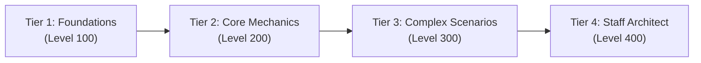

# 🗺️ Interview Handbook — Interactive Curriculum Roadmap

> **Interactive Checkbox Study Tracker & Mastery Progression**  
> **Canonical Repository**: [santoshjammi29/data-engineering-interview-handbook](https://github.com/santoshjammi29/data-engineering-interview-handbook) | **Ecosystem**: [moderndataengineer.uk](https://moderndataengineer.uk)  
> **Total Exercises & Drills**: `33` | **Primary Pillar**: `General Data Engineering & Modeling`

---

## How to Use This Roadmap

1. **Fork this repository** to your personal GitHub account.
2. Work through the modules in sequence or target specific architectural topics.
3. Check off boxes (`- [x]`) as you complete each exercise, drill, or notebook.
4. Commit and push your progress to your personal branch to track your career journey!

```
Progress: [ ] 0 / 33 Completed (0.0%)
```

---

## Curriculum Structure: The 4 Mastery Tiers



### 🟡 Tier 2: Core Mechanics & Implementation (Level 200)
> Production pipeline patterns, schema validation, standard transformations, and unit tests.

- [ ] `data-engineering-interview-handbook-cs-spark_architecture_and_tuning_cheatsheet` — [Cheat Sheet: Spark Architecture And Tuning Cheatsheet](cheatsheets/spark_architecture_and_tuning_cheatsheet.md) `Level 200`
- [ ] `data-engineering-interview-handbook-curriculum-topics` — [Topics Directory: Interview Handbook](topics/README.md) `Level 200`

### 🟠 Tier 3: Complex Scenarios, Edge Cases & Performance (Level 300)
> Performance tuning, partition skew, memory triage runbooks, and failure recovery.

- [ ] `interview-pillars-01_spark_and_databricks` — [01 Spark And Databricks](pillars/01_spark_and_databricks.md) `Level 300`
- [ ] `interview-pillars-02_databricks_lakehouse` — [02 Databricks Lakehouse](pillars/02_databricks_lakehouse.md) `Level 300`
- [ ] `interview-pillars-03_modern_lakehouse` — [03 Modern Lakehouse](pillars/03_modern_lakehouse.md) `Level 300`
- [ ] `interview-pillars-04_datalake_architecture` — [04 Datalake Architecture](pillars/04_datalake_architecture.md) `Level 300`
- [ ] `interview-pillars-05_apache_airflow` — [05 Apache Airflow](pillars/05_apache_airflow.md) `Level 300`
- [ ] `interview-pillars-06_azure_data_factory` — [06 Azure Data Factory](pillars/06_azure_data_factory.md) `Level 300`
- [ ] `interview-pillars-07_dbt_data_build_tool` — [07 Dbt Data Build Tool](pillars/07_dbt_data_build_tool.md) `Level 300`
- [ ] `interview-pillars-08_microsoft_fabric` — [08 Microsoft Fabric](pillars/08_microsoft_fabric.md) `Level 300`
- [ ] `interview-pillars-09_database_architecture` — [09 Database Architecture](pillars/09_database_architecture.md) `Level 300`
- [ ] `interview-pillars-10_sql_server_tsql` — [10 Sql Server Tsql](pillars/10_sql_server_tsql.md) `Level 300`
- [ ] `interview-pillars-11_python_for_data_engineering` — [11 Python For Data Engineering](pillars/11_python_for_data_engineering.md) `Level 300`
- [ ] `interview-pillars-12_data_modeling_and_cdc` — [12 Data Modeling And Cdc](pillars/12_data_modeling_and_cdc.md) `Level 300`
- [ ] `interview-pillars-13_power_bi_and_serving` — [13 Power Bi And Serving](pillars/13_power_bi_and_serving.md) `Level 300`
- [ ] `interview-pillars-14_system_design_at_scale` — [14 System Design At Scale](pillars/14_system_design_at_scale.md) `Level 300`
- [ ] `interview-pillars-15_apache_iceberg_deep_dive` — [15 Apache Iceberg Deep Dive](pillars/15_apache_iceberg_deep_dive.md) `Level 300`
- [ ] `interview-pillars-16_apache_flink_streaming` — [16 Apache Flink Streaming](pillars/16_apache_flink_streaming.md) `Level 300`
- [ ] `interview-pillars-17_trino_presto_duckdb` — [17 Trino Presto Duckdb](pillars/17_trino_presto_duckdb.md) `Level 300`
- [ ] `interview-pillars-18_genai_vector_lakehouse` — [18 Genai Vector Lakehouse](pillars/18_genai_vector_lakehouse.md) `Level 300`
- [ ] `interview-pillars-19_finops_compute_optimization` — [19 Finops Compute Optimization](pillars/19_finops_compute_optimization.md) `Level 300`
- [ ] `interview-pillars-20_data_quality_contracts_observability` — [20 Data Quality Contracts Observability](pillars/20_data_quality_contracts_observability.md) `Level 300`
- [ ] `interview-pillars-all_20_pillars_master_guide` — [All 20 Pillars Master Guide](pillars/all_20_pillars_master_guide.md) `Level 300`
- [ ] `interview-playbooks-01_sql_and_pyspark_125` — [01 Sql And Pyspark 125](playbooks/01_sql_and_pyspark_125.md) `Level 300`
- [ ] `interview-playbooks-02_kafka_and_streaming_125` — [02 Kafka And Streaming 125](playbooks/02_kafka_and_streaming_125.md) `Level 300`
- [ ] `interview-playbooks-03_azure_databricks_125` — [03 Azure Databricks 125](playbooks/03_azure_databricks_125.md) `Level 300`
- [ ] `interview-playbooks-04_aws_cloud_125` — [04 Aws Cloud 125](playbooks/04_aws_cloud_125.md) `Level 300`
- [ ] `interview-playbooks-05_project_defense_125` — [05 Project Defense 125](playbooks/05_project_defense_125.md) `Level 300`
- [ ] `interview-playbooks-06_system_design_125` — [06 System Design 125](playbooks/06_system_design_125.md) `Level 300`
- [ ] `interview-playbooks-07_managerial_leadership_125` — [07 Managerial Leadership 125](playbooks/07_managerial_leadership_125.md) `Level 300`
- [ ] `interview-playbooks-100_databricks_interview_defense_playbook` — [100 Databricks Interview Defense Playbook](playbooks/100_databricks_interview_defense_playbook.md) `Level 300`
- [ ] `interview-playbooks-100_spark_data_issues_problems_and_answers` — [100 Spark Data Issues Problems And Answers](playbooks/100_spark_data_issues_problems_and_answers.md) `Level 300`
- [ ] `interview-playbooks-125_master_defense_playbook` — [125 Master Defense Playbook](playbooks/125_master_defense_playbook.md) `Level 300`

---

## Suggested Study Schedules

| Schedule | Pace | Target Audience | Focus |
|---|---|---|---|
| **4-Week Sprint** | 5-6 drills / day | Interview Prep / Fast Track | Focus on Tier 2 & Tier 3 core drills |
| **8-Week Deep-Dive** | 2-3 drills / day | Full Technical Mastery | Complete all 33 exercises + tests |
| **12-Week Staff Track** | 1-2 drills / day | Architect & Tech Lead | Deep dive into Tier 3 & Tier 4 blueprints |

---

## Sister Repositories & Ecosystem Roadmaps

Explore interactive roadmaps across all 14 pillars of the lakehouse ecosystem:
- [Modern Data Engineer Central Hub](https://moderndataengineer.uk)
- [Databricks Handbook](https://github.com/santoshjammi29/databricks-handbook)
- [PySpark Handbook](https://github.com/santoshjammi29/pyspark-handbook)
- [SQL Handbook](https://github.com/santoshjammi29/sql-handbook)
- [dbt Handbook](https://github.com/santoshjammi29/dbt-handbook)
- [Streaming Handbook](https://github.com/santoshjammi29/streaming-handbook)
- [DataOps & CI/CD Handbook](https://github.com/santoshjammi29/dataops-cicd-handbook)
- [System Design Handbook](https://github.com/santoshjammi29/data-system-design-handbook)
- [Interview Handbook](https://github.com/santoshjammi29/data-engineering-interview-handbook)
- [Security Handbook](https://github.com/santoshjammi29/security-handbook)
