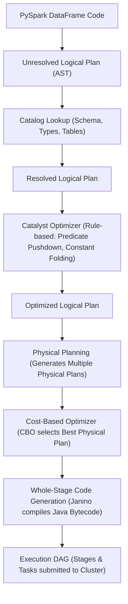

> 🧭 **Modern Data Engineering Ecosystem Navigation**
> - 📘 **Architecture & Concept:** [Data System Design — Lakehouse Architecture](https://github.com/santoshjammi29/data-system-design-handbook/tree/main/modules/01_lakehouse_and_medallion_architecture)
> - 💻 **Hands-On Recipe:** [Databricks Handbook — Production Recipes](https://github.com/santoshjammi29/databricks-handbook)
> - 🔬 **Empirical Lab:** [Spark Experiments — Production Benchmarks](https://github.com/santoshjammi29/spark-experiments)
> - 🚨 **Incident Runbook:** [DataOps CI/CD Incident Runbooks](https://github.com/santoshjammi29/dataops-cicd-handbook/tree/main/runbooks)
> - 🎯 **Interview Defense:** [Interview Defense Playbook](https://github.com/santoshjammi29/data-engineering-interview-handbook/blob/main/playbooks/125_master_defense_playbook.md) *(You are here)*
> - 🌐 **Interactive Web Practice:** [Practice on moderndataengineer.uk](https://moderndataengineer.uk/interview)

## Section 1: SQL & PySpark (Questions 1 – 50)

### Q1: Return matching records from 2 tables which also contain Null values.

Standard SQL `=` and `<>` operators operate on three-valued logic (`TRUE`, `FALSE`, `UNKNOWN`). When comparing two `NULL` values using `=`, the result is `UNKNOWN`, which evaluates to `FALSE` in join filters. To match records where both sides contain `NULL`, you must use **null-safe equality**:
- **ANSI SQL-99:** `ON a.col IS NOT DISTINCT FROM b.col`
- **Spark SQL / Databricks / Hive:** `ON a.col <=> b.col`

**Production Code:**
```sql
-- ANSI Standard
SELECT a.*, b.*
FROM table_a a
INNER JOIN table_b b
  ON a.customer_id IS NOT DISTINCT FROM b.customer_id;

-- Spark SQL / Databricks
SELECT a.*, b.*
FROM table_a a
INNER JOIN table_b b
  ON a.customer_id <=> b.customer_id;
```

**PySpark DataFrame API:**
```python
from pyspark.sql import functions as F

# eqNullSafe() matches nulls with nulls
df_joined = df_a.join(df_b, df_a["customer_id"].eqNullSafe(df_b["customer_id"]), "inner")
```

**Senior Defense & Gotchas:**
- `COALESCE(col, 'dummy_value')` is an anti-pattern: it breaks partition pruning, prevents Catalyst optimizer filter pushdown, and risks collisions if the dummy value naturally appears in source systems.
- Null-safe joins can cause **severe data skew** if millions of records have `NULL` keys, as all null records hash to partition 0 during shuffle. Mitigate by salting or handling nulls in a separate union branch.

---

### Q2: Return all records from Left Table which matches with Right Table.

Depending on whether you need columns from the right table or want to prevent row duplication:
1. **Inner Join:** Returns matched rows with columns from both tables. If the right table has multiple matches, the left table's rows are multiplied.
2. **Left Semi Join (Best Practice):** Returns rows from the left table *only* where at least one match exists in the right table. It **never multiplies rows** and does not project right-table columns.

**Production Code:**
```sql
-- Production standard: Avoids row multiplication when right table has duplicate keys
SELECT a.*
FROM transactions a
LEFT SEMI JOIN active_merchants b
  ON a.merchant_id = b.merchant_id;
```

**PySpark DataFrame API:**
```python
df_matched = df_transactions.join(df_active_merchants, on="merchant_id", how="left_semi")
```

**Senior Defense & Gotchas:**
- Many junior engineers write `SELECT a.* FROM a LEFT JOIN b ON a.id = b.id WHERE b.id IS NOT NULL`. This causes unnecessary shuffle memory overhead, row multiplication if `b.id` is not unique, and requires an expensive `DISTINCT` deduplication pass. Catalyst executes `LEFT SEMI JOIN` with an optimized hash probe that stops at the first match.

---

### Q3: From a Travel history table containing User Id, City, and Travel Date, identify the source and destination city of each journey.

Use analytical window functions partitioned by `user_id` and ordered by `travel_date`:
- **Leg-by-Leg Destination:** `LEAD(city) OVER (PARTITION BY user_id ORDER BY travel_date)`
- **Overall Origin & Destination:** `FIRST_VALUE(city)` and `LAST_VALUE(city)` with explicit window frames.

**Production Code:**
```sql
-- Point-to-Point Journey Legs
SELECT
    user_id,
    city AS source_city,
    LEAD(city) OVER (PARTITION BY user_id ORDER BY travel_date) AS destination_city,
    travel_date AS departure_date,
    LEAD(travel_date) OVER (PARTITION BY user_id ORDER BY travel_date) AS arrival_date
FROM travel_history;

-- Overall Origin and Final Destination across entire journey history
SELECT
    user_id,
    FIRST_VALUE(city) OVER (
        PARTITION BY user_id ORDER BY travel_date
    ) AS origin_city,
    LAST_VALUE(city) OVER (
        PARTITION BY user_id ORDER BY travel_date 
        ROWS BETWEEN UNBOUNDED PRECEDING AND UNBOUNDED FOLLOWING
    ) AS final_destination_city
FROM travel_history;
```

**Senior Defense & Gotchas:**
- **The `LAST_VALUE()` Frame Trap:** The default window frame in ANSI SQL is `RANGE BETWEEN UNBOUNDED PRECEDING AND CURRENT ROW`. Without explicitly defining `ROWS BETWEEN CURRENT ROW AND UNBOUNDED FOLLOWING` or `ROWS BETWEEN UNBOUNDED PRECEDING AND UNBOUNDED FOLLOWING`, `LAST_VALUE()` will mistakenly return the *current row's value*, not the last row in the partition.

---

### Q4: Find 4th highest salary for each department.

Use `DENSE_RANK()` inside a Common Table Expression (CTE) partitioned by `department_id` and ordered by `salary DESC`. `DENSE_RANK()` ensures tied salaries share the same rank without skipping numbers.

**Production Code:**
```sql
WITH ranked_salaries AS (
    SELECT
        emp_id,
        emp_name,
        department_id,
        salary,
        DENSE_RANK() OVER (PARTITION BY department_id ORDER BY salary DESC) as salary_rank
    FROM employees
)
SELECT department_id, emp_id, emp_name, salary
FROM ranked_salaries
WHERE salary_rank = 4;
```

**PySpark DataFrame API:**
```python
from pyspark.sql.window import Window
from pyspark.sql import functions as F

window_dept = Window.partitionBy("department_id").orderBy(F.col("salary").desc())

df_4th = (
    df_employees
    .withColumn("salary_rank", F.dense_rank().over(window_dept))
    .filter(F.col("salary_rank") == 4)
)
```

**Senior Defense & Gotchas:**
- If a department has fewer than 4 distinct salary tiers, this query returns zero rows for that department. If the business requirement demands returning the lowest available salary when < 4 tiers exist, handle it using `COALESCE` with `MIN(salary)` or an outer query check.

---

### Q5: What is the difference between Rank & Dense_Rank?

Both assign ranks based on an ordering within a partition, but they handle ties differently:
- **`RANK()`:** Produces gaps in rank sequence after ties. If two rows tie for rank 1, the next rank assigned is 3 (Sequence: 1, 1, 3, 4).
- **`DENSE_RANK()`:** Never produces gaps in rank sequence after ties. If two rows tie for rank 1, the next rank assigned is 2 (Sequence: 1, 1, 2, 3).
- **`ROW_NUMBER()`:** Strictly sequential without ties (Sequence: 1, 2, 3, 4), breaking ties arbitrarily unless secondary sort keys are specified.

**Comparison Table:**
| Salary | `ROW_NUMBER()` | `RANK()` | `DENSE_RANK()` |
| :--- | :--- | :--- | :--- |
| $150,000 | 1 | 1 | 1 |
| $120,000 | 2 | 2 | 2 |
| $120,000 | 3 | 2 | 2 |
| $100,000 | 4 | **4** (skips 3) | **3** (consecutive) |

---

### Q6: From a large dataset having duplicate records, keep only latest records.

In analytical SQL or PySpark, use `ROW_NUMBER()` partitioned by the natural business key and ordered by the event/update timestamp descending, filtering for `rn = 1`. In Delta Lake, use `MERGE INTO` or Delta's Change Data Feed (CDF).

**Production Code (PySpark):**
```python
from pyspark.sql.window import Window
from pyspark.sql import functions as F

window_spec = Window.partitionBy("entity_id").orderBy(F.col("updated_at").desc())

df_deduped = (
    df_raw
    .withColumn("row_num", F.row_number().over(window_spec))
    .filter(F.col("row_num") == 1)
    .drop("row_num")
)
```

**Delta Lake Native Merge (ACID Ingestion):**
```sql
MERGE INTO silver_customers target
USING bronze_updates source
ON target.customer_id = source.customer_id
WHEN MATCHED AND source.updated_at > target.updated_at THEN
  UPDATE SET *
WHEN NOT MATCHED THEN
  INSERT *;
```

**Senior Defense & Gotchas:**
- Running `ROW_NUMBER()` over petabyte-scale data causes an expensive shuffle across all nodes. In Delta Lake on Databricks, cluster the table by `entity_id` using **Liquid Clustering** (`CLUSTER BY (entity_id)`), which enables data skipping and localized partition pruning during deduplication.

---

### Q7: Count Null values first column wise and then row wise.

- **Column-wise:** Use aggregated conditional counts (`COUNT(CASE WHEN col IS NULL THEN 1 END)` or `sum(col.isNull.cast('int'))` for every column).
- **Row-wise:** Compute the sum of boolean null checks across columns for each record.

**PySpark Implementation:**
```python
from pyspark.sql import functions as F

# 1. Column-wise Null Count
col_null_counts = df.select([
    F.sum(F.when(F.col(c).isNull(), 1).otherwise(0)).alias(c)
    for c in df.columns
])
col_null_counts.show()

# 2. Row-wise Null Count
null_expression = sum([
    F.when(F.col(c).isNull(), 1).otherwise(0) 
    for c in df.columns
])
df_with_row_nulls = df.withColumn("row_null_count", null_expression)
df_with_row_nulls.filter(F.col("row_null_count") > 0).show()
```

---

### Q8: How do you handle JSON Data?

Never use string manipulation or Python regex. In PySpark:
1. Define a strict schema using `StructType` or DDL string.
2. Use `from_json(col, schema)` to parse JSON strings into typed structs in a single vectorized pass.
3. Access fields with dot notation (`col.field`) and explode arrays using `explode()` or `explode_outer()`.
4. For single-field ad-hoc extraction, use `get_json_object()`.

**Production Code:**
```python
from pyspark.sql import functions as F

payload_schema = """
    transaction_id STRING,
    amount DOUBLE,
    timestamp LONG,
    merchant STRUCT<id: STRING, category: STRING>
"""

df_parsed = (
    df_raw
    .withColumn("data", F.from_json(F.col("raw_payload"), payload_schema))
    .select(
        F.col("data.transaction_id"),
        F.col("data.amount"),
        F.col("data.timestamp"),
        F.col("data.merchant.id").alias("merchant_id"),
        F.col("data.merchant.category").alias("merchant_category")
    )
)
```

**Senior Defense & Gotchas:**
- Avoid using `schema_of_json()` in production jobs: it triggers an eager scan of sample records to infer types, doubling I/O and risking pipeline breakage on schema drift.
- Use **Auto Loader** (`cloudFiles`) with `cloudFiles.schemaEvolutionMode = "rescue"` to automatically capture corrupted or unexpected JSON fields into a `_rescued_data` column without dropping records.

---

### Q9: How do you handle a slow Spark job?

Follow a structured 5-step Spark UI triage methodology:
1. **Locate the Bottleneck Stage:** Open Spark UI -> Stages tab. Identify stages with 90%+ duration.
2. **Detect Data Skew:** Look at Task Duration, Shuffle Read Size, and Input Size across Min, 25th, Median, 75th, and Max. If Max is 10x+ higher than Median, data skew is present.
3. **Inspect Shuffle Spill:** Look for **Spill (Memory)** and **Spill (Disk)** in the stage details. Spill indicates Tungsten execution memory exhaustion.
4. **Inspect Garbage Collection (GC):** Check Task Deserialization and GC Time. If GC exceeds 10–15% of task run time, executors are memory-starved.
5. **Analyze Physical Plan (`df.explain(True)`):** Check for missing predicate pushdown, Cartesian products (`CartesianProductExec` or `BroadcastNestedLoopJoin`), or unpruned full-table scans.

---

### Q10: How do you optimize a slow SQL query?

1. **Predicate Pushdown & SARGability:** Ensure `WHERE` clauses are Search Argument Able (avoid `WHERE YEAR(date) = 2024`, use `WHERE date >= '2024-01-01' AND date < '2025-01-01'`).
2. **Partition Pruning & File Skipping:** Filter on partition or cluster keys to avoid reading unnecessary Parquet files.
3. **Column Projection:** Eliminate `SELECT *`. Parquet is columnar; reading only required columns drastically reduces network and memory I/O.
4. **Broadcast Small Dimensions:** Use `/*+ BROADCAST(dim) */` hints on tables $< 100\text{MB}$ to eliminate shuffle.
5. **Optimize Joins & Aggregations:** Aggregate data *before* joining (`GROUP BY` early) to minimize join volume.

---

### Q11: Why can a job still be slow even after filtering 80% of data?

1. **Full Table Scan (Filter Not Pushed Down):** The filter was applied on a non-partitioned, non-clustered, or calculated column, forcing Spark to scan 100% of underlying Parquet files from storage.
2. **Data Skew in the Remaining 20%:** The filtered 20% contains a massive key skew (e.g. 90% of rows belong to `merchant_id = 'AMAZON'`), causing a single executor task to run for hours.
3. **Downstream Wide Shuffle:** A wide transformation (`GROUP BY`, `JOIN`, `DISTINCT`) occurs after the filter, shuffling data with a suboptimal partition count (`spark.sql.shuffle.partitions = 200` default creates 200 small tasks or massive spilled partitions).
4. **Python UDF Bottleneck:** Filtering happened after a non-vectorized Python UDF, which forced row-by-row Py4J serialization of all 100% of rows prior to filtering.

---

### Q12: How does Spark optimize filters on Delta tables?

Delta Lake integrates tightly with the Catalyst Optimizer through 4 core mechanisms:
1. **Metadata Data Skipping:** Delta collects column-level statistics (min, max, null count) for the first 32 columns in the table transaction log (`_delta_log`). If a filter `WHERE age > 65` is applied, Delta skips Parquet files where `max(age) <= 65` entirely without reading disk.
2. **Partition Pruning:** Hive-style partition directories are pruned directly via the transaction log.
3. **Liquid Clustering / Z-Ordering:** Groups multidimensional attributes into the same Parquet files, maximizing the effectiveness of min/max skipping.
4. **Deletion Vectors:** Instead of rewriting an entire 500MB Parquet file when rows are filtered/deleted, Delta writes a lightweight bitmap file of deleted row IDs, skipping them in-memory during read.

---

### Q13: What happens internally during repartition?

`repartition(N)` triggers a full physical shuffle exchange (`ShuffleExchangeExec`):
1. **Map Phase:** Each executor maps incoming records through a Round-Robin or Hash partitioner:
   $$\text{partition\_id} = \text{hash}(key) \pmod N$$
2. **Write Phase:** Map tasks write serialized shuffle blocks to local executor disks and register block locations with the `MapOutputTracker` on the Driver.
3. **Shuffle Boundary:** Spark inserts a stage boundary.
4. **Reduce Phase:** $N$ reduce tasks pull their respective blocks across the cluster network over Netty, deserialize records, and construct $N$ brand new, evenly balanced partitions.

---

### Q14: How would you handle a skew during production?

1. **Enable Spark 3.0+ AQE Skew Join:** Set `spark.sql.adaptive.enabled = true` and `spark.sql.adaptive.skewJoin.enabled = true`. AQE detects when a partition exceeds `spark.sql.adaptive.skewJoin.skewedPartitionFactor * median` and automatically splits the skewed partition into smaller sub-partitions.
2. **Salting Technique:** If AQE cannot resolve it (e.g., in complex non-equi joins or custom aggregations):
   - Add a salted key: `salted_key = concat(skewed_key, '_', floor(rand() * 10))`
   - Replicate the dimension table 10x using `explode(array(0..9))`
   - Join on `salted_key`, then aggregate.
3. **Broadcast Join:** If one side is $< 500\text{MB}$, force broadcast via `broadcast(df_small)` to completely bypass the shuffle.

---

### Q15: How do you remove Duplicates?

In PySpark, use `df.dropDuplicates()` (or `df.dropDuplicates(["col1", "col2"])` for key-based deduplication), or in SQL use `SELECT DISTINCT`.
When duplicate records share identical values across all columns, Spark triggers a hash aggregate across all fields to drop duplicates.

**Production Code:**
```python
# Deduplicate across entire row
df_unique = df.dropDuplicates()

# Deduplicate based on specific business keys
df_unique_customers = df.dropDuplicates(["customer_id", "email"])
```

---

### Q16: What if Duplicates have different timestamps?

When duplicate business records have different update or ingestion timestamps, simple `dropDuplicates()` is non-deterministic. To reliably keep the latest record, use an analytical window with `ROW_NUMBER() OVER (PARTITION BY natural_keys ORDER BY event_timestamp DESC)` and filter for `row_num = 1`.

**Production Code:**
```python
from pyspark.sql.window import Window
from pyspark.sql import functions as F

dedup_window = (
    Window
    .partitionBy("account_id", "transaction_type")
    .orderBy(F.col("event_timestamp").desc())
)

df_latest = (
    df_transactions
    .withColumn("row_rank", F.row_number().over(dedup_window))
    .filter(F.col("row_rank") == 1)
    .drop("row_rank")
)
```

**Senior Defense & Gotchas:**
- Never use `GROUP BY key` with `MAX(timestamp)` if you need non-aggregated attribute columns. Doing so forces a self-join back to the source table, doubling total I/O and shuffle cost. `ROW_NUMBER()` retrieves the entire latest row in a single shuffle pass.

---

### Q17: Find Minimum, Maximum and Average Salary for every department in a company.

**Production SQL:**
```sql
SELECT
    department_id,
    COUNT(emp_id) AS total_employees,
    MIN(salary) AS min_salary,
    MAX(salary) AS max_salary,
    ROUND(AVG(salary), 2) AS avg_salary
FROM employees
GROUP BY department_id;
```

**PySpark DataFrame API:**
```python
from pyspark.sql import functions as F

df_dept_stats = (
    df_employees
    .groupBy("department_id")
    .agg(
        F.count("emp_id").alias("total_employees"),
        F.min("salary").alias("min_salary"),
        F.max("salary").alias("max_salary"),
        F.round(F.avg("salary"), 2).alias("avg_salary")
    )
)
```

---

### Q18: Find moving average sales for 3 Days (Friday, Saturday and Sunday) in a quarter.

1. Filter dates where `DAYOFWEEK(date_col) IN (6, 7, 1)` (Friday, Saturday, Sunday in standard ANSI Sunday=1 convention).
2. Calculate the moving average using a window frame: `AVG(sales) OVER (PARTITION BY quarter ORDER BY sales_date ROWS BETWEEN 2 PRECEDING AND CURRENT ROW)`.

**Production SQL:**
```sql
WITH weekend_sales AS (
    SELECT
        sales_date,
        quarter(sales_date) AS sales_quarter,
        year(sales_date) AS sales_year,
        daily_sales,
        DAYOFWEEK(sales_date) AS dow
    FROM store_daily_sales
    WHERE DAYOFWEEK(sales_date) IN (6, 7, 1) -- Fri, Sat, Sun
)
SELECT
    sales_year,
    sales_quarter,
    sales_date,
    daily_sales,
    AVG(daily_sales) OVER (
        PARTITION BY sales_year, sales_quarter
        ORDER BY sales_date
        ROWS BETWEEN 2 PRECEDING AND CURRENT ROW
    ) AS weekend_3day_moving_avg
FROM weekend_sales;
```

---

### Q19: From a flight database, find out total delay for each flight in a week.

**Production SQL:**
```sql
SELECT
    flight_id,
    YEAR(flight_date) AS flight_year,
    WEEKOFYEAR(flight_date) AS flight_week,
    SUM(COALESCE(departure_delay_mins, 0) + COALESCE(arrival_delay_mins, 0)) AS total_delay_minutes,
    COUNT(flight_instance_id) AS total_trips
FROM flight_operations
GROUP BY
    flight_id,
    YEAR(flight_date),
    WEEKOFYEAR(flight_date);
```

---

### Q20: How do you calculate transaction volume for a merchant?

Group by `merchant_id` (and time period if needed) and calculate both total count of transactions and gross monetary volume.

**Production SQL:**
```sql
SELECT
    merchant_id,
    COUNT(transaction_id) AS total_transaction_count,
    ROUND(SUM(amount), 2) AS gross_transaction_volume,
    ROUND(AVG(amount), 2) AS avg_transaction_value
FROM transactions
GROUP BY merchant_id;
```

---

### Q21: Calculate Daily Cumulative Balance for merchant?

Aggregate daily net change per merchant, then apply an analytical cumulative window sum ordered by `txn_date` with `ROWS BETWEEN UNBOUNDED PRECEDING AND CURRENT ROW`.

**Production SQL:**
```sql
WITH daily_merchant_summary AS (
    SELECT
        merchant_id,
        txn_date,
        SUM(net_amount) AS daily_net_change
    FROM merchant_transactions
    GROUP BY merchant_id, txn_date
)
SELECT
    merchant_id,
    txn_date,
    daily_net_change,
    SUM(daily_net_change) OVER (
        PARTITION BY merchant_id
        ORDER BY txn_date
        ROWS BETWEEN UNBOUNDED PRECEDING AND CURRENT ROW
    ) AS cumulative_running_balance
FROM daily_merchant_summary;
```

---

### Q22: Fetch out Top 3 geographies with highest customer base.

**Production SQL:**
```sql
WITH geo_ranks AS (
    SELECT
        country,
        state,
        COUNT(DISTINCT customer_id) AS total_customers,
        DENSE_RANK() OVER (ORDER BY COUNT(DISTINCT customer_id) DESC) as rank_position
    FROM customer_master
    GROUP BY country, state
)
SELECT country, state, total_customers
FROM geo_ranks
WHERE rank_position <= 3;
```

---

### Q23: How do you handle Fault Tolerance using Spark?

Spark achieves fault tolerance through **RDD Lineage Graphs (Lazy Evaluation)** and **Deterministic Recomputation**:
1. **Worker / Executor Loss:** Executors are stateless computation workers. If an executor dies, the Driver detects heartbeat loss, asks cluster manager (K8s/YARN) for a new executor, and replays the DAG lineage only for the lost partitions.
2. **Shuffle Fetch Failure:** If an executor hosting shuffle map files crashes, a downstream task raises `FetchFailedException`. The Driver restarts the upstream map stage to regenerate the lost shuffle files.
3. **Driver Failure:** Handled by cluster manager restarts (YARN restart / K8s pod restart). In Spark Structured Streaming, end-to-end fault tolerance is guaranteed via **Write-Ahead Logs (WAL)** and **Checkpoints**.

---

### Q24: What is the difference between Job, Stage and Task? How does Spark decide number of tasks per stage?

- **Job:** Created whenever an **Action** (`collect()`, `count()`, `write()`, `saveAsTable()`) is invoked on a DataFrame.
- **Stage:** Created at each **Shuffle Boundary** (Wide Transformation). A Job consists of one or more sequential or parallel Stages.
- **Task:** The smallest atomic execution unit. Runs on a single CPU core over a single partition of data inside an Executor.
- **Task Count Determination:**
  - **Input Stages:** Number of file splits read from storage:
    $$\text{Tasks} = \frac{\text{Total Input Size}}{\text{spark.sql.files.maxPartitionBytes}} \quad (\text{default } 128\text{MB})$$
  - **Shuffle Stages:** Governed by `spark.sql.shuffle.partitions` (default 200) or dynamically determined at runtime by **AQE** (`spark.sql.adaptive.advisoryPartitionSizeInBytes`, default 64MB).

---

### Q25: What is difference between Broadcast Join vs Sort Merge Join?

**Comparison Architecture:**
| Attribute | Broadcast Join (`BroadcastHashJoin`) | Sort-Merge Join (`SortMergeJoin`) |
| :--- | :--- | :--- |
| **Data Size** | Small table ($\le 10\text{MB}$ default, tuneable to a few GBs) | Any size (Petabyte-scale) |
| **Shuffle Phase** | **None** on the large table. Zero network shuffle. | **Full Shuffle Exchange** on both datasets. |
| **Sorting** | No sorting required. Small table hashed into RAM. | Both sides hashed into buckets and sorted on disk/RAM. |
| **Driver Overhead** | High. Driver collects small table and broadcasts via P2P. | Zero driver memory burden. |
| **Spill Risk** | OOM on Driver/Executors if small table is larger than expected. | Spills to disk if RAM is exceeded, but **never crashes**. |

---

### Q26: Explain all types of Join with a simple use case.

1. **Inner Join:** Retains only keys present in both tables (e.g., active orders with customer profiles).
2. **Left Outer Join:** Retains all left records, filling right columns with `NULL` if missing (e.g., all customers and their optional loyalty discounts).
3. **Right Outer Join:** Retains all right records (rare in production; converted to Left Outer).
4. **Full Outer Join:** Retains all rows from both tables, pairing matches and null-padding mismatches (e.g., reconciliation between bank statement and accounting ledger).
5. **Left Semi Join:** Returns left rows where a match exists on the right without row multiplication (e.g., users who logged in at least once this month).
6. **Left Anti Join:** Returns left rows where NO match exists on the right (e.g., orphan transaction detection, churned users).
7. **Cross Join (Cartesian Product):** Every row in left paired with every row in right ($N \times M$ rows, e.g., generating all product $\times$ store inventory matrix combinations).

---

### Q27: How do you execute PySpark code on a cluster?

1. **Execution Modes:**
   - **Client Mode:** Driver runs locally on the machine executing `spark-submit` (e.g., interactive notebook, Edge node). Used for debugging.
   - **Cluster Mode:** Driver runs inside an Application Master container on one of the worker nodes in the cluster. Used for production scheduled batch jobs.
2. **Submitting Jobs (`spark-submit`):**
```bash
spark-submit \
  --master yarn \
  --deploy-mode cluster \
  --num-executors 20 \
  --executor-cores 4 \
  --executor-memory 16G \
  --driver-memory 8G \
  --conf spark.sql.adaptive.enabled=true \
  --conf spark.dynamicAllocation.enabled=true \
  main_pipeline.py --env prod --date 2026-11-18
```
3. **Databricks Workflows / Lakeflow Jobs:** Packaged via Databricks Asset Bundles (DABs) and triggered as automated ephemeral Job clusters via Databricks REST API or orchestrator (Airflow / ADF).

---

### Q28: How do you decide cluster configuration for your PySpark job?

Use the **3-Pillar Sizing Methodology** based on data volume, core-to-memory ratio, and YARN/K8s overhead:
1. **Rule of Thumb for Memory:** Size total cluster RAM to $2\times$ to $3\times$ the uncompressed raw dataset size to prevent disk spill during wide shuffles.
2. **Cores per Executor:** Allocate **4 to 5 cores per executor**.
   - Less than 4 cores: Excessive JVM overhead per core.
   - More than 5 cores: Excessive concurrent HDFS/cloud storage I/O threads causing thread contention and degraded I/O throughput.
3. **Executor Memory Allocation:** 16 GB to 32 GB per executor. Always reserve 10% (minimum 384MB) for off-heap overhead (`spark.executor.memoryOverhead`).
4. **Node Instance Type:** Memory-Optimized (e.g. Azure `E-series` / AWS `r5`) for shuffle-heavy ETL; Compute-Optimized (Azure `F-series` / AWS `c5`) for CPU-bound hashing and encryption.

---

### Q29: How do you Debug a failed Spark job?

Execute a 4-step root-cause isolation workflow:
1. **Identify the Failure Stage in Spark UI:** Determine if failure happened at data ingestion, join shuffle, or write phase.
2. **Inspect Driver vs Executor Logs:**
   - If Driver failed: Look for Driver OOM (`java.lang.OutOfMemoryError: Java heap space`) caused by calling `df.collect()`, `df.toPandas()`, or broadcasting a table that exceeded memory.
   - If Executor failed: Check container exit code. **Exit Code 137** indicates SIGKILL: the container was killed by YARN NodeManager or K8s OOMKiller for exceeding `memoryOverhead` (off-heap memory leak or PyArrow buffer overflow).
3. **Diagnose FetchFailedException:** Indicates executor crash during shuffle read. Increase `spark.shuffle.io.maxRetries` (from 3 to 10) and `spark.shuffle.io.retryWait` (from 5s to 30s) or resolve data skew.
4. **Inspect Data Skew & Partition Sizing:** Check min vs max task runtimes in the failing stage.

---

### Q30: Convert rows into columns using SQL or PySpark (Pivot).

**Production SQL:**
```sql
SELECT *
FROM (
    SELECT department, year, sales
    FROM department_sales
)
PIVOT (
    SUM(sales)
    FOR year IN (2022, 2023, 2024)
);
```

**PySpark DataFrame API:**
```python
# Best Practice: Always provide the explicit list of distinct pivot values!
# Omitting values forces Spark to execute an extra full scan to discover distinct keys.
df_pivoted = (
    df_sales
    .groupBy("department")
    .pivot("year", [2022, 2023, 2024])
    .sum("sales")
)
```

---

### Q31: Explain narrow vs wide transformations.

**Comparison Architecture:**
- **Narrow Transformation:** Each partition of the parent RDD is used by at most one partition of the child RDD. Operations occur in-memory within the same executor without cross-network data movement.
  - Examples: `map()`, `flatMap()`, `filter()`, `withColumn()`, `drop()`, `union()`.
- **Wide Transformation:** Multiple child partitions depend on data from across all parent partitions. Requires a **Shuffle Exchange**: records must be written to disk, transferred across network sockets, and reorganized by hash key.
  - Examples: `groupBy()`, `join()`, `distinct()`, `repartition()`, `reduceByKey()`, window functions with `partitionBy`.

---

### Q32: Convert SQL query into PySpark DataFrame code and find out the highest salary per department in the employee table.

**SQL:**
```sql
WITH ranked_emp AS (
    SELECT *, ROW_NUMBER() OVER (PARTITION BY department_id ORDER BY salary DESC) as rn
    FROM employees
)
SELECT * FROM ranked_emp WHERE rn = 1;
```

**PySpark Implementation:**
```python
from pyspark.sql.window import Window
from pyspark.sql import functions as F

dept_window = Window.partitionBy("department_id").orderBy(F.col("salary").desc())

df_highest_salary = (
    df_employees
    .withColumn("rn", F.row_number().over(dept_window))
    .filter(F.col("rn") == 1)
    .drop("rn")
)
```

---

### Q33: Find duplicate records in a DataFrame and remove them.

To identify duplicates before dropping, use `groupBy()` with `count()` filtering `count > 1`. To remove them, use `df.dropDuplicates(["key1", "key2"])`.

**Production Code:**
```python
# 1. Identify and inspect duplicate records
df_duplicates = (
    df_orders
    .groupBy("order_id", "customer_id")
    .count()
    .filter("count > 1")
)

# 2. Remove duplicate records
df_clean = df_orders.dropDuplicates(["order_id", "customer_id"])
```

---

### Q34: How do you apply Join on 3 columns.

In PySpark, pass a Python list of column names to the `on` parameter, or use explicit equality expressions combined with `&` (bitwise AND).

**Production Code:**
```python
# Method 1: Using column list (recommended when column names are identical in both frames)
df_joined = df_orders.join(
    df_shipments,
    on=["order_id", "customer_id", "order_date"],
    how="inner"
)

# Method 2: Explicit conditions (when column names differ across tables)
df_joined = df_orders.join(
    df_shipments,
    on=(df_orders["order_id"] == df_shipments["src_order_id"]) &
       (df_orders["customer_id"] == df_shipments["src_cust_id"]) &
       (df_orders["order_date"] == df_shipments["ship_date"]),
    how="inner"
)
```

---

### Q35: Explain SCD Type 2 with a use-case.

Slowly Changing Dimension (SCD) Type 2 tracks complete historical changes by creating a new record every time an attribute updates, preserving full audit history. Columns required:
- `surrogate_key` (e.g. Hash of `natural_key + valid_from`)
- `natural_key` (e.g. `customer_id`)
- `attribute_columns` (e.g. `address`, `tier`)
- `valid_from` (Timestamp / Date when record became active)
- `valid_to` (Timestamp / Date when record expired, or `9999-12-31` / `NULL` for current)
- `is_current` (Boolean flag: `true` for active record, `false` for historical)

**Delta Lake Implementation:**
```sql
-- Step 1: Update current record expiration
MERGE INTO dim_customers target
USING (
    SELECT updates.customer_id, updates.address, updates.effective_time
    FROM customer_updates updates
) source
ON target.customer_id = source.customer_id AND target.is_current = true
WHEN MATCHED AND target.address <> source.address THEN
  UPDATE SET target.valid_to = source.effective_time, target.is_current = false;

-- Step 2: Insert the new active version
INSERT INTO dim_customers
SELECT 
    uuid(), source.customer_id, source.address, source.effective_time, '9999-12-31', true
FROM customer_updates source;
```

---

### Q36: How do you count number of Credit vs Debit Transactions per user? What insight can you get from this?

**Production SQL:**
```sql
SELECT
    user_id,
    COUNT(txn_id) AS total_transactions,
    COUNT(CASE WHEN txn_type = 'CREDIT' THEN 1 END) AS credit_count,
    COUNT(CASE WHEN txn_type = 'DEBIT' THEN 1 END) AS debit_count,
    SUM(CASE WHEN txn_type = 'CREDIT' THEN amount ELSE 0 END) AS total_credited,
    SUM(CASE WHEN txn_type = 'DEBIT' THEN amount ELSE 0 END) AS total_debited,
    ROUND(
        COUNT(CASE WHEN txn_type = 'DEBIT' THEN 1 END) * 1.0 / 
        NULLIF(COUNT(CASE WHEN txn_type = 'CREDIT' THEN 1 END), 0), 2
    ) AS debit_to_credit_ratio
FROM transactions
GROUP BY user_id;
```
**Business Insight:**
- Cash flow health & liquidity risk: Users with high debit-to-credit ratios ($> 3.0$) indicate spending velocity outpacing deposit replenishment.
- Fraud & structuring detection: Sudden spikes in credit counts followed by immediate equal debits indicate mule account activity or anti-money laundering (AML) structuring.

---

### Q37: Identify and flag a user who undergoes 3 transactions within 60 seconds.

Use the `LAG(event_timestamp, 2)` analytical window function partitioned by `user_id` and ordered by `event_timestamp`. Comparing the current transaction's timestamp with the timestamp from 2 transactions ago identifies whether 3 consecutive events occurred within $\le 60\text{ seconds}$.

**Production SQL:**
```sql
WITH txn_velocity AS (
    SELECT
        user_id,
        transaction_id,
        event_timestamp,
        LAG(event_timestamp, 2) OVER (
            PARTITION BY user_id ORDER BY event_timestamp
        ) AS ts_2_txns_ago
    FROM user_transactions
)
SELECT
    user_id,
    transaction_id,
    event_timestamp,
    ts_2_txns_ago,
    unix_timestamp(event_timestamp) - unix_timestamp(ts_2_txns_ago) AS window_duration_seconds
FROM txn_velocity
WHERE ts_2_txns_ago IS NOT NULL
  AND (unix_timestamp(event_timestamp) - unix_timestamp(ts_2_txns_ago)) <= 60;
```

---

### Q38: How do you optimize transformations in PySpark?

1. **Replace Python UDFs with Native Functions:** Native Spark functions execute directly in the JVM via Catalyst with Whole-Stage CodeGen, avoiding expensive Python-JVM serialization. If custom logic is required, use Vectorized Pandas UDFs (PyArrow).
2. **Predicate Pushdown & Early Projection:** Filter rows and select columns as early as possible before any join or aggregation.
3. **Strategic Caching (`persist()`):** Cache intermediate DataFrames *only* if they are referenced multiple times in downstream branches. Always use `StorageLevel.MEMORY_AND_DISK_SER` and `unpersist()` when complete.
4. **Avoid Driver Bottlenecks:** Eliminate `collect()`, `take()`, or calling `toPandas()` on large DataFrames.
5. **Tune Shuffle Partitions:** Match shuffle partition counts to cluster cores ($2\times \text{ to } 3\times \text{ total available executor cores}$) or rely on AQE.

---

### Q39: Difference between Repartition vs Coalesce.

**Comparison Architecture:**
| Dimension | `repartition(N)` | `coalesce(N)` |
| :--- | :--- | :--- |
| **Shuffle Phase** | **Full Shuffle Exchange**. Shuffles 100% of data across the network. | **No Shuffle**. Merges adjacent local partitions on the same worker node. |
| **Partition Count** | Can **increase** or **decrease** partition count. | Can **ONLY decrease** partition count. |
| **Data Distribution** | Uniform, balanced partition distribution. | Can introduce severe partition skew if parent partitions were unequal. |
| **Primary Use Case** | Eliminating data skew before expensive joins or aggregations. | Combining thousands of small files into fewer output files before writing to storage. |

---

### Q40: What happens internally while running a PySpark job?

**Internal Execution Lifecycle:**


---

### Q41: Ways to handle Data skew, OOM errors and Streaming failures.

**Production Triage Matrix:**
- **Data Skew:**
  - Enable AQE: `spark.sql.adaptive.skewJoin.enabled = true`.
  - Manual key salting with random salt keys ($0 \dots N-1$).
  - Convert to Broadcast Join if one side is small enough.
- **OutOfMemory (OOM) Errors:**
  - *Driver OOM:* Eliminate `collect()`; increase `spark.driver.memory`.
  - *Executor Heap OOM:* Reduce executor cores (less concurrency per JVM); increase shuffle partitions; resolve skew.
  - *Executor Off-Heap OOM (Exit 137):* Increase `spark.executor.memoryOverhead` from 10% to 20–25% (crucial when using PyArrow).
- **Streaming Failures:**
  - Maintain idempotent writes (`foreachBatch` with Delta merge).
  - Use RocksDB state store (`spark.sql.streaming.stateStore.providerClass`) to prevent JVM heap bloat.
  - Enforce restrictive watermarking (`withWatermark()`) to purge stale state.

---

### Q42: Brief about Spark 3.0 features (Adaptive Query Execution and Auto skew handling).

Adaptive Query Execution (AQE) dynamically re-optimizes query plans during runtime using post-shuffle partition statistics:
1. **Dynamically Coalescing Shuffle Partitions:** Replaces static `spark.sql.shuffle.partitions` by merging small shuffle partitions into target sizes (default 64MB).
2. **Dynamically Switching Join Strategies:** If runtime statistics reveal that a table's actual filtered size is $< 10\text{MB}$, AQE automatically converts a Sort-Merge Join to a Broadcast Hash Join.
3. **Dynamic Skew Join Optimization:** Automatically detects skewed partitions and splits them into smaller sub-partitions, joining them independently with corresponding duplicate keys on the opposite table.

---

### Q43: Row vs Columnar formats (Parquet, ORC, Avro).

**Comparison Architecture:**
- **Avro (Row-Oriented):** Data stored record by record. Ideal for fast serialization, message bus transmission (Kafka), and schema evolution where entire rows are frequently written or read.
- **Parquet & ORC (Columnar):** Data organized into column chunks and row groups.
  - **Column Projection:** Reads only queried columns from disk, skipping 80–90% of I/O.
  - **Predicate Pushdown:** Uses file-level, row-group-level, and page-level min/max statistics and dictionary encodings to skip reading non-matching rows.
  - **High Compression:** Homogeneous column data compresses dramatically better using Snappy or ZSTD ($3\times \text{ to } 5\times$ smaller footprint than row-based formats).

---

### Q44: Best practices for Partitioning & bucketing.

**Production Guidelines:**
1. **Partition Sizing Rule:** Each partition folder must contain **at least 500 MB to 2 GB** of data. Never partition on high-cardinality keys (e.g. `user_id`, `timestamp`), which creates millions of tiny files and overwhelms the metastore.
2. **Temporal Partitioning:** Partition by coarse time grains (`year`, `month`, or `date`).
3. **Bucketing:** Pre-shuffles and sorts data on join keys (e.g., `user_id`) into a fixed number of buckets ($N = 64, 128$). When joining two tables bucketed on the same key with the same bucket count, Spark eliminates the shuffle exchange entirely.
4. **Modern Alternative (Databricks):** In modern lakehouse architectures, replace manual partitioning and bucketing with **Delta Lake Liquid Clustering** (`CLUSTER BY (col1, col2)`), which handles flexible multi-dimensional clustering without partition hierarchy constraints.

---

### Q45: Explain Window / analytical functions.

Window functions perform calculations across a set of table rows related to the current row, without collapsing rows into a single summary row like `GROUP BY`.
- **Ranking Functions:** `ROW_NUMBER()`, `RANK()`, `DENSE_RANK()`, `NTILE(n)`.
- **Value Functions:** `LEAD()`, `LAG()`, `FIRST_VALUE()`, `LAST_VALUE()`.
- **Aggregate Functions:** `SUM()`, `AVG()`, `COUNT()` over a rolling window.
- **Window Frame:** `ROWS BETWEEN [start] AND [end]` defines physical row boundaries; `RANGE BETWEEN` defines logical value boundaries.

---

### Q46: Explain UDF vs native functions (performance impact).

**Performance Hierarchy:**
1. **Native Spark SQL Functions (Fastest):** Executes directly inside the JVM using Catalyst Whole-Stage CodeGen and Tungsten binary memory format. Zero serialization overhead.
2. **Vectorized Pandas UDFs (PyArrow):** Batches data into Apache Arrow columnar memory structures. Transfer between JVM and Python worker uses shared memory/C-pipes. $10\times \text{ to } 50\times$ faster than standard Python UDFs.
3. **Standard Python UDFs (Slowest - $10\times \text{ to } 100\times$ Penalty):** For every row, data is serialized from JVM memory into a socket pipe, sent to a Python daemon, processed row-by-row in Python, serialized back to the pipe, and deserialized in the JVM. Completely prevents Catalyst code generation and predicate pushdown.

---

### Q47: Explain Driver vs Executor roles.

**Architecture:**
- **Driver Node:**
  - Maintains the `SparkSession` and coordinates the application.
  - Converts user code into an RDD Lineage Graph and execution DAG.
  - Interacts with Cluster Manager (K8s / YARN / Mesos) to request executor containers.
  - Schedules tasks on executors via `TaskScheduler` and tracks task completion.
  - Collects results for driver actions (`collect()`, `take()`).
- **Executor Nodes:**
  - Runs individual task threads assigned by the Driver.
  - Reads data from storage partitions and applies transformations in memory.
  - Stores cached data and temporary shuffle blocks on local disk/RAM.
  - Reports heartbeat metrics, task status, and execution failures back to the Driver.

---

### Q48: Memory management and JVM GC behaviour.

Spark partitions executor memory into **On-Heap** and **Off-Heap (Tungsten)**:
$$\text{Executor Memory} = \text{Reserved (300MB)} + \text{Spark Memory (75%)} + \text{User Memory (25%)}$$
- **Spark Memory (75%):** Shared dynamically between **Execution Memory** (shuffles, hash joins, sorting) and **Storage Memory** (cached DataFrames, broadcast variables). Execution memory has eviction priority over storage memory.
- **User Memory (25%):** Holds user-defined data structures, custom UDF objects, and internal metadata.
- **JVM GC Behavior:** Spark generates millions of short-lived objects during serialization. G1GC (Garbage-First Garbage Collector) partitions heap into equal regions (1MB to 32MB) and performs concurrent marking.

---

### Q49: Interpret GC logs and identify memory pressure issues.

1. **GC Pause Ratio:** If GC time in the Spark UI exceeds **10% of total task time**, the cluster is under severe memory pressure.
2. **Evacuation Failure (`to-space exhausted`):** Occurs when the survivor space cannot accommodate live objects, causing expensive stop-the-world pauses.
3. **Humongous Allocations:** Objects exceeding 50% of a G1GC region bypass young generation and are allocated directly in Old Generation, triggering premature Full GCs.
4. **Remediation:** Increase G1 region size (`-XX:G1HeapRegionSize=32m`), initiate concurrent marking earlier (`-XX:InitiatingHeapOccupancyPercent=35`), or reduce cores per executor from 8 to 4 to reduce thread allocation contention.

---

### Q50: What is DAG creation and explain task execution.

1. **DAG Creation:** As transformations are declared, Spark builds an internal Directed Acyclic Graph representing the lineage of RDD operations. When an action is called, the `DAGScheduler` splits the DAG into **Stages** wherever wide shuffle boundaries occur.
2. **Task Creation:** Each Stage is converted into a `TaskSet`. The number of tasks equals the number of partitions in that stage.
3. **Task Execution:** The `TaskScheduler` sends serialized task definitions over RPC to available Executor worker threads. Executors deserialize the bytecode, run whole-stage code-generated Java loops over partition records, write shuffle output or final storage files, and send task completion metrics back to the Driver.
