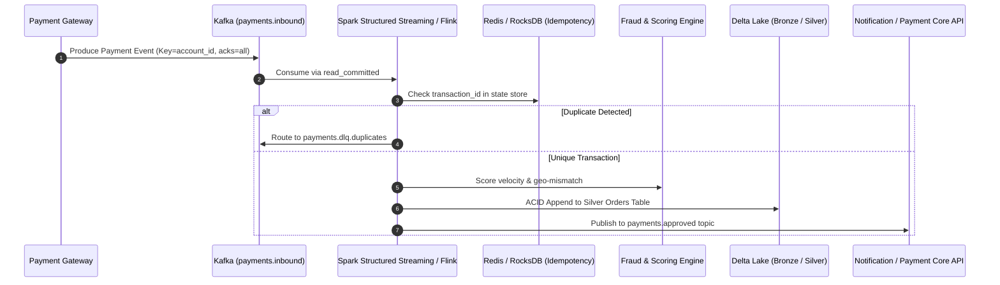

> 🧭 **Modern Data Engineering Ecosystem Navigation**
> - 📘 **Architecture & Concept:** [Data System Design — Lakehouse Architecture](https://github.com/santoshjammi29/data-system-design-handbook/tree/main/modules/01_lakehouse_and_medallion_architecture)
> - 💻 **Hands-On Recipe:** [Databricks Handbook — Production Recipes](https://github.com/santoshjammi29/databricks-handbook)
> - 🔬 **Empirical Lab:** [Spark Experiments — Production Benchmarks](https://github.com/santoshjammi29/spark-experiments)
> - 🚨 **Incident Runbook:** [DataOps CI/CD Incident Runbooks](https://github.com/santoshjammi29/dataops-cicd-handbook/tree/main/runbooks)
> - 🎯 **Interview Defense:** [Interview Defense Playbook](https://github.com/santoshjammi29/data-engineering-interview-handbook/blob/main/playbooks/125_master_defense_playbook.md) *(You are here)*
> - 🌐 **Interactive Web Practice:** [Practice on moderndataengineer.uk](https://moderndataengineer.uk/interview)

## Section 2: Apache Kafka Production Engineering (Questions 51 – 55)

### Q51: Explain your real time experience in Kafka.

"In our production enterprise payments and telemetry lakehouse, I architected a multi-cluster Apache Kafka deployment (KRaft mode) processing over **150,000 events/second** (peaks of 250MB/sec).
My responsibilities included:
1. **Topic Partition Topology:** Sizing partitions based on consumer throughput ($P = \max(T/P_{prod}, T/P_{cons})$) across 32 partitions per high-velocity topic.
2. **End-to-End Exactly-Once Semantics (EOS):** Configuring idempotent producers (`enable.idempotence=true`), transactional producer coordinators, and `read_committed` consumer isolation.
3. **Cluster Governance & Monitoring:** Tracking Consumer Group Lag, Under-Replicated Partitions (URP), and ISR shrink/expand rates via Prometheus and Grafana alerts."

---

### Q52: How do you tackle flaws and failure modes in Kafka?

We tackle Kafka flaws through 4 core architectural guardrails:
1. **Consumer Rebalance Storms:** Caused by slow processing exceeding `max.poll.interval.ms`. We migrated to the **Cooperative Sticky Assignor** (`partition.assignment.strategy = CooperativeStickyAssignor`), which incrementally reassigns only displaced partitions instead of triggering a 'stop-the-world' rebalance across all consumers.
2. **Poison Pill Messages (Malformed Payloads):** When a deserialization error occurs, catching the exception, publishing the bad record with header metadata to a **Dead Letter Queue (DLQ)** topic, and advancing consumer offset to prevent stream blockage.
3. **Out-of-Sync Replicas (ISR Shrinkage):** Set `min.insync.replicas = 2` with `replication.factor = 3` and `acks = all`. If replicas drop below 2, producers fail with `NotEnoughReplicasException`, prioritizing consistency over silent data loss.
4. **Broker Disk Saturation:** Enforcing tiered storage policies and segment time retention (`retention.ms = 86400000`, 24 hours) with log compaction for state topics.

---

### Q53: How do you ensure high throughput and low latency in Kafka?

Tune producer batching, broker I/O, and consumer fetching in lockstep:
- **Producer High-Throughput Tuning:**
  - `batch.size = 65536` (64 KB buffer per partition)
  - `linger.ms = 10` to `20` (allows micro-buffering to achieve dense batches)
  - `compression.type = zstd` (superior compression ratio with low CPU latency overhead)
  - `buffer.memory = 67108864` (64 MB buffer memory)
- **Broker OS Zero-Copy & Page Cache:**
  - Kafka bypasses JVM heap copying by using OS kernel page cache and the `sendfile()` system call (zero-copy data transfer directly from disk page cache to network socket).
- **Consumer Fetch Tuning:**
  - `fetch.min.bytes = 1048576` (1 MB) and `fetch.max.wait.ms = 500` ensures consumers read bulk batches instead of tiny single-message network round trips.

---

### Q54: Explain designing a real time payment processing pipeline using Kafka.

**Architecture Workflow:**


**Production Design Principles:**
1. **Partition by `account_id`:** Guarantees strict chronological ordering for each user's transactions while distributing load across brokers.
2. **Two-Phase Idempotency:** Producers use transaction IDs; streaming engine validates `payment_id` against state store before firing downstream banking APIs.
3. **Outbox Pattern:** Transactional database events written to an outbox table are tailed via Debezium CDC into Kafka to prevent dual-write divergence.

---

### Q55: How do you handle schema evolution from Kafka to Delta Lake?

1. **Confluent Schema Registry & Avro:** Enforce **BACKWARD_TRANSITIVE** or **FULL** compatibility on the Kafka topic. Producers cannot register breaking schema changes (e.g. dropping non-optional fields or changing types).
2. **Spark Auto Loader Ingestion (`cloudFiles`):**
   ```python
   df_stream = (
       spark.readStream
       .format("cloudFiles")
       .option("cloudFiles.format", "json")
       .option("cloudFiles.schemaLocation", "abfss://checkpoints@lake.dfs.core.windows.net/schema_cust")
       .option("cloudFiles.schemaEvolutionMode", "addNewColumns")
       .load("abfss://raw@lake.dfs.core.windows.net/kafka_landing/")
   )
   ```
3. **Delta Lake Schema Evolution:**
   When writing to Delta Lake, enable `.option("mergeSchema", "true")`. Delta automatically appends new columns to the `_delta_log` metadata without rewriting historical Parquet files.

---

## Section 3: Spark Structured Streaming (Questions 56 – 60)

### Q56: Checkpointing (offsets, state, metadata).

Checkpointing provides fault tolerance and end-to-end exactly-once guarantees by persisting 4 internal subdirectories on durable cloud object storage:
1. `offsets/`: Write-Ahead Log (WAL) recording the exact starting and ending source offsets (e.g. Kafka partition offsets) for each micro-batch.
2. `commits/`: Contains empty commit files written only after all sinks complete processing. When restarting, if an offset exists in `offsets/` but not in `commits/`, Spark replays that exact batch.
3. `metadata/`: Unique identifier for the streaming query session. Changing schemas or stream definitions invalidates this metadata.
4. `state/`: Stores serialized operator state (delta files and consolidated snapshot files) for stateful aggregations (`groupBy`, `dropDuplicates`, stream-stream joins).

---

### Q57: Watermarking & late data handling.

Watermarking establishes how late incoming data can arrive relative to event-time before being discarded.
- **Definition:** Watermark delay $T$ means Spark drops all records with event timestamp:
  $$\text{event\_time} < \max(\text{event\_time}) - T$$
- **State Store Pruning:** When using stateful operations, the state store would grow infinitely without watermarks. Watermarks allow Spark to purge state older than the threshold.

**Production Code:**
```python
df_streaming_agg = (
    df_events
    .withWatermark("event_time", "15 minutes")
    .groupBy(
        F.window("event_time", "10 minutes", "5 minutes"),
        F.col("device_type")
    )
    .count()
)
```

**Output Mode Interaction:**
- **Append Mode:** Emits rows to downstream sinks *only* when the watermark passes the end of the window (guaranteeing the aggregated result will never change).
- **Update Mode:** Emits updated aggregates at every micro-batch where rows in that window are modified.
- **Complete Mode:** Emits the entire cumulative state table on every micro-batch (invalid for continuous unbounded tables).

---

### Q58: State management across micro-batches.

Stateful operations require maintaining historical state across micro-batches.
1. **Default HDFS-Backed State Store:** Maintains the entire state map on the JVM Java heap. At scale (millions of keys), this triggers severe GC pause storms and executor OOMs.
2. **RocksDB State Store (Databricks / Production Standard):**
   Stores state **off-heap** in local C++ RocksDB instances, spilling cleanly to local NVMe SSDs and committing checkpoints to remote cloud storage. Eliminates JVM GC pauses and scales to billions of state keys.
```python
# Enable off-heap RocksDB State Store
spark.conf.set(
    "spark.sql.streaming.stateStore.providerClass",
    "com.databricks.sql.streaming.state.RocksDBStateStoreProvider"
)
```

---

### Q59: How is Spark Structured Streaming different from DStreams?

**Comparison Architecture:**
| Feature | Spark Structured Streaming (Modern) | Legacy DStreams (Deprecated) |
| :--- | :--- | :--- |
| **Mental Model** | **Unbounded Table** continuously appended. Unified batch & streaming API. | Sequence of discrete RDDs generated every batch interval. |
| **Engine & Optimizer** | **Catalyst Optimizer** & Tungsten Whole-Stage CodeGen. Full SQL support. | Raw RDD API. No query optimization or SQL optimization. |
| **Time Semantics** | True **Event-Time** processing with native watermarks. | **Processing-Time** (when data reaches the worker node). |
| **State Management** | Native off-heap RocksDB state store, stream-stream joins. | Fragile Java serialization (`updateStateByKey`), GC-heavy. |
| **Ecosystem Integration** | Native Delta Lake ACID streaming source and sink. | Lacks ACID transactional sink capabilities. |

---

### Q60: Debug streaming issues (OOM errors, Skewed partitions, Slow streaming jobs).

**Triage Runbook:**
1. **Micro-Batch Processing Time > Trigger Interval (Backpressure):**
   - *Symptom:* Input rate outpaces processing rate; Kafka consumer lag increases indefinitely.
   - *Fix:* Throttle ingestion using `maxOffsetsPerTrigger = 50000` (Kafka) or `maxFilesPerTrigger = 100` (Auto Loader) to stabilize micro-batch sizes.
2. **State Store OOM & Disk Saturation:**
   - *Symptom:* Executors crash with Exit Code 137 during stateful windowing.
   - *Fix:* Switch from HDFS state store to RocksDB state store; tighten watermark delay (e.g. from 24h to 1h); ensure join keys have high cardinality.
3. **Task Skew within Micro-Batch:**
   - *Symptom:* 99 out of 100 tasks finish in 100ms; 1 task runs for 3 minutes.
   - *Fix:* Check partition key distribution; salt skewed keys or repartition incoming streaming DataFrame across worker cores before stateful aggregation.
