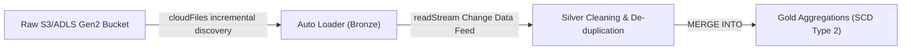
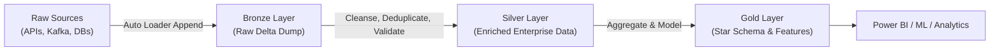

## Section 4: Azure Cloud & Databricks (Questions 61 – 90)

### Q61: How do you pass parameter from one Notebook to another Notebook?

1. **`dbutils.notebook.run()` with Arguments:**
   Pass parameters as a Python dictionary to `dbutils.notebook.run("path", timeout_seconds, {"param_key": "param_val"})`.
2. **Accessing via Databricks Widgets:**
   In the child notebook, read parameters using `dbutils.widgets.get("param_key")`:
   ```python
   # Parent Notebook
   result = dbutils.notebook.run(
       "./child_transform",
       timeout_seconds=600,
       arguments={"batch_date": "2026-11-18", "env": "prod"}
   )

   # Child Notebook
   dbutils.widgets.text("batch_date", "")
   dbutils.widgets.text("env", "")
   batch_date = dbutils.widgets.get("batch_date")
   env = dbutils.widgets.get("env")

   # Returning status back to parent
   dbutils.notebook.exit(json.dumps({"status": "SUCCESS", "records_processed": 500000}))
   ```
3. **Databricks Workflows (Modern Standard):** Pass task parameters across workflow graph tasks using Task Values (`dbutils.jobs.taskValues.set()` and `dbutils.jobs.taskValues.get()`).

---

### Q62: If records are moved from source to target table and source is deleted, how do you identify deleted records? (Upsert & Delete detection)

Execute a **Full Outer Join** or **Left Anti Join** between the target table and the current source snapshot:
- **Left Anti Join:** Records existing in `target` but missing in `source` represent deleted records.
- **Delta Lake Change Data Feed (CDF):** If CDC is enabled on the source table (`delta.enableChangeDataFeed = true`), Delta automatically tracks row-level changes with metadata columns: `_change_type = 'delete'`, `_commit_version`, `_commit_timestamp`.

**Production Code (Delete Sync via Merge):**
```sql
MERGE INTO gold_target t
USING (
    -- Tag current source records as active, and missing target records as deleted
    SELECT customer_id, name, 'ACTIVE' AS status FROM bronze_source
    UNION ALL
    SELECT t.customer_id, t.name, 'DELETED' AS status
    FROM gold_target t
    LEFT ANTI JOIN bronze_source s ON t.customer_id = s.customer_id
    WHERE t.is_active = true
) s
ON t.customer_id = s.customer_id
WHEN MATCHED AND s.status = 'DELETED' THEN
  UPDATE SET t.is_active = false, t.deleted_at = current_timestamp()
WHEN MATCHED AND s.status = 'ACTIVE' THEN
  UPDATE SET *
WHEN NOT MATCHED THEN
  INSERT *;
```

---

### Q63: Explain Databricks Architecture (Control Plane vs Data Plane).

**Architecture Breakdown:**
1. **Control Plane (Managed by Databricks):**
   - Web application UI, notebook management, cluster manager orchestration, Databricks REST API endpoints, job scheduling service, and Unity Catalog centralized metastore.
2. **Data Plane (Runs in Customer's Azure Subscription / Cloud Account):**
   - **VNet Injection:** Databricks clusters run inside the customer's own Virtual Network (VNet) across private subnets (public/private).
   - **Storage:** All customer raw data, Delta tables, checkpoints, and DBFS storage root reside in customer-owned Azure Data Lake Storage Gen2 (ADLS Gen2) containers.
   - **No Data in Control Plane:** Data in transit and at rest remains strictly inside the customer's boundary; only telemetry and command coordination travel to the Control Plane over secure Azure Private Link.

---

### Q64: A Delta table has doubled in size over time. How would you optimize the performance of this Delta table?

Execute a 4-step Lakehouse compaction and pruning regime:
1. **Compaction (`OPTIMIZE`):** Merge thousands of small, fragmented files into standard 1GB files:
   ```sql
   OPTIMIZE gold_sales;
   ```
2. **Liquid Clustering (Modern Standard):** Re-cluster table around query filter dimensions:
   ```sql
   ALTER TABLE gold_sales CLUSTER BY (region, order_date);
   OPTIMIZE gold_sales;
   ```
3. **Purge Historical Files (`VACUUM`):** Remove tombstoned Parquet files older than retention threshold (default 7 days):
   ```sql
   VACUUM gold_sales RETAIN 168 HOURS;
   ```
4. **Enable Deletion Vectors:** Prevents table file duplication during point updates and deletes:
   ```sql
   ALTER TABLE gold_sales SET TBLPROPERTIES (
       'delta.enableDeletionVectors' = true
   );
   ```

---

### Q65: In which places have you used the Databricks ecosystem during production?

1. **Data Ingestion & Bronze Landing:** Auto Loader (`cloudFiles`) for streaming ingestion of IoT, Kafka, and ERP JSON dumps into Delta Lake Bronze.
2. **ETL & Data Quality:** Lakeflow Pipelines (Delta Live Tables - DLT) with `EXPECT` constraints for automated data quality gates in Silver cleaning.
3. **Serving & BI:** Databricks SQL (DBSQL) Serverless Warehouses powered by Photon engine for Tableau and Power BI direct lakehouse queries.
4. **Unified Governance:** Unity Catalog for 3-tier namespace (`catalog.schema.table`), row/column masking, and end-to-end data lineage.
5. **Orchestration & CI/CD:** Databricks Asset Bundles (DABs) for GitOps deployments across Dev/Staging/Prod via GitHub Actions.

---

### Q66: What is the difference between Delta Lake vs Parquet?

**Comparison Architecture:**
- **Parquet:** Raw columnar file format containing data pages, dictionary encodings, and file-level footer metadata. Lacks ACID transactions, cannot handle concurrent writes, does not support point deletes/updates, and has no audit history.
- **Delta Lake:** Open-source storage layer built *on top* of Parquet files with an **ACID Transaction Log (`_delta_log/`)**:
  - Provides ACID transactions (Serializable / WriteSerializable).
  - Time Travel & data versioning via transaction log commits.
  - Supports `UPDATE`, `DELETE`, and `MERGE INTO`.
  - Schema enforcement and schema evolution.
  - Column-level metadata data skipping and Liquid Clustering.

---

### Q67: Difference between Full load and Incremental load?

- **Full Load:** Truncates and reloads the entire source table on every run. Simple to implement but becomes computationally prohibitive, cost-inefficient, and creates massive downtime at scale ($> 1\text{TB}$).
- **Incremental Load:** Ingests only new, modified, or deleted records since the high-watermark timestamp or transaction commit ID of the previous run. Drastically reduces compute time, network I/O, and storage churn.

---

### Q68: Design a pipeline which can handle incremental load using Databricks.

**Incremental Pipeline Design (Auto Loader + Delta Merge):**

```python
# Production Auto Loader Stream
df_incremental = (
    spark.readStream
    .format("cloudFiles")
    .option("cloudFiles.format", "parquet")
    .option("cloudFiles.schemaLocation", "abfss://checkpoints@lake.dfs.core.windows.net/schema")
    .load("abfss://raw-landing@lake.dfs.core.windows.net/orders/")
)

# Idempotent write via foreachBatch
def upsert_to_delta(micro_batch_df, batch_id):
    micro_batch_df.createOrReplaceTempView("updates")
    micro_batch_df._jdf.sparkSession().sql("""
        MERGE INTO silver_orders target
        USING updates source
        ON target.order_id = source.order_id
        WHEN MATCHED THEN UPDATE SET *
        WHEN NOT MATCHED THEN INSERT *
    """)

(
    df_incremental.writeStream
    .foreachBatch(upsert_to_delta)
    .option("checkpointLocation", "abfss://checkpoints@lake.dfs.core.windows.net/orders_chk")
    .start()
)
```

---

### Q69: If a Spark job is running slow on Databricks, how will you Optimize it?

1. **Enable Photon Engine:** Toggle Photon on the Databricks cluster for $3\times \text{ to } 8\times$ faster vectorized C++ query execution.
2. **Review Query Profile in Spark UI:** Identify long task stages, high spill to disk, and executor skew.
3. **Tune Shuffle & AQE:** Verify AQE is active (`spark.sql.adaptive.enabled = true`). Adjust `spark.sql.adaptive.advisoryPartitionSizeInBytes = 67108864` (64MB).
4. **Broadcast Small Lookups:** Ensure dimension tables under threshold use Broadcast joins.
5. **Optimize Delta Files:** Run `OPTIMIZE table_name` and configure Liquid Clustering.

---

### Q70: What do you mean by small file problem and how do you solve this problem?

The **Small File Problem** occurs when streaming or high-frequency batch jobs write thousands of tiny Parquet files ($< 10\text{MB}$ each). Reading thousands of files causes massive cloud storage metadata overhead (millions of `GET/LIST` requests) and degrades query throughput.
- **Solution 1 - Delta Auto Compaction & Optimized Writes:**
  ```sql
  ALTER TABLE transactions SET TBLPROPERTIES (
      'delta.autoOptimize.optimizeWrite' = true,
      'delta.autoOptimize.autoCompact' = true
  );
  ```
- **Solution 2 - Scheduled Maintenance:**
  Run `OPTIMIZE table_name` regularly in off-peak batch windows.

---

### Q71: How partitions count is decided? What will you do if partitions are too low?

- **Target Partition Sizing:** Ideal partition size in Spark memory is **100 MB to 200 MB**.
  $$\text{Partitions} = \frac{\text{Total Stage Data Size}}{128\text{MB}}$$
- **Rule of Thumb:** Total partitions should be **$2\times \text{ to } 3\times$ the number of total available CPU cores** across all cluster executors.
- **If Partitions Are Too Low:**
  - Tasks will process multiple gigabytes each, triggering JVM Heap OOMs or massive Tungsten spill to disk.
  - Fix: Explicitly call `df.repartition(desired_count)` or configure `spark.sql.shuffle.partitions`.

---

### Q72: How do you process a dataset of 5TB size in Databricks?

1. **Cluster Topology:** Size a multi-node worker cluster (e.g. 16 workers, `Standard_E16ds_v5` with 16 vCPUs and 128 GB RAM each = 2 TB total RAM, 256 cores) with cluster autoscaling.
2. **Photon Engine:** Enable Photon for vectorized C++ execution.
3. **Partitioning & Liquid Clustering:** Cluster target Delta tables by primary query filters (`CLUSTER BY (country, event_date)`).
4. **Incremental Micro-Batching:** If loading initial history, avoid a single monolithic DataFrame write; chunk processing into monthly or weekly partitions using a control table.
5. **Disk Spill Storage:** Ensure worker VMs use NVMe SSD storage (`ds` series) for high-speed local shuffle write bandwidth.

---

### Q73: How do you design a pipeline with the help of Databricks?

Design around the **Medallion Architecture** using modern Databricks Lakeflow / Delta Live Tables (DLT):
1. **Bronze Layer:** Stream raw ingested files into append-only Delta tables with Auto Loader (`cloudFiles`).
2. **Silver Layer:** Apply schema expectations (`EXPECT`), parse JSON structures, scrub nulls, and deduplicate with `ROW_NUMBER()`.
3. **Gold Layer:** Aggregate and structure data into Kimball star schemas or business marts using Delta Lake with Liquid Clustering.

---

### Q74: How do you integrate Databricks and Azure Data Factory?

Use the native **ADF Azure Databricks Linked Service**:
1. **Security & Identity:** Connect securely via **System-Assigned Managed Identity (SMI)** or Service Principal with secrets in Azure Key Vault.
2. **Activity Types:** Invoke pipelines using the **Databricks Notebook Activity** or **Databricks Python Activity**.
3. **Parameter Passing:** Pass ADF pipeline variables (`@pipeline().parameters.TriggerDate`) into Databricks notebook base parameters.
4. **Compute Strategy:** Always configure ADF to spin up **New Job Clusters** rather than attaching to existing interactive clusters to save 50% on DBU costs.

---

### Q75: Explain with example ACID properties in Delta tables / Delta Lake.

**ACID Breakdown:**
1. **Atomicity:** All writes (e.g. 500 new Parquet files during a `MERGE`) either commit completely or abort entirely. If a job fails halfway, the files are ignored because no commit entry is added to `_delta_log/000000X.json`.
2. **Consistency:** Schema enforcement prevents writing corrupted rows that violate types or nullability constraints (`NOT NULL`).
3. **Isolation (Serializable / WriteSerializable):** Concurrent writes are managed via **Optimistic Concurrency Control (OCC)**. If two transactions modify the same table, the second checks if the files it read were changed; if not, it commits; if yes, it re-evaluates.
4. **Durability:** Once committed in the transaction log on cloud object storage (ADLS Gen2 / S3), data survives node crashes, cluster restarts, and network partitions.

---

### Q76: How does Databricks interact with Data Lake storage (ADLS Gen2)?

Databricks interacts with ADLS Gen2 using the **ABFS (Azure Blob File System) driver** over HTTPS (`abfss://<container>@<account>.dfs.core.windows.net/`).
- **Modern Security Architecture:** Access is governed via **Unity Catalog External Locations** backed by **Azure Managed Identities**. Compute clusters never hold raw storage keys or SAS tokens.
- **Direct Cloud Object Access:** Data reads stream directly from ADLS Gen2 blobs into worker memory using multi-threaded parallel HTTP GET requests.


---


---

### Q77: Which services will you use for ingestion, transformation and storage?

**Azure Enterprise Architecture Stack:**
1. **Ingestion:**
   - *Batch & External APIs:* Azure Data Factory (ADF) for 100+ native connectors, SFTP, and on-premises SQL Server via Self-Hosted Integration Runtime (SHIR).
   - *Real-time Streaming:* Azure Event Hubs (Kafka-compatible endpoint) / Apache Kafka.
   - *File Ingestion:* Databricks Auto Loader (`cloudFiles`) directly over ADLS Gen2 landing zones.
2. **Transformation:**
   - Azure Databricks (PySpark, SQL, Delta Live Tables) powered by the Photon C++ engine.
3. **Storage:**
   - Azure Data Lake Storage Gen2 (ADLS Gen2) hierarchical namespace with Delta Lake format, governed by **Unity Catalog**.
4. **Serving & BI:**
   - Databricks SQL Serverless Warehouses, Azure Synapse Analytics, Power BI (Direct Lake mode).

---

### Q78: How will you design a Data Warehouse? Where will you use SCD Type 1 and SCD Type 2?

Design a Kimball dimensional model (Star Schema) on top of the Lakehouse Gold layer:
- **Fact Tables:** Numerical metrics and transactional events (e.g., `fact_orders`, `fact_payments`) keyed by integer surrogate date/entity keys.
- **Dimension Tables:** Contextual business entities (e.g., `dim_customer`, `dim_product`).
- **Where to Use SCD Type 1:**
  - Non-critical attributes where historical correction is standard: typo fixes in names, updated phone numbers, current contact preferences. The old value is overwritten directly (`UPDATE SET phone = new_phone`).
- **Where to Use SCD Type 2:**
  - Audit-critical, compliance, or financial dimensions where historical point-in-time reporting is mandatory: customer billing address changes (affects tax calculation), product unit price adjustments, territory assignments. New record inserted with `valid_from`, `valid_to`, and `is_current`.

---

### Q79: What is the primary use case difference between ADF vs Databricks?

**Comparison Matrix:**
| Capability | Azure Data Factory (ADF) | Azure Databricks |
| :--- | :--- | :--- |
| **Primary Strength** | **Orchestration & Data Movement** (Hybrid connectivity, ELT scheduling, REST calls). | **Complex Heavy Compute & Transformation** (Distributed PySpark, Machine Learning, ACID Delta Lake). |
| **Code Paradigm** | Low-Code / GUI Drag-and-Drop pipelines. | Code-First (Python, SQL, Scala, R) with full Git version control. |
| **Streaming** | Limited micro-batch copy activities. | True real-time sub-second streaming with Structured Streaming. |
| **Best Practice Synergy** | Use ADF as the outer orchestrator and file mover; trigger Databricks Job clusters for all heavy transformations. |

---

### Q80: Describe Medallion Architecture (Bronze -> Silver -> Gold).

**Medallion Architecture Blueprint:**

- **Bronze Layer (Raw History):** Ingestion zone. Data is appended in its rawest state with ingestion timestamps and filename metadata. Schema enforcement is minimal to prevent ingestion failure.
- **Silver Layer (Enterprise Truth):** Cleaning and conformance zone. Data types are validated, strings normalized, nulls sanitized, and duplicates eliminated. Provides an enterprise-wide single source of truth.
- **Gold Layer (Curated Consumption):** Business aggregation zone. Data is structured into Kimball star schemas, aggregated daily/monthly summaries, and optimized for sub-second BI queries.

---

### Q81: Clearly explain data flow and design decisions.

**Key Design Decisions:**
1. **Decouple Storage & Compute:** Data persists on ADLS Gen2 in open-source Delta Lake format, preventing vendor lock-in and allowing independent cluster scaling.
2. **Idempotence Everywhere:** All Silver and Gold transformations use Delta `MERGE INTO`, guaranteeing that re-running failed batches produces identical outputs without row duplication.
3. **Immutability of Bronze:** Bronze is strictly append-only. If a bug is discovered in Silver/Gold business logic, downstream tables can be completely recalculated from Bronze history.

---

### Q82: Explain Cluster types (Job vs All-Purpose).

**Comparison:**
- **All-Purpose Clusters (Interactive):**
  - Manually provisioned and shared among multiple analysts and data engineers for interactive notebook exploration.
  - Higher DBU cost tier. Kept running between executions (subject to auto-termination timeout).
- **Job Clusters (Automated / Ephemeral):**
  - Automatically spun up by Databricks Workflows or ADF to execute a specific production pipeline, and immediately terminated upon completion.
  - Lower DBU cost tier (~50% cost of all-purpose clusters). Completely isolated, preventing resource contention.

---

### Q83: Explain Autoscaling & VM sizing.

- **Autoscaling:** Databricks evaluates cluster load based on executor shuffle queue backlog and CPU utilization. If queued tasks exceed executor capacity, it requests additional VMs; when idle, it scales down.
- **VM Sizing Strategy:**
  - *Storage-to-RAM Ratio:* For shuffle-heavy ETL, select memory-optimized VMs (e.g. `Standard_E8ds_v5` - 8 cores, 64GB RAM).
  - *Driver Node Sizing:* Sized to handle metadata operations and task scheduling ($16\text{GB to } 32\text{GB}$ RAM).
  - *Spot Instances:* Use Azure Spot VMs for worker nodes to save up to 70% in dev/test clusters, keeping on-demand for the Driver to maintain cluster stability.

---

### Q84: Explain Driver vs Worker nodes.

- **Driver Node:** Coordinates execution. Translates user SQL/PySpark code into DAGs, schedules tasks, manages metadata with Unity Catalog, hosts the Spark UI, and collects driver results.
- **Worker (Executor) Nodes:** Heavy lifters. Spawns JVM processes that execute task threads against partition splits, manage local memory/NVMe disk shuffle caches, and stream data to object storage.

---

### Q85: Explain Managed vs External tables.

**Comparison:**
| Attribute | Managed Tables | External (Unmanaged) Tables |
| :--- | :--- | :--- |
| **Metadata Location** | Unity Catalog metastore. | Unity Catalog metastore. |
| **Data File Location** | Default storage location managed by Unity Catalog. | Custom cloud storage path specified via `LOCATION 'abfss://...'`. |
| **Behavior on `DROP TABLE`** | **Deletes both** metadata and the underlying Parquet data files. | **Deletes metadata only**. The underlying data files remain on cloud storage. |
| **Production Best Practice** | Use Managed tables inside Unity Catalog for automatic lifecycle management and governed access. | Use External tables when multiple non-Databricks engines must read the underlying storage directory directly. |

---

### Q86: Explain Init scripts.

Init scripts are shell scripts that execute during cluster startup *before* the Spark driver and executor JVMs initialize.
- **Common Use Cases:** Installing custom operating system packages (`apt-get install unixodbc`), configuring security certificates, setting custom JVM parameters, and tuning OS-level kernel network buffers.
- **Modern Security Best Practice:** Store init scripts in **Unity Catalog Volumes** (`/Volumes/catalog/schema/volume/init.sh`) or workspace files, completely deprecating insecure DBFS root init scripts.

---

### Q87: Explain `_delta_log` metadata architecture.

**Architecture Breakdown:**
Delta Lake stores all table transaction history inside a hidden `_delta_log/` directory alongside Parquet data files:
1. **JSON Commit Files:** Every write operation generates a monotonically increasing JSON file (`00000000000000000000.json`, `00000000000000000001.json`). Each file records atomic actions: `add` (new Parquet files written), `remove` (files tombstoned), `commitInfo`, and column statistics.
2. **Parquet Checkpoint Files:** Every 10 commits, Delta aggregates historical JSON files into a consolidated Parquet checkpoint file (`00000000000000000010.checkpoint.parquet`). Readers read the latest checkpoint plus subsequent JSON commits, avoiding scanning thousands of individual JSON files.
3. **CRC Files:** Cyclic Redundancy Check (`.crc`) files accompany each commit to verify log file integrity and detect incomplete writes.

---

### Q88: What is Time Travel & retention (`VACUUM`)?

- **Time Travel:** Delta Lake allows querying earlier states of a table using transaction log versioning or timestamps:
  ```sql
  SELECT * FROM orders VERSION AS OF 14;
  SELECT * FROM orders TIMESTAMP AS OF '2026-11-15 12:00:00';
  ```
- **Retention & `VACUUM`:** `VACUUM` permanently deletes files marked as `remove` in the transaction log older than the retention threshold (default 7 days):
  ```sql
  VACUUM orders RETAIN 168 HOURS;
  ```
  *Gotcha:* Running `VACUUM` with retention $< 168\text{ hours}$ without disabling the safety check (`spark.databricks.delta.vacuum.parallelDelete.enabled`) is blocked to prevent breaking active concurrent queries.

---

### Q89: Optimistic Concurrency Control (OCC) in Delta Lake.

Delta Lake handles concurrent transactions without locking the entire table:
1. **Record Read Version:** Transaction reads table state at version $V_0$.
2. **Execute In-Memory:** Changes are computed and new Parquet files are written optimistically to storage.
3. **Attempt Commit:** Transaction attempts to write commit file $V_{0}+1$.
4. **Conflict Resolution:** If another transaction already committed $V_{0}+1$, Delta checks if the files written conflict with the files modified by the concurrent commit.
   - *No Conflict (e.g. mutually exclusive partitions):* Transaction automatically rebases and commits as $V_{0}+2$.
   - *Conflict:* Transaction throws `ConcurrentAppendException` or aborts to maintain Serializable isolation.

---

### Q90: Compare Parquet vs Avro vs Delta vs Iceberg.

**Enterprise Lakehouse Storage Comparison:**
| Dimension | Parquet | Avro | Delta Lake 3.x | Apache Iceberg |
| :--- | :--- | :--- | :--- | :--- |
| **Storage Model** | Columnar file | Row-based file | ACID Layer over Parquet | ACID Layer over Parquet/ORC |
| **Metadata Structure** | In-file footers | In-file headers | Ordered JSON log + Checkpoint Parquet | Hierarchical Snapshots (Manifest Lists & Manifest Files) |
| **ACID Transactions** | No | No | Yes (Serializable) | Yes (Serializable) |
| **Partition Evolution** | No | No | Yes (via Liquid Clustering) | Yes (Hidden Partitioning) |
| **Primary Ecosystem** | General Analytics | Kafka / Ingestion | Databricks, Spark, Fabric | Snowflake, Trino, AWS Athena |
