> 🧭 **Modern Data Engineering Ecosystem Navigation**
> - 📘 **Architecture & Concept:** [Data System Design — Lakehouse Architecture](https://github.com/santoshjammi29/data-system-design-handbook/tree/main/modules/01_lakehouse_and_medallion_architecture)
> - 💻 **Hands-On Recipe:** [Databricks Handbook — Production Recipes](https://github.com/santoshjammi29/databricks-handbook)
> - 🔬 **Empirical Lab:** [Spark Experiments — Production Benchmarks](https://github.com/santoshjammi29/spark-experiments)
> - 🚨 **Incident Runbook:** [DataOps CI/CD Incident Runbooks](https://github.com/santoshjammi29/dataops-cicd-handbook/tree/main/runbooks)
> - 🎯 **Interview Defense:** [Interview Defense Playbook](https://github.com/santoshjammi29/data-engineering-interview-handbook/blob/main/playbooks/125_master_defense_playbook.md) *(You are here)*
> - 🌐 **Interactive Web Practice:** [Practice on moderndataengineer.uk](https://moderndataengineer.uk/interview)

## Section 5: AWS Cloud Big Data Stack (Questions 91 – 95)

### Q91: Explain how will you build end-to-end data pipeline using AWS services?

**End-to-End AWS Pipeline Architecture:**

```mermaid
flowchart LR
    A["Sources<br/>(IoT, CDC, APIs)"] -->|Kinesis Data Streams| B["Kinesis Firehose"]
    B -->|Micro-batch dump| C["Amazon S3<br/>(Raw Landing)"]
    C -->|Crawlers / Catalog| D["AWS Glue Data Catalog"]
    D -->|Distributed PySpark| E["AWS Glue Jobs / EMR"]
    E -->|Cleaned Parquet/Iceberg| F["Amazon S3<br/>(Curated Lake)"]
    F -->|Query Engine| G["Amazon Athena / Redshift Spectrum"]
    G --> H["Amazon QuickSight / BI"]
```

1. **Ingest:** Capture real-time events via Kinesis Data Streams and stream batch files to S3 via Kinesis Firehose.
2. **Store:** Persist raw and curated data in S3 using Apache Iceberg or Parquet with S3 Intelligent-Tiering.
3. **Catalog & Secure:** Manage schemas via AWS Glue Data Catalog with AWS Lake Formation governing fine-grained column/row permissions.
4. **Transform:** Execute distributed PySpark transformations on AWS Glue 4.0 Serverless jobs or Amazon EMR.
5. **Orchestrate & Serve:** Coordinate workflows with AWS Step Functions; query data via Amazon Athena and Amazon Redshift Serverless.

---

### Q92: Which services will you use for ingestion, transformation and storage?

**AWS Service Selection Matrix:**
- **Ingestion:** Amazon Kinesis Data Streams (low-latency streaming), AWS DMS (Database Migration Service for relational CDC), Amazon API Gateway + AWS Lambda (REST webhooks).
- **Storage:** Amazon S3 (Primary Object Store) organized into Raw, Cleaned, and Curated buckets; Amazon DynamoDB for real-time key-value lookups.
- **Transformation:** AWS Glue (Serverless Spark for general batch/micro-batch ETL), Amazon EMR (Petabyte-scale managed Spark/Flink), AWS Lambda (event-driven lightweight transformations $< 15\text{ mins}$).

---

### Q93: How AWS Glue works, and explain a real case example from a previous project.

**Under the Hood:**
AWS Glue is a fully managed, serverless ETL service built on Apache Spark.
- **Data Processing Units (DPUs):** Compute capacity measured in DPUs (1 DPU = 4 vCPUs and 16 GB RAM). An auto-scaling Glue job dynamically provisions DPUs based on worker queue depth.
- **Glue DynamicFrames:** An extension of Spark DataFrames that handles semi-structured data with schema inconsistencies without requiring explicit schema casting.
- **Real-World Case Study:** In our Clickstream Analytics platform, we ingested 40 million JSON user events daily from S3 landing buckets into an Iceberg curated lake. Our Glue job leveraged DynamicFrames to parse nested polymorphic event payloads, applied `ResolveChoice` to resolve type ambiguities (e.g. `user_id` arriving as string vs integer), partitioned data by `year/month/day`, and loaded clean Parquet into S3 with a 99.9% reduction in manual data-cleaning tickets.

---

### Q94: When will you use AWS Glue and when AWS Lambda?

**Decision Framework:**
| Criteria | AWS Lambda (Event-Driven Micro-ETL) | AWS Glue (Distributed Spark ETL) |
| :--- | :--- | :--- |
| **Data Size per Execution** | Megabytes ($< 500\text{MB}$). | Gigabytes to Terabytes ($> 1\text{GB}$). |
| **Max Execution Duration** | **15 minutes** hard timeout. | Hours/Days supported. |
| **Execution Trigger** | Real-time S3 `ObjectCreated` event, SQS, API Gateway. | Scheduled batch runs, EventBridge, Step Functions. |
| **Processing Paradigm** | Single-threaded / Lightweight Python or Node.js. | Distributed Apache Spark across multiple DPUs. |
| **Cost Profile** | Millisecond billing; cheap for fast, sporadic micro-events. | Minimum 1-minute DPU billing; cost-effective for large bulk transformations. |

---

### Q95: How do you orchestrate multiple ETL jobs in AWS?

1. **AWS Step Functions (Serverless State Machines - Best Practice):**
   - Visual JSON/ASL (Amazon States Language) state machine that coordinates Glue jobs, Lambda functions, Athena queries, and ECS tasks.
   - Built-in error handling (`Retry` and `Catch`), exponential backoff, parallel execution branches, and human-in-the-loop task tokens.
2. **Amazon Managed Workflows for Apache Airflow (MWAA):**
   - Used for complex enterprise dependency graphs involving hybrid clouds, 50+ interconnected DAGs, and custom Python sensors.
3. **AWS Glue Workflows:** Lightweight built-in DAG orchestrator utilizing Glue Triggers (On Demand, Scheduled, or Conditional on job success).
