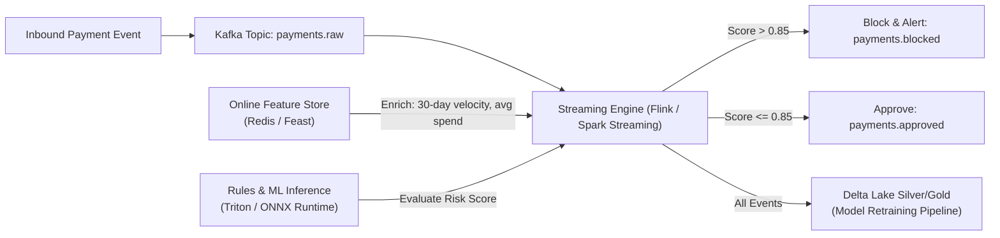

> 🧭 **Modern Data Engineering Ecosystem Navigation**
> - 📘 **Architecture & Concept:** [Data System Design — Lakehouse Architecture](https://github.com/santoshjammi29/data-system-design-handbook/tree/main/modules/01_lakehouse_and_medallion_architecture)
> - 💻 **Hands-On Recipe:** [Databricks Handbook — Production Recipes](https://github.com/santoshjammi29/databricks-handbook)
> - 🔬 **Empirical Lab:** [Spark Experiments — Production Benchmarks](https://github.com/santoshjammi29/spark-experiments)
> - 🚨 **Incident Runbook:** [DataOps CI/CD Incident Runbooks](https://github.com/santoshjammi29/dataops-cicd-handbook/tree/main/runbooks)
> - 🎯 **Interview Defense:** [Interview Defense Playbook](https://github.com/santoshjammi29/data-engineering-interview-handbook/blob/main/playbooks/125_master_defense_playbook.md) *(You are here)*
> - 🌐 **Interactive Web Practice:** [Practice on moderndataengineer.uk](https://moderndataengineer.uk/interview)

## Section 7: System Design & Enterprise Scenarios (Questions 111 – 115)

### Q111: Design a system capable of handling millions of transactions every second.

**High-Throughput Enterprise Architecture:**
```mermaid
flowchart TD
    A["Millions of TPS Clients / Edge Gateways"] -->|Layer 4 NLB / Geo-DNS| B["Edge API Gateway / Ingestion Tier"]
    B -->|Partition Key = Hash(Account_ID)| C["Distributed Apache Kafka / Pulsar Cluster<br/>(500+ Partitions, NVMe Tiered Storage)"]
    C -->|Sub-second Stream Processing| D["Apache Flink / Spark Structured Streaming<br/>(RocksDB State Store, Auto-scaled Workers)"]
    D -->|Low-Latency Point Reads/Writes| E["NoSQL Serving Layer<br/>(ScyllaDB / DynamoDB / Cassandra)"]
    D -->|Bulk Append Micro-Batches| F["Lakehouse Storage (ADLS / S3)<br/>(Delta Lake / Apache Iceberg)"]
    F -->|Vectorized Analytical Engine| G["Databricks SQL / Trino / Snowflake"]
```
**Core Engineering Tenets:**
1. **Partition Sharding:** Distribute data evenly across hundreds of Kafka partitions keyed by high-cardinality entities (`account_id` or `uuid`) to prevent broker hotspotting.
2. **Asynchronous Non-Blocking I/O:** Edge gateways buffer events using Netty/epoll, validating payloads against local cached schemas before acknowledging HTTP 202.
3. **Decoupled Serving vs Analytical Storage:** Real-time balance lookups served from an in-memory distributed key-value store (Aerospike/Redis) with $< 5\text{ms}$ SLA, while historical aggregations land in Delta Lake via micro-batching.

---

### Q112: Design a fraud detection pipeline which functions in real time.

**Real-Time Fraud Detection Engine:**

**Key Technical Design Elements:**
- **Stateful Sliding Windows:** Detect card testing attacks (e.g. 5 transactions in $< 30\text{ seconds}$) using event-time sliding windows in memory.
- **Sub-10ms Feature Store Enrichment:** Stream worker enriches the live transaction event with precomputed customer features (e.g. 90-day average transaction amount, home geo-hash) from Redis.
- **Lightweight Low-Latency Inference:** Run embedded ONNX/C++ scoring models directly inside the stream worker task to eliminate remote HTTP network latency.

---

### Q113: Did you use any optimization technique in your previous project? Give a brief on it.

**STAR Defense:**
- **Situation:** Our nightly customer 360 gold table aggregation job took 3 hours and 40 minutes, frequently missing the 6:00 AM executive reporting SLA.
- **Intervention:**
  1. *Identified Broadcast Spill:* Analysis in Spark UI showed a dimension join was spilling 140 GB to disk because one table grew just beyond the default 10MB broadcast threshold. Increased `spark.sql.autoBroadcastJoinThreshold` to 100MB.
  2. *Replaced Hive Partitioning with Liquid Clustering:* Migrated a 4-level partition hierarchy (`year/month/day/country`) into Delta **Liquid Clustering** on `(country, order_date)`, cutting file count by 85%.
  3. *Cached Static Dimension in Memory:* Replaced repeated scans of a static product taxonomy with `.persist(StorageLevel.MEMORY_AND_DISK_SER)`.
- **Result:** Pipeline execution dropped from 220 minutes to 34 minutes (84% reduction), saving \$4,200 monthly in compute allocation.

---

### Q114: What will be your action plan when your pipeline fails suddenly?

**4-Phase Production Incident Runbook:**
1. **Triage & Containment (0–15 Minutes):**
   - Acknowledge alert (PagerDuty). Identify blast radius (downstream dashboard failures, missing client data).
   - Check if source ingestion is still healthy or if consumer lag is accumulating.
   - If downstream corruptions occurred, roll back the target Delta table immediately using **Delta Time Travel** (`RESTORE TABLE gold_orders TO VERSION AS OF <last_known_good>`).
2. **Root Cause Analysis (15–45 Minutes):**
   - Inspect Driver/Executor logs via Databricks Spark UI and cloud logging (Azure Log Analytics / AWS CloudWatch).
   - Classify failure: Infrastructure (node eviction, spot loss), Data Quality (schema mismatch, unexpected nulls), or Memory (OOM Exit 137).
3. **Remediation & Re-run (45–60 Minutes):**
   - Apply hotfix: increase memory overhead, adjust schema evolution flag, or isolate poison-pill records into a quarantine table.
   - Re-run pipeline leveraging **idempotent Delta `MERGE INTO`** to ensure zero duplicate records are generated during reprocessing.
4. **Post-Mortem & Blameless RCA:**
   - Document root cause, timeline, detection gap, and remediation action items (e.g. adding automated Great Expectations / DLT `EXPECT` checks to prevent recurrence).

---

### Q115: How did you deal with deployment? What major challenges did you face?

**GitOps Deployment Strategy:**
- **Infrastructure as Code (IaC) & Asset Bundles:** Implemented **Databricks Asset Bundles (DABs)** managed in GitHub repositories.
  ```yaml
  # bundle.yml snippet
  bundle:
    name: retail_lakehouse_pipeline

  targets:
    dev:
      workspace:
        host: https://adb-dev.azuredatabricks.net
    prod:
      workspace:
        host: https://adb-prod.azuredatabricks.net
  ```
- **CI/CD Pipeline Workflow:** Pull Requests trigger GitHub Actions executing automated `pytest` unit tests, Spark plan validations (`df.explain()`), and SQL linter rules (`sqlfluff`). Merges to `main` deploy bundles across Staging and Production.
- **Major Challenge - State & Schema Drift across Environments:** Dev schemas had manual column additions that were missing in production Delta tables.
  - *Fix:* Enforced all DDL migrations through versioned migration scripts (using `dbx` and Liquibase for Delta Lake) and blocked manual workspace schema modifications via Unity Catalog privilege revoking.
